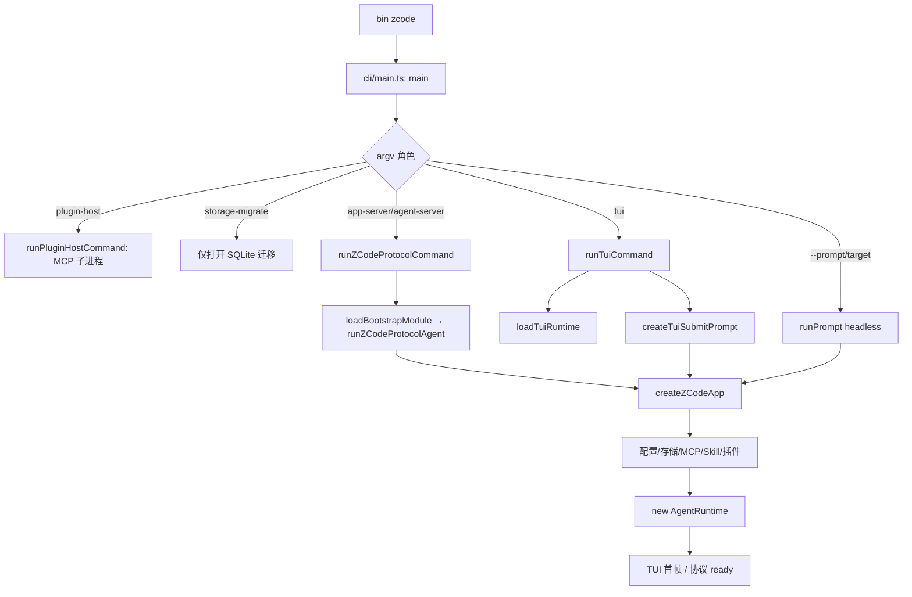
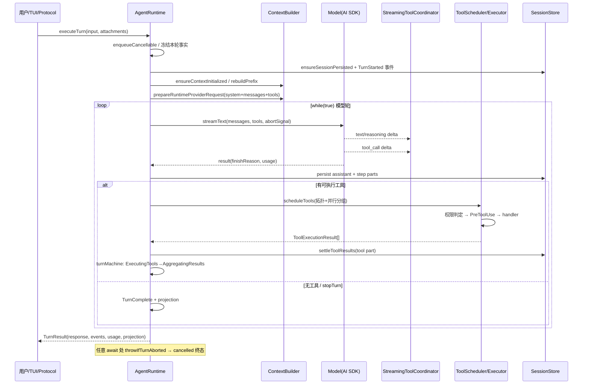

# 01a ZCode 4.0.0 内核与运行时源码拆解

> 分析对象：`resources/src/ZCode-4.0.0`（Apache-2.0，TypeScript，pnpm monorepo）。
> 范围：第一方源码，聚焦 `apps/zcode-cli/packages/*` 与 `packages/provider*`、`model-option-map`、`session-control` 及相关文档。
> 所有结论尽量给出 `文件:行号`。未读到/推断处标注「待验证」。

## 1. 一句话定位

ZCode 4.0.0 是一个「**以 CLI 为权威内核、桌面/远程端为薄投影**」的 Coding Harness：单个 workspace 对应一个常驻 `zcode-cli` 进程，进程内运行 `AgentRuntime` 状态机，驱动「模型流式输出 → 工具调度执行 → 结果回填 → 再请求」的 turn loop；会话与消息以 SQLite 落盘，上下文通过 system prompt 分节 + system-reminder 公告 + compact 管理，所有端通过 ZCode Protocol（stdio NDJSON + V4 topic）消费同一份事实。

## 2. 技术栈与运行形态

- 语言/工具链：TypeScript + ESM（`package.json:4`），pnpm 10.33.2 workspace（`package.json:136`），构建用 `tsc -b` + 自定义 `scripts/build*.mjs`，lint 用 `oxlint`（`package.json:71,116`）。
- 运行时：Node.js；本地存储用内置 `node:sqlite` 的 `DatabaseSync`（`apps/zcode-cli/packages/adapters/src/storage/session-store/sqlite-session-store.ts:6,273`）；模型调用基于 AI SDK（`@zcode/adapters` 的 `AiSdkModelExecution`，`apps/zcode-cli/packages/adapters/src/model/model-execution.ts:39,173`）。
- 打包形态：常规为 node-bundle；可选 SEA（Single Executable Application，`package.json:49-51` 的 `build:sea` / `build:zcode`）。
- 进程形态：**多进程**（Electron Main / 每窗口 Host / 每 workspace 一个 CLI / plugin-host MCP 子进程 / dwf-child 沙箱子进程 / 可选的远程 `zcode-server`），但**每个 CLI 进程内部是单 AgentRuntime 事件循环 + 多 subagent 子运行时（同进程内 new AgentRuntime）**；没有 Web Worker 参与 agent loop（`docs/architecture/zcode-code-architecture-overview.md:9-28`，`apps/zcode-cli/packages/cli/src/main.ts:21-26,76-79`）。

## 3. 模块地图

| 包/目录 | 职责 | 关键文件 | 规模（`*.ts` 非测试） |
| --- | --- | --- | --- |
| `apps/zcode-cli/packages/cli/src` | 命令解析、入口、TUI/headless/protocol 分发、进程边界 | `main.ts`、`run.ts`、`tui-command.ts`、`prompt-command.ts` | 约 60 文件 |
| `apps/zcode-cli/packages/bootstrap/src` | 应用装配（DI）：配置、存储、Provider、MCP、插件、Skill、AgentRuntime 构造 | `app/create-app.ts`、`zcode-protocol-entrypoint.ts`、`zcode-protocol/server.ts` | 约 200 文件 |
| `apps/zcode-cli/packages/core/src/agent` | turn 状态机与历史（hydration、消息条目） | `turn-state.ts`、`turn-machine.ts`、`message-history.ts` | 15 文件 |
| `apps/zcode-cli/packages/core/src/runtime` | AgentRuntime 主体与 turn loop/工具/compact/resume 方法族 | `agent-runtime.ts`、`methods/turn.ts`、`methods/turn-loop.ts`、`methods/turn-model-step.ts` | `runtime/methods` 约 90 文件 |
| `apps/zcode-cli/packages/core/src/tool` | 工具契约、注册表、调度器、执行器、内置工具 handlers | `types.ts`、`registry.ts`、`scheduler.ts`、`handlers/index.ts` | 约 60 文件 |
| `apps/zcode-cli/packages/core/src/{permission,hooks,compact,context,memory,subagent,workflow,mcp}` | 权限、钩子、压缩、上下文、记忆、子代理、工作流、MCP | 各 `index.ts`/核心实现 | 合计约 120 文件 |
| `apps/zcode-cli/packages/{contracts,shared-types,adapters,tui}` | 契约/Schema、接口、Node 适配器、终端 UI | `contracts/src/hooks/index.ts`、`adapters/src/storage/*`、`tui/src/index.ts` | 中等 |
| `packages/provider{, -node}` | Provider Registry、配置解析、选择校验、节点侧配置仓库 | `provider/src/registry.ts`、`resolver.ts`、`provider-node/src/provider-registry-runtime.ts` | 约 35 文件 |
| `packages/model-option-map` | 受限 CEL 表达式引擎，把公共 Model Option 映射为原始请求体 Patch | `parser.ts`、`evaluator.ts`、`compiler.ts` | 9 文件 |
| `packages/session-control` | 会话控制面契约（跨进程 send/rename/stop 等） | `contract.ts`、`contract/app.ts`、`contract/cli.ts` | 约 15 文件 |
| `packages/shared/src/zcode-protocol-v4` | 对话协议 schema（command/snapshot/delta/topic/wire） | `command.ts`、`transport.ts`、`snapshot.ts`、`delta.ts` | 约 40 文件 |

`core/src` 全量约 610 个非测试 TS 文件（不含大体积资产），其中 `runtime/methods/` 是最密集的实现区。

## 4. 进程模型与启动链路

### 4.1 进程职责（事实来源：`docs/architecture/zcode-code-architecture-overview.md`）

```
Electron App
├─ Main Process：窗口/原生能力/attachment 薄转发/日志（:32-35）
└─ Window Host（每窗口唯一 PID）：service graph + RemoteConnectionRegistry + ControllerProjection（:40-46）
   ├─ Renderer：仅 UI + V4 projection，不持权威 conversation（:36-38）
   └─ workspaceKey A/B ──stdio── zcode-cli（每 workspace 最多一个，:48-50）
```
远程形态：SSH/WSL 共享连接、Docker/Server 独占连接，经 `zcode-server` 再以 stdio 挂远端 CLI（`docs/architecture/communication-protocol-layers.md:129-141`）。

### 4.2 从 `zcode` 命令到 TUI 就绪

`bin.zcode → apps/zcode-cli/packages/cli/dist/zcode.cjs`（`apps/zcode-cli/packages/cli/package.json:6-9`）。

```
main.ts:18  main()
 ├─ :21-28  按角色改进程名（CLI / plugin-host / storage-migrate）
 ├─ :31     applyCliRuntimeEnvSanitization：清洗注入的 NODE_ENV/代理/证书变量
 ├─ :39-51  protocol/TUI 下把 console 重定向到 stderr（关键：stdout 是协议帧通道）
 ├─ :64-89  SEA 运行时工具、插件宿主分流、provider 环境准备
 └─ :91-96  await import("./run.js") → run(ctx, deps)
run.ts:314 run()
 ├─ :369-381  parseGlobalArgs + extractDisallowedToolsArgs
 ├─ :447-598  locale/mode/browser/surface/resume/workflow-mode/cwd 校验
 └─ :635-730  分流：--prompt/--target → runPrompt；app-server/agent-server → runZCodeProtocolCommand；tui → runTuiCommand
tui-command.ts:18 runTuiCommand()
 ├─ :34       loadTuiRuntime()（tsx 动态导入 tui 包）
 ├─ :43-60    createTuiSubmitPrompt：把 mode/resume/工具禁用表/工作流模式交给 prompt handler
 └─ :70-119   runTui({ loadStartupOptions, sendInput, subscribeSessionEvents, ... })
                ├─ 启动选项并发拉取：会话元数据 + 自定义命令 + git 分支（:72-90）
                └─ TUI 首帧渲染 = 就绪
```

`bootstrap` 的职责是**装配而非启动 UI**：`loadBootstrapModule()` 仅 `import("@zcode/bootstrap")`（`cli/src/bootstrap-loader.ts:5-7`）；真正装配入口是 `createZCodeApp(options)`（`bootstrap/src/app/create-app.ts:183`），它做：解析配置（:201-213）、计算 storageRoot（:254-259）、打开 session store（:283-291）、并发加载 skill/MCP 目录（:397-419）、解析运行时配置（:435-451）、构造 `new AgentRuntime(sessionId, runtimeConfig, deps)`（:1002-1092），最后 `completeAppStartup` + 打点（:1093-1103）。AgentRuntime 依赖大量由 bootstrap 注入的端口：eventStore、sessionStore、mcpPort、executionPort、fileSystemPort、httpClientPort、artifactStore、modelFactory、permissionBroker、workflowPort、dynamicWorkflowRunPort 等（:1045-1091）。

`zcode-protocol-entrypoint.ts:367-368` 与 `zcode-protocol/server.ts:339` 是协议侧的同一装配入口。

### 4.3 启动链 mermaid



## 5. Agent Loop 全链路

### 5.1 状态机（骨架）

`TurnPhase`：`idle → processing_input → awaiting_model_response → streaming → scheduling_tools → executing_tools → aggregating_results → awaiting_model_response`（工具循环）或 `→ completing/error`（`core/src/agent/turn-state.ts:27-38,233-266`）。`TurnState` 关键字段：`id/turnNumber/traceId/input/attachments/streamingContent/toolCalls/toolResults/scheduledTools/pendingInputs/pendingPermissions/resultType`（:46-68）。`TurnMachineImpl` 提供不可变 `transition()`（非法跃迁抛 `InvalidTurnPhase`，`turn-machine.ts:92-104`），`getNextPhase()` 决定工具循环是否继续（`turn-machine.ts:308-339`）。

### 5.2 一次用户输入到 turn 结束的数据流

1. **入队与接纳**：`executeTurn()` 把 prompt 包成 `PromptRuntimeCommand` 经 `enqueueCancellableRuntimeCommand` 入队（`runtime/methods/turn.ts:108-146`）；`executeTurnCommand()` 在任何 `await` 前冻结本轮模型选择、输出风格、trace/turn id（:155-205）。
2. **模型与上下文**：`createTurnModel` 创建执行模型（含 fallback，`turn.ts:282-408`）；随后 `ensureContextInitialized` / `rebuildContextPrefix` 按当前 Model 投影上下文（:413-424）。
3. **Hooks 与持久化**：`runSessionStartHooks("startup")` 与 `runUserPromptSubmitHooks`（:426-432, :593-601）；`ensureSessionPersisted`、写 `TurnStarted` 事件、目标（goal）记账（:485-590）。
4. **主循环** `runRegularTurnLoop`（`methods/turn-loop.ts:68-282`）：`while(true)` 每轮——
   - `throwIfTurnAborted`（:73）；
   - 取出 steer/guide 与主代理后台结果（:84-98）；
   - MCP 初始化/刷新、计算可见工具集 `getTurnTools`（:100-126）；
   - 收集输入附件：环境/模型公告、ToolSearch 公告、agent listing、skills listing、todo 提醒、runtime mode 提醒、total-token 倒数、memory 更新、hook 上下文（:297-435）；
   - **compact**：`microcompactIfNeeded` + `autoCompactIfNeeded`（:161-199）；
   - `prepareRuntimeProviderRequest` 组装 system + messages + tools（:210-216）；
   - `startModelRequest` → `runModelBackedTurnStep`（:248-276）。
5. **模型请求与流式**：`runModelBackedTurnStep` 写 `ModelRequest` 事件、`persistAssistantMessage` + `step-start` part（`turn-model-step.ts:196-227`），调 `runModelTextRequest`，回调 `onStreamTextDelta`/`onStreamReasoningDelta`/`onStreamToolCall` 交给 `StreamingToolCoordinator`（:256-285）；流失败/stall 走 stream recovery、selection fallback、重试（:287-560）。
6. **工具循环**：抽取 toolCalls（含 provider-native 轮次去重，`turn-model-step.ts:576-582`）；过滤 `providerExecuted`，`admit` + `drain` 流式工具（:808-811）；`executeToolCallsForModelStep` 排序、落 `tool` part、调度、执行、结算（`turn-tools.ts:36-327`）；若工具带 `turnControl.stopTurnAfterResult` 或 abort 则 break，否则 `return "continue"` 进入下一轮模型请求（:265-326）。
7. **收尾**：`TurnComplete` 事件、usage 汇总、projection 重建、goal/target 结算（`turn.ts:929-1080`）。`cancelled` 属于正常结束（`turn-state.ts:151-158` 注释）。

### 5.3 中止/取消传播

- 入口 `createTurnAbortScope(options.abortSignal)` 派生本轮 signal（`turn.ts:207-208`），每个等待点 `throwIfTurnAborted` 检查（loop :73、model step :286）。
- 工具执行中收到 abort：**不立即抛**，而是把 signal 传给 executor，让每个 tool call 生成 `ToolCancelled` result，结算完再结束本轮（`turn-tools.ts:132-134,241-268`）；`withUserStoppedToolResultContent` 改写工具结果文本（`turn-tools.ts:241`）。
- 模型执行层用 `abortSignal` 透传到 AI SDK（`turn-model-step.ts:257`）；空完成/流恢复重试受 `retryBudget` 与 admission 槽位约束（`adapters/src/model/runner-generate.ts:89-108`）。
- 用户队列输入（steer）经 `pendingInputs`/`drainPendingInputs`（`turn-machine.ts:221-236`）在完整工具批次边界注入下一请求（`turn-loop.ts:84-98`）。

### 5.4 时序图



## 6. 关键机制逐条拆解

每条格式：解决什么问题 → 实现方式 → 代码位置 → 设计取舍 → 可复用性。

### 6.1 Tool 系统

- **问题**：让模型以统一 schema 调用宿主能力，并在不确定/危险操作时征得用户同意。
- **实现**：`ToolEntry` 声明 `capability`、`metadata(name/description/readOnly/destructive/concurrentSafe/riskLevel/needsApproval)`、`inputSchema`/`runtimeInputSchema`、`handler`、`validateInput`、`resolveInput`（把模型入参归一化为执行事实，位于 hook 与权限之前）、`prepareApproval`、`resolveTimeoutBudgetMs`、`cancellation`、`formatModelContent`/`resultBudget`（`core/src/tool/types.ts:82-118,393-528`）。注册表用 `Map` + alias，`toContracts()` 输出 provider 可见工具（`tool/registry.ts:30-129`）。内置工具一次列出几十个（Read/Write/Edit/Bash/Glob/Grep/WebFetch/Agent/Task/Skill/Todo/Cron/Workflow/MSP 等，`tool/handlers/index.ts:89-166`），Read 工具定义展示了完整契约（`handlers/read.ts:504-566`）。
- **权限**：`PermissionService.checkPermission` 顺序为 plan 转换 → 需用户交互 → guarded 单次确认 → alwaysAsk → yolo/guarded 放行 → disallowedTools → project deny → project ask → 特例预放行 → plan 模式闸门 → project allow（`permission/service.ts:112-242`）。`PermissionBehavior = allow|ask|deny`（:72），会话级 allow 规则随实例消亡（:100-104）。
- **并行**：`ToolScheduler` 做拓扑排序 + 按 `canRunParallel` 分组，`destructive` 禁止并行、`concurrentSafe=true` 允许、`sideEffectScope==="none"` 视为可并行，默认最大并发 10（`tool/scheduler.ts:48,60-83,85-103,154-202`）。
- **回填与渲染**：结果经 `settleToolResults` 写入 `tool` part（`tool-result-settlement.ts`），`emitStreamingToolLedgerUpdate` 发 UI 事件，`formatModelContent` + `resultBudget` 控制进入模型的字节数（`tool/types.ts:625-639`）。
- **取舍**：把"入参归一化"放在权限与 hook 之前，确保"批准 A 跑 B"不可能（`types.ts:459-471`）；代价是工具契约字段极多、上手成本高。
- **可复用性：A（契约与调度器可直接继承）；B（权限策略需按产品模式裁剪）**。理由：ToolEntry/Scheduler 与 runtime 解耦且边界清晰；权限与 workspace-hook trust 深度绑定 ZCode 产品语义。

### 6.2 Session / Task 模型

- **问题**：会话唯一标识、状态、持久化和恢复。
- **实现**：`SessionRow` 字段含 `id/project_id/workspace_id/parent_id/task_type/slug/directory/title/version/permission/time_*`（`adapters/src/storage/session-store/rows.ts:1-28`）；消息/part/session_entry/todo/permission 各自成表（`migrations.ts:23-104`）；默认库路径 `~/.zcode/cli/db/db.sqlite`（`session-store/paths.ts:4`）。`resumeFromStore()` 从 store 读 session + messages，恢复工作目录、权限模式、model selection、read-file-state 与 projection（`methods/resume.ts:81-224`）。后台任务用 `RuntimeTaskRegistry`（`runtime-task/registry.ts:12,105-152`）。
- **取舍**：SQLite + 迁移版本化（单库、级联删除、索引齐全），冷恢复时重放事件并重算前缀，保证"resume 后请求字节不变"；workflow run/task link 也进同一库（`migrations.ts:244-386`）。
- **可复用性：A（session store schema/resume 思路）**。理由：结构清晰、迁移可验证；但 ZCode 的 `task`/`goal` 语义较重，WitCode 可先只取 session/message/part 三张表。

### 6.3 Context 工程

- **system prompt 组装**：`ContextBuilder.build()` 按序 push section：CLI 身份前缀、identity/自定义/workflow-actor（stable）、desktop context、dynamic behavior、session guidance、memory、环境/模型（meta_user）、context management、finishing work、memory notes、total tokens、git 上下文、request_user_context（项目指令/memory 索引）、current date（`core/src/context/builder.ts:82-228`）。`assembleSystemMessages` 输出三条 system：cli_prefix、stable body（`cacheControl: EPHEMERAL`）、dynamic body（:230-276）。
- **context window / compact**：`DEFAULT_COMPACT_CONTEXT_WINDOW=200_000`，输出预留 `32_000`（或 min(window×0.08, …)），buffer `13_000`，阈值 = 有效窗口 − buffer（`compact/policy.ts:6-16,67-95`）；`shouldAutoCompact` 检查 enabled/历史足够/失败熔断（≤3 次）/token 超阈值（:95-162）。token 来源可为估算或 provider usage（:28-30,109-111）。
- **system-reminder 注入**：来源分「持久化」（context_prefix、skills_listing、todo_reminder、tool_hook_context 等）与「每请求」（incoming_message、memory_update、runtime_mode、output_style 等）两类（`system-reminder/source.ts:1-58`）；注入时机集中在 `collectInputAttachments`（每轮新输入时）与 `appendRequestAnnouncements`（每次请求前，`turn-loop.ts:297-435,203-208`），且"先持久化再提交"保证冷恢复前缀不变。
- **working memory / memory 工具**：memory 目录以 `MEMORY.md`（索引，约束 <200 行/<25KB）+ 顶层 md 文件构成（`memory/dream.ts:95-166`）；`dream`（reflective pass）与 extraction 子代理有严格只读/限定写工具的 policy（`memory/extraction.ts:44-70`、`memory/memory-agent-loop.ts:168-207`）；项目记忆预取在 turn 中异步分支执行（`turn.ts:841-849`）。
- **取舍**：把"动态公告"持久化进历史而非只在内存，牺牲存储换恢复一致性；compact 与 reminder 顺序被严格固定。
- **可复用性：A（ContextBuilder/compact policy/reminder 分类）；B（memory 文件语义）**。理由：分节与缓存策略可直接复用；memory 的"索引文件 + dream"属产品约定。

### 6.4 Model / Provider 抽象

- **接口**：`ModelExecutor` 仅两方法 `generateText` / `streamText`（`adapters/src/model/model.ts:21-24`）；`ExecutableModel` 通过 `bind(options)` 产生不可变副本，`prepareRequest` 校验属性/选项后委托 executor（:37-98）。Registry 以 `providerId/modelId` 索引 `Provider/ProviderModel`，`validateSelection` 校验选择（`provider/src/registry.ts:47-124`；能力字段见 `resolver.ts:163-173`：`contextWindow`、`maxOutputTokens`、`reasoningLevel` 的 `optionSpecs`）。
- **流式协议适配**：`AiSdkModelExecution` 把 provider 分为 `openai | anthropic | openai-compatible`（`model-execution.ts:39`），`createAnthropicCompatFetch` 等做协议兼容（:25），流式 chunk 经 SSE 解析与 business-error 检测（:843-891）。
- **错误重试**：`failure-classifier.ts` 把错误归类并标注 `retryable`，保留 `retry-after`（:154,：684 注释）；`runner-generate.ts` 的 attempt 循环受 `retryBudget` 控制（:89-108），退避由 `runner-retry.ts:44,92` 计算，另有 admission 槽位与空完成重试（`empty-completion-retry.ts`）。
- **`model-option-map` 解决什么**：把公共选项 `reasoningLevel`/`maxOutputTokens` 用受限 CEL 表达式映射为各 provider 原始 JSON Body 的 RFC 7396 Merge Patch，避免为每家 provider 维护 `reasoningMapping`/`providerOptions` 第二套真相（`docs/working-memory/provider-refactor/design/model/model-option-map.md:7-31`）；实现为 tokenizer→parser→AST evaluator，禁 `eval`（:65-68，包内 `packages/model-option-map/src/{tokenizer,parser,evaluator,compiler}.ts`）；patch 固定顺序 reasoning→maxOutput，冲突即报错（:105-118）。
- **取舍**：单一真相 + AI SDK 之后应用 patch；代价是需要一套自研 DSL 与配置编辑体验。
- **可复用性：A（ModelExecutor/Registry/OptionMap）**。理由：Magpie 的模型管理可直接对接 Registry + optionSpecs，option-map 是明显可搬的资产。

### 6.5 Subagent 与 Dynamic Workflow

- **Subagent 派生**：Agent 工具 `Agent`/`Task` → `createDefaultSubagentPort`（`runtime/methods/subagent.ts:68-119`）→ `createExploreSubagentPort`（`subagent/runner.ts:161`）。每个子代理 `new AgentRuntime(...)` **在父进程内**创建（:309），`childSessionId = subagent_${agentId}`（:1132-1145），独立 system prompt（`SubagentContextBuilder`，`subagent/context-builder.ts:28-76`）、工具 allowlist 与权限继承/限制（`subagent/tool-policy.ts`、`inheritPermissionMode`）、输出目录 `<root>/<session>/<agentId>/{metadata.json,output.txt}`（runner.ts:1140-1148）。可前台等待或后台运行（自动转后台定时器 `autoBackgroundMs`，runner.ts:988-1017）。
- **上下文隔离**：靠独立 session id + 独立 ContextBuilder + 只继承必要 env/MCP，工具事件镜像到父 transcript（`subagent/tool-event-mirror.ts`）。
- **Workflow 编排**：`WorkflowDefinition` 定义 `phaseOrder` 与各 phase 的 `behavior`（agent / scheduled_graph）（`core/src/workflow/definition.ts:11,32-124`）；`WorkflowGraphScheduler` 以图快照为事实，做 ready 节点排序、planner runner、node runner、snapshot/artifact 落盘与 resume 修复（`workflow/scheduler.ts:34-57`）；动态工作流工具面（CreateWorkflow 等 10 个）受灰度门与"按需激活"控制（handlers/index.ts:168-194）。
- **取舍**：workflow 引擎在 CLI 进程内、以 journal 持久化，支持孤儿 run 收敛与额度自动续跑（`create-app.ts:960-988,1175-1197`）。
- **可复用性：B（Subagent 可直接借鉴；Workflow 需按 WitCode 任务模型重写）**。理由：subagent 的进程内派生+隔离很实用；workflow 的 phase/graph 与 ZCode 特有 journal/额度深度耦合。

### 6.6 Hooks

- **类型**：`HookEventName = SessionStart | UserPromptSubmit | PreToolUse | PermissionRequest | PostToolUse | PostToolUseFailure | Stop`（`contracts/src/hooks/index.ts:7-15`）；结果 `HookOutcome = success|blocked|failed|cancelled|timed_out`（:19-25）。
- **时机**：SessionStart/UserPromptSubmit 在 turn 准备阶段（`turn.ts:426,593-601`）；PreToolUse/PostToolUse 在 executor 的权限前后；Stop 在 turn 结束续跑判定（`runtime/methods/hooks.ts`）。
- **失败策略**：`InMemoryHookRunner` 串行跑注册项，支持 `timeoutMs`、按 `onError` 决定放行或 deny（PreToolUse 的 `onError:"deny"` 会阻断工具，`hooks/runner.ts:250-275,550-567`），workspace hook 另有 trust/review 准入（:76-147）。
- **可复用性：B**。理由：事件模型可直接继承；失败策略与 workspace trust 属 ZCode 安全模型，需简化。

### 6.7 协议（stdio / envelope / schema）

- **通道与信封**：Host ↔ CLI 用 stdio NDJSON（`docs/architecture/communication-protocol-layers.md:29-35,56-74`）；典型 JSON-RPC 风格：`{id, method, params}` 请求、`{id, result|error}` 响应、反向 notification/event（`bootstrap/src/zcode-protocol/transport.ts:138,345-360`）。
- **V4 内容层**：command（createSession/sendText/stop/compact/…）、ACK、conversation topic 的 `snapshot | deltas + seq` 帧（`zcode-protocol-v4/transport.ts:175-228`），`docs/architecture/message-flow.md:28-48` 明确"ACK 与 projection 是两条语义"。
- **schema 组织**：`packages/shared/src/zcode-protocol/`（plugin-host queries、trace）与 `zcode-protocol-v4/`（command/rows/snapshot/delta/wire/transport 等约 40 文件），全部 zod schema（`zcode-protocol-v4/transport.ts:21-22`）；wire 层可做二进制/重组（`wire*.ts`）。
- **取舍**：内容（V4）与信封（RPC/NDJSON）与通道（stdio/MessagePort/WebSocket）三层解耦（`communication-protocol-layers.md:1-21`）；代价是 schema 数量多、跨端协同成本高。
- **可复用性：A（envelope/topic 设计）；B（V4 schema 精简后复用）**。

### 6.8 流恢复与请求重试（补充）

- **问题**：大模型流式请求在网络抖动、stall、空完成、限流时不能把整轮作废，否则用户体验与成本都很差。
- **实现**：`StreamingToolCoordinator` 在流到达时即登记 tool call（`turn-model-step.ts:229-234,278-280`），流失败时走三层恢复：① 执行 Selection 的声明式 fallback（:299-326）；② 同模型 `streamRecovery`（`methods/streaming-recovery.ts`，:328-342）；③ 短重试（:377-439）。空完成有专门 retry 预算（`empty-completion-retry.ts:55-100`），失败分类把 429/5xx/网络错标为 `retryable` 并保留 `retry-after`（`failure-classifier.ts:154`、`model-execution.ts:684,947`）。
- **代码位置**：`core/src/runtime/methods/turn-model-step.ts:287-560`、`core/src/runtime/methods/streaming-recovery.ts`、`adapters/src/model/runner-generate.ts:89-108`、`adapters/src/model/retry-budget.ts:42-60`。
- **设计取舍**：所有恢复请求"重发同一份输入"，因此 `collectInputAttachments` 明确跳过恢复轮（`turn-loop.ts:128-149`），避免同一 reminder 重复进入请求前缀；代价是恢复分支多、状态位（如 `streamRecoveryRetryCount`、`reactiveCompactAttemptedInCurrentModelStep`）散落在 loopState 中。
- **可复用性：B**。理由：重试/退避思路可借鉴，但与 admission 槽位、usage 事件、provider business error 强耦合，需按 WitCode 的网关重新接。

### 6.9 MCP 接入（补充）

- **问题**：把外部 MCP server 的工具并入统一的 ToolRegistry，且支持动态配置与按需连接。
- **实现**：`mcp/index.ts:112` 把 MCP 工具注册进 registry；`createAppMcpConfigurationSource` 并发加载配置（`create-app.ts:412-419`）；主循环只在"正常新请求"刷新 MCP 工具列表，恢复/续写沿用原列表（`turn-loop.ts:100-122`）；MCP 工具在 UI 投影里带 `mcpPresentation` 展示来源（`tool/types.ts:106-117`）。
- **取舍**：MCP 初始化可与其余装配并发，且在 subagent 里按需借用父 MCP 快照（`runtime/methods/subagent.ts:190-225`）。
- **可复用性：A**。理由：MCP 作为工具来源插件化，与 DSH 的开放性目标一致，可直接继承注册/展示模式。

## 7. 数据与持久化

| 数据 | 落盘位置 | 格式 | 证据 |
| --- | --- | --- | --- |
| session | `~/.zcode/cli/db/db.sqlite`（可配 `storage.sessionDbPath`） | SQLite `session` 表；字段见 `SessionRow` | `session-store/paths.ts:4`、`rows.ts:1-28`、`migrations.ts:23-44` |
| message / part | 同库 | `message(id,session_id,data JSON)`、`part(id,message_id,session_id,data JSON)`，级联删除 | `migrations.ts:50-71` |
| session_entry / todo / permission | 同库 | `session_entry(type,data JSON)`、`todo` 行、`permission(project_id,data JSON)` | `migrations.ts:73-104` |
| workflow_run / session_task_link / model_usage | 同库（后续迁移） | 行 + 索引 | `migrations.ts:244-386,466-477` |
| context / working memory | 文件树 | `MEMORY.md` 索引 + 顶层 md 记忆文件；memory root 由配置决定 | `memory/dream.ts:95-166` |
| subagent 输出 | `<subagent-root>/<session>/<agentId>/` | `metadata.json` / `output.txt` / `task.output` | `subagent/runner.ts:1140-1148` |
| 恢复 | 冷启动 `resumeFromStore` 重放 messages + events + read-file-state，重算 projection | — | `methods/resume.ts:81-224` |

不是 JSONL：会话正文以 SQLite 行中的 JSON 字符串存储；事件（eventStore）可在内存实现（`createInMemorySessionEventStore`，`create-app.ts:14,1045`）。多 session 并发：每 workspace 一个 CLI；同一 CLI 内主 session + 子 session（subagent/fork）共享同一 store，靠 `sessionId` 隔离（`create-app.ts:189`、`subagent/runner.ts:1136`）。

补充几点恢复与一致性细节：

- **fork / rewind**：`forkStableConversationAtMessage`、`rewindConversationToMessage` 等把分叉写成新的 session 行并复制消息（`methods/turn.ts:167-301`、`sqlite-session-store.ts:456-533`），`session.parent_id` 保留血缘（`rows.ts:4`）。
- **事件与投影分离**：`eventStore` 只承载运行时事件（TurnStarted/ModelRequest/ToolComplete/TurnComplete 等），`ProductProjection` 由事件 reducer 生成，UI 只读 projection（`docs/architecture/message-flow.md:9-24`）；因此持久化恢复重放的是 messages + events 两类事实。
- **存储迁移可验证**：`storage-migrate` 子命令只打开 SQLite 做迁移、不初始化 Provider/MCP/Agent（`run.ts:315-345`），并有 checksum/rollback（`packages/shared/src/sqlite-migrations/contract.ts:24`、模块 `runner.ts`/`backup.ts`/`restore.ts`）。
- **V4 topic 订阅**：协议侧有 session resident pool 与 `sessionResidency`，按 `sessionId` 决定哪个 CLI 进程持有权威（`bootstrap/src/zcode-protocol/session-residency.ts`、`session-resident-pool.ts`）。

## 8. 工程约束

- 类型：`pnpm typecheck`（`package.json:60` 起，多包 `tsc -b`），CLI 包 `tsc --noEmit`（`apps/zcode-cli/packages/cli/package.json scripts.typecheck`）。
- Lint：`oxlint` + 自定义架构脚本（`package.json:71`），`lint:fix`（:72）。
- 架构检查：`pnpm architecture:check`（`scripts/architecture/architecture-check.mjs check`，:78）、`pnpm test:architecture`（含 source-size-policy 等，:82）。
- 测试入口：CLI `node --import tsx --test tests/*.test.ts`（cli package.json scripts.test）；`pnpm test:engineering`（vitest，:90）；pre-push 走 `verify:pre-push`（:51）。
- 文档防陈旧：`pnpm docs:stale-phrases:check`（:84）、`pnpm db:schema:check`（根目录脚本）。

## 9. 值得继承的 10 个设计（按价值排序）

1. **CLI 为权威、端为投影**（`zcode-code-architecture-overview.md:5-28`）：单一事实源 + snapshot/delta，直接可用于 WitCode 多端。
2. **`ModelExecutor` + Registry + model-option-map**（`adapters/model/model.ts:21-24`、`docs/.../model-option-map.md`）：模型管理（Magpie）可直接对接，避免多套请求字段真相。
3. **`ToolEntry` 契约与 `resolveInput` 归一化位置**（`tool/types.ts:393-476`）：从根上杜绝"批准 A 执行 B"。
4. **ToolScheduler 拓扑+并行分组**（`tool/scheduler.ts:60-202`）：可直接继承的依赖安全并行模型。
5. **System prompt 分节 + cacheHint**（`context/builder.ts:82-276`）：stable/dynamic 分段与缓存锚点，工程价值高。
6. **动态公告"先持久化再提交"**（`turn-loop.ts:297-435`）：保证 resume 后请求前缀一致，是可靠恢复的关键。
7. **turn 状态机显式 phase + 非法跃迁失败**（`turn-state.ts:233-266`、`turn-machine.ts:92-104`）：可观测、可诊断。
8. **compact 策略含熔断与“快速回填”检测**（`compact/policy.ts:95-162`、`turn-loop.ts:171-198`）：避免压缩风暴。
9. **Subagent 独立 session + 同进程 AgentRuntime**（`runtime/methods/subagent.ts:309`）：上下文隔离且成本低。
10. **NDJSON envelope + V4 topic 三层解耦**（`communication-protocol-layers.md`）：协议演进成本低。

## 10. 不值得继承 / 有明显债务的 5 个点

1. **巨型单文件与"注释即历史"**：`turn.ts` 1210 行、`turn-model-step.ts` 982 行、`create-app.ts` 1692 行，且大量注释在讲 bug 根因（如 `turn.ts:215-218,374-382`）——继承逻辑时应重写为小模块 + 测试，不要连注释债务一起搬。
2. **权限/Workspace-Hook Trust 过度产品化**：`hooks/workspace-hook-*.ts` 十余文件 + trust record/review，通用 Harness 很难直接使用，属 C（重写）。
3. **V4 schema 面过宽**：`zcode-protocol-v4/` 40+ 文件、wire 二进制重组复杂；小团队维护成本高，建议只取 command/snapshot/delta 子集（B）。
4. **Workflow 与 ZCode 特有 journal/额度/常驻池强耦合**（`create-app.ts:960-988,1175-1197`）：不可直接继承（C）。
5. **Hook 失败策略分散**：PreToolUse 的 `onError:"deny"`、timeout、trust 准入分别在多处实现（`hooks/runner.ts:250-275`），语义不统一，宜收敛（B/C）。

## 11. 对 WitCode 的直接启示

- **内核优先级**：先落 `AgentRuntime + turn 状态机 + ToolRegistry/Scheduler + ContextBuilder + SessionStore(SQLite)` 五件套，即可跑通最小闭环；Hooks/Workflow/MCP 可后置。
- **模型管理（Magpie）对接点**：`ProviderRegistry.validateSelection` + `Model.optionSpecs` + `model-option-map`，让模型切换只改 Selection，不动请求体代码。
- **开放性（DSH 插件/主题）对接点**：`ToolEntry` 的 `mcpPresentation`/`providerVisible` 与 `plugin-reference`/`skills` 的装配模式，可做插件工具与主题提示的统一注入；插件不进 core，只在 bootstrap 装配（`create-app.ts:397-419`）。
- **恢复一致性优先**：所有动态上下文写入历史而非内存（`turn-loop.ts:297-435`）；WitCode 若做多端/断线恢复，此条比功能数量更重要。
- **协议选型**：stdio NDJSON + JSON-RPC 风格 envelope 足够，V4 的 snapshot/delta/seq 适合作为 conversation 交付语义；不要一上来引入全部 wire 二进制能力。

### 11.1 待验证 / 待补充清单

以下结论基于已读文件，但尚未逐文件通读，落地实现前应二次确认：

1. **`apps/zcode-cli/packages/contracts` 与 `shared-types` 的边界**：两者都承载跨包类型，本文只确认 `contracts/src/hooks/index.ts` 与 `shared-types` 的 `RunContext/GlobalOptions` 引用（`run.ts:11`），未梳理完整导出表——**待补充**。
2. **TUI 就绪的精确定义**：`runTui()` 来自 `tui` 包动态加载（`tui-command.ts:34`），其内部首帧/事件订阅的完成点未逐行验证——**待验证**。
3. **多 session 并发的锁与写冲突**：`sqlite-session-store.ts` 用 `begin immediate` 事务（:407,456,480），但跨进程并发写（两个 CLI 同库）的隔离级别未验证——**待验证**。
4. **Hook 的 Stop 续跑语义**：仅确认 `HookEventName.Stop` 存在与 `HookRunResult.preventContinuation`（`turn.ts:603-650`），Stop hook 触发新一轮的完整条件未读完——**待补充**。
5. **Dynamic Workflow 的 planner/graph 细节**：只读到 `WorkflowGraphScheduler` 入口与 expert 定义的 phaseOrder（`workflow/scheduler.ts:34-57`、`workflow/definition.ts:49`），planner 的脚本 DSL（`dynamic-workflow/authoring.md`）未展开——**待补充**。
6. **SEA 打包与 Windows runtime host**：`build:sea` 与 `scripts/windows-runtime-host` 存在，但本文未分析其对进程模型的影响——**待验证**。

## 12. 证据索引（文件:行号）

- `apps/zcode-cli/packages/cli/src/main.ts:18,21-28,31,39-51,91-96`
- `apps/zcode-cli/packages/cli/src/run.ts:314,369-381,635-652,675-730`
- `apps/zcode-cli/packages/cli/src/tui-command.ts:18,34,43-60,70-119`
- `apps/zcode-cli/packages/cli/src/bootstrap-loader.ts:5-7`
- `apps/zcode-cli/packages/bootstrap/src/index.ts:3,76`
- `apps/zcode-cli/packages/bootstrap/src/app/create-app.ts:183,189,201-213,254-259,344-369,397-419,435-451,960-988,1002-1092,1093-1103,1175-1197`
- `apps/zcode-cli/packages/bootstrap/src/zcode-protocol-entrypoint.ts:367-368`
- `docs/architecture/zcode-code-architecture-overview.md:5-28,32-50,64-98`
- `docs/architecture/communication-protocol-layers.md:23-35,56-74,129-141`
- `docs/architecture/message-flow.md:28-48,74-85`
- `apps/zcode-cli/packages/core/src/agent/turn-state.ts:27-38,46-68,151-158,233-266`
- `apps/zcode-cli/packages/core/src/agent/turn-machine.ts:41-66,92-104,151-219,308-339`
- `apps/zcode-cli/packages/core/src/runtime/methods/turn.ts:108-146,148-205,207-208,282-408,413-432,485-590,593-601,850-926,929-1080`
- `apps/zcode-cli/packages/core/src/runtime/methods/turn-loop.ts:68-282,297-435,441-472`
- `apps/zcode-cli/packages/core/src/runtime/methods/turn-model-step.ts:107-151,153-285,576-582,808-895`
- `apps/zcode-cli/packages/core/src/runtime/methods/turn-tools.ts:36-59,135-230,241-326`
- `apps/zcode-cli/packages/core/src/runtime/methods/resume.ts:81-224`
- `apps/zcode-cli/packages/core/src/runtime-task/registry.ts:12,105-152`
- `apps/zcode-cli/packages/core/src/tool/types.ts:82-118,393-528,625-639`
- `apps/zcode-cli/packages/core/src/tool/registry.ts:12-130`
- `apps/zcode-cli/packages/core/src/tool/scheduler.ts:48,60-103,154-202,233-245`
- `apps/zcode-cli/packages/core/src/tool/handlers/index.ts:89-194`
- `apps/zcode-cli/packages/core/src/tool/handlers/read.ts:504-566`
- `apps/zcode-cli/packages/core/src/permission/service.ts:72,98-158,169-242`
- `apps/zcode-cli/packages/core/src/context/types.ts:31-74,110-116`
- `apps/zcode-cli/packages/core/src/context/builder.ts:82-228,230-276`
- `apps/zcode-cli/packages/core/src/compact/policy.ts:6-16,67-162`
- `apps/zcode-cli/packages/core/src/system-reminder/source.ts:1-58`
- `apps/zcode-cli/packages/core/src/memory/dream.ts:95-166`
- `apps/zcode-cli/packages/core/src/memory/extraction.ts:44-70`
- `apps/zcode-cli/packages/core/src/memory/memory-agent-loop.ts:168-207`
- `apps/zcode-cli/packages/adapters/src/model/model.ts:21-24,37-98`
- `apps/zcode-cli/packages/adapters/src/model/model-execution.ts:39,173,843-891`
- `apps/zcode-cli/packages/adapters/src/model/runner-generate.ts:89-108`
- `apps/zcode-cli/packages/adapters/src/model/failure-classifier.ts:46,154,684`
- `apps/zcode-cli/packages/adapters/src/storage/session-store/paths.ts:4`
- `apps/zcode-cli/packages/adapters/src/storage/session-store/rows.ts:1-28`
- `apps/zcode-cli/packages/adapters/src/storage/session-store/migrations.ts:10-104,244-386`
- `apps/zcode-cli/packages/adapters/src/storage/session-store/sqlite-session-store.ts:6,244-287`
- `packages/provider/src/registry.ts:47-124`
- `packages/provider/src/resolver.ts:163-173`
- `docs/working-memory/provider-refactor/design/model/model-option-map.md:7-137`
- `apps/zcode-cli/packages/core/src/subagent/profile.ts:23-35,72-85`
- `apps/zcode-cli/packages/core/src/subagent/runner.ts:161,1132-1148`
- `apps/zcode-cli/packages/core/src/subagent/context-builder.ts:28-76`
- `apps/zcode-cli/packages/core/src/runtime/methods/subagent.ts:68-119,309,544`
- `apps/zcode-cli/packages/core/src/workflow/definition.ts:11,32-124`
- `apps/zcode-cli/packages/core/src/workflow/scheduler.ts:34-57`
- `apps/zcode-cli/packages/contracts/src/hooks/index.ts:7-25`
- `apps/zcode-cli/packages/core/src/hooks/runner.ts:38,250-275,550-567`
- `apps/zcode-cli/packages/bootstrap/src/zcode-protocol/transport.ts:92,138,308,345-360`
- `packages/shared/src/zcode-protocol-v4/transport.ts:21-22,175-228`
- `package.json:4,49-51,60,71-72,78,82,84,90,136`
