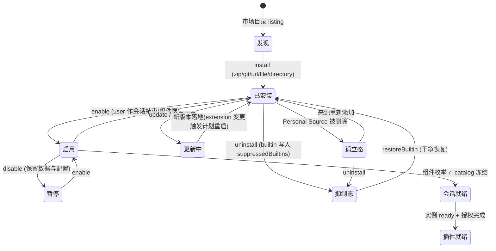

# ZCode 4.0.0 扩展生态、UI 插件协议、桌面端与工程体系拆解

> 分析对象：`D:\Files\Projects\WitCode\resources\src\ZCode-4.0.0`（只读基线）
> 定位：WitCode 重构 Coding Harness 的「为什么看起来完整 + 哪些资产可整套继承」专题。
> 代码位置格式：`包内相对路径:行号`；不确定处标注「待验证」。

---

## 1. 一句话定位

ZCode 4.0.0 的完整性来自**三层可独立演进的扩展面 + 一套强约束工程门禁**：普通插件（`plugin.json` 声明 skills/commands/agents/hooks/mcpServers/ui.surfaces）负责「能力随会话注入」，MCP Apps + Electron 沙箱负责「交互 UI 常驻侧栏」，Extension Host（独立 utilityProcess + 能力表 + 授权档位）负责「无会话的常驻代码」；三层共用同一个市场目录与生命周期，并由 `architecture-policy.yaml` 把跨层耦合在 push 前拦住。理解它是理解「为什么一个 Coding Harness 看起来像产品而不是 demo」的关键。

---

## 2. 扩展体系总览

```mermaid
graph TB
    subgraph HOST[ZCode 宿主 Desktop]
        MAIN[Electron Main<br/>窗口/进程/广播/监管]
        WH[Window Host utilityProcess<br/>业务服务 + extensions-service]
        EXT[Extension Host utilityProcess<br/>全 App 唯一, 常驻代码]
        RD[Renderer React + Zustand]
        SB[plugin-sandbox<br/>persist 分区 / CSP / guest]
    end
    subgraph PLUGIN[插件包 = 一个 plugin.json]
        MAN[manifest: name/version/<br/>skills/commands/agents/hooks/<br/>mcpServers/userConfig/ui]
        SK[SKILL.md 技能根]
        MCP[MCP server 进程<br/>CLI stdio 启动]
        EXTCODE[extension.main<br/>activate(ctx)/deactivate()]
        UI[ui.surfaces -> MCP App HTML]
    end
    subgraph MARKET[市场与分发]
        OFF[Official zcode-plugins-official<br/>= Builtin + CDN]
        BUILTIN[Builtin 随包播种]
        CDN[CDN zip + sha256]
        PERSONAL[Personal: claude 官方/Git/URL/<br/>npm/file/directory/inline]
        CAT[marketplace.json<br/>listing + componentTypes]
    end
    CAT -->|安装/更新| MAN
    OFF --> BUILTIN
    OFF --> CDN
    PERSONAL --> CAT
    MAN --> SK
    MAN --> MCP
    MAN --> EXTCODE
    MAN --> UI
    MCP -->|stdio| WH
    MCP -->|MCP Apps 资源 + 工具| UI
    UI -->|alias bridge / App SDK| SB
    SB -->|MessagePort| RD
    RD <-->|@zcode/rpc| WH
    WH <-->|MessageChannelMain| EXT
    MAIN -.监管/崩溃预算.-> EXT
    EXT -.贡献表/插槽动态值.-> RD
```

三层的关键差别：

| 层 | 载体 | 运行位置 | 是否有会话 | 生命周期 owner |
| --- | --- | --- | --- | --- |
| 组件层（Skill/Command/Agent/Hook/MCP） | 目录 + frontmatter | CLI 会话内 | 必须有会话 | CLI 插件加载器 |
| UI 层（MCP Apps / `ui.surfaces`） | `ui://` HTML 资源 | Electron 沙箱 guest | 需会话（surface `availability: "session"`） | Host + Main 沙箱登记 |
| 扩展层（`extension` 键） | `dist/extension.js` | 全 App 唯一 extension 进程 | 不需要会话 | Main 监管器 + Window Host |

证据：`docs/plugins/extension-host.md:6-42`、`UI_PLUGIN.md:16-32`、`CONTEXT.md`。

---

## 3. 插件清单与生命周期

### 3.1 `plugin.json` 字段表

`PluginManifest` 定义于 `apps/zcode-cli/packages/contracts/src/plugins/index.ts:159`，采用「未知顶层键原样保留」的宽松策略（`docs/plugins/extension-host.md:200`），因此新增 `extension`、`slots` 不会破坏旧 CLI。

| 字段 | 类型（契约处） | 含义与产物 |
| --- | --- | --- |
| `name` / `version` | `string` | 插件身份 `${name}@${marketplace}` 与版本；稳定 ID 见 `contracts/src/plugins/index.ts:278` |
| `description` / `description_i18n` | `string` / map | 详情描述；`author` / `homepage` / `repository` / `license` / `keywords` 为元信息 |
| `commands` | `unknown`（目录路径或内联） | 自定义斜杠命令根，加载为 `CustomCommandRoot` |
| `agents` | `unknown` | 子代理定义，进入 `${name}:${agent}` 命名空间 |
| `skills` | `unknown`（多为 `"skills"`） | 技能根；扫描 `SKILL.md`，见 §6 |
| `hooks` | `unknown` | `HookEventName -> HookMatcherConfig[]`（`contracts/src/plugins/index.ts:312`） |
| `mcpServers` | `unknown` | `Record<string, McpServerConfig>`；CLI 以 `${ZCODE_PLUGIN_ROOT}/dist/server.mjs` 之类启动 stdio 服务 |
| `userConfig` | `Record<string, PluginUserConfigOption>` | 用户可配选项，支持 `sensitive`（普通值在 CLI config，敏感值在私有文件）；`contracts/src/plugins/index.ts:62` |
| `ui` | `unknown` → `ui.surfaces[]` | 面板入口声明：`{id,title,icon,server,resourceUri,availability}`；`contracts/src/plugins/index.ts:187` |
| `extension` | `unknown` → 严格 schema | 常驻代码：`engines.zcode/main/activationEvents/grants/protocols/contributes{commands,views}`；`shared/src/extension-host/manifest.ts:76` |
| `slots` | `unknown` → 严格 schema | 顶层插槽条目，按 `id`（`composer.status` 等）分组，`target` 只能是 `view/command/surface/tool` 之一 |
| `channels/lspServers/outputStyles/settings/dependencies` | `unknown` | 渠道、LSP、输出风格、设置与插件依赖（支持循环/跨市场诊断） |

`componentTypes` 不是 manifest 字段，而是**市场目录条目**字段：`packages/shared/src/plugin-types.ts:12` 定义 `agent|command|skill|hook|mcp|lsp`，发布时额外有 `"ui"`、`"extension"`。`OfficialPluginDefinition.componentTypes` 注释明确要求「manifest 有 `ui.surfaces` 必须同时声明 `"ui"`」（`apps/zcode-cli/packages/bootstrap/src/app/official-plugin-definitions.ts:41`）。

### 3.2 生命周期状态机

CLI 子命令共 8 个：`list / install / uninstall / enable / disable / update / validate / marketplace`（`apps/zcode-cli/packages/cli/src/plugins-command.ts:69-88`）。产品语义里的「暂停」就是 `disable`（`CONTEXT.md`「更多菜单仅暂停/启用与卸载」）。协议层还有 `restoreBuiltin`（`bootstrap/src/zcode-protocol/plugins.ts:505`）与 `marketplace` 更新（`:394`）。



两个易混淆状态（裁决见 `CONTEXT.md`）：**安装成功 ≠ 插件就绪**（还要启用、实例 ready、授权）；**Restorable Builtin** 卸载后进入持久化抑制，重启不得自动重播种；**Orphaned Installed** 来源消失但目录与数据保留，不能更新但可启停卸载。

项目目录插件另有信任门：`PluginWorkspaceTrust.state: "pending"|"trusted"`，pending 时强制停用且不解析任何组件（`contracts/src/plugins/index.ts:248`）。

---

## 4. 插件加载与隔离

### 4.1 组件层：CLI 进程内、目录枚举、链接逃逸防护

- 清单目录优先级 `.zcode-plugin` → `.claude-plugin` → `.codex-plugin`（`docs/plugins/extension-host.md:693`），`plugins/list` 是唯一事实源，配置落在 `~/.zcode/cli/config.json`。
- 技能扫描只接受真实文件：`SKILL.md` 候选按路径解析，符号链接/junction 一律拒绝，防止 `SKILL.md -> ~/.aws/` 这类文件级逃逸与目录级 `skills/evil-link -> ../../outside`（`apps/zcode-cli/packages/adapters/src/skills/scan.ts:7-22,43-82`）。
- 加载诊断是稳定错误码体系：`plugin_manifest_invalid`、`plugin_dependency_cycle`、`plugin_variable_missing`、`plugin_duplicate_id` 等 30 余种（`contracts/src/plugins/index.ts:30-60`），逐项降级而非整包失败。

### 4.2 扩展层：独立 utilityProcess，但不是安全沙箱

`docs/plugins/extension-host.md:44-89` 给出进程拓扑。关键事实：

- 所有扩展运行在**同一个** utilityProcess（用户决策，不按插件隔离进程）；崩溃预算 5 分钟内最多自动重启 3 次，退避 1/2/4 秒；每 5 秒 parentPort 存活探测，连续 3 次无回应判卡死；`deactivate` 共用 1 秒退出预算，1.5 秒强杀（`:642-677`）。
- 环境变量白名单：只传 `PATH/HOME/TMPDIR/LANG/SystemRoot/APPDATA/NODE_ENV` 等 14 项 + `ZCODE_PROCESS_LABEL=extension-host`；**不继承** Window Host 的遥测凭据与 OAuth 配置（`:664-665`）。代理/NoProxy/CA 只从设置页读取，经 `http.setGlobalProxyFromEnv()` 注入（`:666-670`）。
- API 注入方式：插件导出 `activate(ctx)`，`ctx` 由协议表生成并冻结；id 必须已在清单声明，否则 `not-declared`；停用后调用抛 `disposed`；未捕获错误用 `AsyncLocalStorage` 归因到插件，只记日志不杀进程；`process.exit` 被拦截（`:301-362`）。
- 能力表 `EXTENSION_CAPABILITIES` 是唯一定义：`{id, kind:"call"|"subscribe", input/output: ZodType, backend:"service"|"pump"|"renderer", grant}`（`:381-424`）。`extension-window` 频道只暴露通用 `call` / `onDynamicSubscribe`，**不为单个能力加方法**；网关按「查表→校验入参→查授权→审计→分派」五步走，处理函数表用 `satisfies CapabilityHandlerMap` 保证穷尽。
- **安全边界是能力表 + 用户授权，不是插件隔离**（`:425-431`）：一个插件可冒充另一个插件，按插件的授权与审计只用于归因；安装任一带扩展的插件等于拿到「已授予任一插件」的能力并集。这是必须在 WitCode 文档里明说的风险。
- 激活事务（`:682-690`）：`activate` 期间先缓存注册，成功返回后一起生效；抛错或超 10 秒全部丢弃并进入 `failed`。事件 `onAvailable`（首次出现）/ `onCommand:id` / `onView:id`。状态：`resolved→activating→active` 或 `failed/invalid/incompatible`。
- 静态声明归 Window Host（`:741-803`）：扩展进程不再读 `plugin.json`，只接收校验后的「扩展声明」；静态表（`rev`）与贡献表快照/增量（`gen/rev`）合并成 Renderer 插槽；动态值只在扩展进程内存，重启清空。

### 4.3 UI 层：Electron 沙箱而非 iframe

`packages/desktop/src/main/pluginSandbox/CONTRACT.md`：

- guest 固定 `contextIsolation / sandbox / webSecurity`，禁用 Node、子框架 Node、`webviewTag`、`plugins`、弹窗；shell 只转发 JSON-RPC。
- 稳定 origin：`persist:plugin-sandbox-v2-<hash(appIdentity)>`，保证 localStorage/IndexedDB 跨进程恢复；**稳定 origin 不等于资源权限**——protocol 仍校验 origin、实例路径、登记凭证，navigation 有 origin 白名单。
- CSP `default-src none`，资源/连接/frame 域按声明派生，`frame-ancestors` 只允许 shell origin；`zcode/csp` 扩展只能放宽 `unsafe-eval`，不增加浏览器能力。
- 原生 camera/microphone/geolocation/clipboardWrite 按资源声明 + 宿主/系统授权，异步确认后二次验证；5 秒一次性手势 token。上限 64 个登记。
- 扩展视图用 `contentKind: "extension"`，按插件派生 appIdentity（同插件视图共享分区，不同插件隔离），无 `sessionId`，拒绝原生权限声明。Gen UI 用 `contentKind: "gen-ui"` 内存分区。
- HTML 资源上限 16 MiB，读取上限 8 MiB，MIME 限 `text/html;profile=mcp-app`；Host 桥不缓存执行结果，单一 owner 在 Agent（`packages/services/src/plugin-ui-bridge/CONTRACT.md`）。

---

## 5. UI 插件与 surface 协议

### 5.1 `ui.surfaces` 与 `componentTypes: ["ui"]`

`ui.surfaces[]` 是「会话侧栏面板」的清单声明，字段 `{id, title, icon?, server, resourceUri, availability:"session"}`，其中 `server` 是运行时 namespaced MCP server 名（`plugin:${name}:${server}`），`resourceUri` 必须以 `ui://` 开头（`contracts/src/plugins/index.ts:187-198`）。发布目录的 `componentTypes: ["ui", …]` 是**分类标签**：未安装时按目录判断，安装后以真实 manifest 为准，暂停不改变分类（`CONTEXT.md`）。

插槽（Extension 侧）与 surface 是两个正交概念。5 个插槽目录（`EXTENSION_SLOTS` 唯一定义，`docs/plugins/extension-host.md:880-895`）：

| 插槽 | 位置 | 接受 target | 作用域 | 每插件上限 |
| --- | --- | --- | --- | --- |
| `composer.status` | 输入框用量圆环左侧 | command | 会话 | 1 |
| `sidePane.launcher` | 启动页「扩展」分区 | view | 工作区 | 5 |
| `nav.primary` | 左侧导航「插件市场」下方 | view / surface | App | 1 |
| `file.viewer` | 打开文件 | view / surface | 工作区 | 5 |
| `composer.mention` | 输入框 `@` 面板 | command / tool | 会话 | 3 |

`surface` target 打开 MCP App 页面，必须有会话；没有则先进根草稿再打开；远程工作区或没有插件沙箱时给「不支持」提示（`:890-895`）。

### 5.2 最小插件示例剖析

`UI_PLUGIN.md:296-333` 的最小清单：

- `mcpServers.app`：`stdio` 启动 `${ZCODE_PLUGIN_ROOT}/dist/server.mjs`，`cwd` 用 `${ZCODE_PROJECT_DIR}`，env 注入 `ZCODE_WORKSPACE_ROOT/ZCODE_PLUGIN_DATA`。
- `ui.surfaces[0]`：`id:"editor"`，`server:"app"`，`resourceUri:"ui://my-panel/editor.html"`，`availability:"session"`；服务端必须注册该资源并返回 `text/html;profile=mcp-app`。
- 工具结果通过 `_meta.ui.resourceUri` + `_meta.ui.surface:"editor"` 关联到面板；`_meta.ui.visibility:["model","app"]` 决定谁能调用，仅页面工具写 `["app"]`。
- 占位符契约：`${ZCODE_PLUGIN_ROOT}` 插件文件、`${ZCODE_PROJECT_DIR}` 工作区操作、`${ZCODE_PLUGIN_DATA}` 持久数据、`${user_config.<key>}` 用户配置（敏感值不进页面）。

页面侧最小连接代码（`UI_PLUGIN.md:395-428`）：用官方 `@modelcontextprotocol/ext-apps` 的 `App`，先注册 `ontoolresult` / `onhostcontextchanged` 再 `await app.connect()`；`getHostContext()?.theme` 应用主题；`ui/set-widget-state` 低层请求保存视图快照（需先查 `experimental["zcode/widgetState"]`）。

### 5.3 页面 API 与 host 能力注入

官方 MCP Apps API 由宿主能力协商决定（`UI_PLUGIN.md:335-363`）：

| 分类 | API | 关键语义 |
| --- | --- | --- |
| 握手 | `new App/connect`、`getHostVersion/getHostCapabilities/getHostContext` | 每活页面一个 App；按能力开关功能，不按版本号猜 |
| 工具结果 | `ontoolinput/ontoolresult/ontoolcancelled` | 大 UI 延迟加载要保留初始结果 |
| 调服务 | `callServerTool/readServerResource/listServerResources` | 沿用 Agent 权限；不能访问其他插件或任意本地文件 |
| 对话协作 | `sendMessage/updateModelContext` | 需 `message`/`updateModelContext` 能力；后者不立即发送 |
| App 内推理 | `createSamplingMessage` | 用当前任务模型，不带主聊天历史；`includeContext` 仅 `none` |
| 页面工具 | `registerTool` 或 `onlisttools/oncalltool` | 握手前登记，随活页面注册/撤销 |
| 展示 | `requestDisplayMode/sendSizeChanged/openLink/downloadFile` | `inline` 内联、`fullscreen` 侧栏；外链仅 http(s) |
| 生命周期 | `onteardown/requestTeardown` | 宿主有时限 teardown，唯一保存不能留到此时 |

低层扩展（`UI_PLUGIN.md:365-376`）：`ui/set-widget-state`、`resources/templates/list`、`resources/subscribe`、`zcode/surface`（当前侧栏 id）、`zcode/csp`。旧 `window.zcode` 别名仍可用但没有 sampling 与页面工具便捷接口（`:378-393`）。

宿主源码导航见 `UI_PLUGIN.md:449-461`：`packages/ui/src/plugin-ui/domain/buildPluginUiHostCapabilities.ts`、`packages/services/src/plugin-ui-bridge/CONTRACT.md`、`packages/desktop/src/main/pluginSandbox/CONTRACT.md`。

---

## 6. Skills 体系

### 6.1 格式与发现

`SKILL.md` 是带 YAML frontmatter 的 Markdown 指令包，最小 frontmatter 只有 `name` + `description`（示例：`apps/zcode-cli/packages/browser-use-plugin/skills/control-browser/SKILL.md:1-3`；`skill-creator-plugin/skills/skill-creator/SKILL.md:1-3`）。契约 `apps/zcode-cli/packages/contracts/src/skills/index.ts:9` 定义来源 `agents | zcode | bundled | plugin | remote`，作用域 `project | user | system | admin`；诊断码覆盖缺 frontmatter、非法 frontmatter、缺 name/description、描述过长、未知键、重名、超大（`:16-23`）。`SkillRoot` 带 `namespace/path/scope/source/priority/pluginId`（`:28-36`），发现时按 namespace 限定、按 qualified name `${name}:${skill}` 命名空间化。

加载规则（`apps/zcode-cli/packages/adapters/src/skills/scan.ts:7`）：插件根有 `SKILL.md` 时只加载根技能，否则扫描一层子目录；所有候选必须是真实文件，拒绝符号链接逃逸。

### 6.2 bundled-skills

`apps/zcode-cli/packages/bundled-skills/README.md`：随 CLI 分发、**不在插件商店、无启停开关、不可卸载**，启动即以 `source:"bundled", scope:"system"` 注册。当前只装 `dynamic-workflows`（对应 `/workflow` 与 `CreateWorkflow`），因为工具由运行时注册，教学技能必须同样不可移除。分发三种形态：开发/Electron 就地读取；SEA 二进制经 `scripts/sea-bundled-skill-assets.mjs` 嵌入并在 `~/.zcode/cli/bundled-skills/<hash>/` 解压一次；远程主机由 `scripts/prepare-prebuilds.mjs` 暂存。

### 6.3 `skills-lock.json` 与 skill-creator

根目录 `skills-lock.json`（version 1）记录 4 个从 GitHub 同步的技能（`agent-browser`、`ai-elements`、`dogfood`、`electron`），每项含 `source`、`sourceType:"github"`、`computedHash` (sha256)——这是上游同步的内容寻址锁。**消费方不在本仓库源码中（待验证：由外部同步脚本在发布流水线使用）。**

`skill-creator-plugin` 本身就是一个纯技能插件（`plugin.json` 仅 `skills:"skills"`），`SKILL.md` 描述「写草稿 → 用 2–3 个真实 prompt 试 → 与用户一起读输出 → 改文案 → 循环」的迭代流程；它是内容型插件，可通过 `defaultEnabled:true` 让首次 `/skill` 即可用而无需 `zcode plugins enable`（`official-plugin-definitions.ts:41-52`）。

---

## 7. 主题与设计系统

### 7.1 Token 化方式

主题是**CSS 变量为主、TS 函数为辅**：

- `packages/ui/src/styles.css` 有 725 处 `--color-*` 引用；`:root`（`:89`）、`.dark`（`:458`）、`.theme-zai-light`（`:636`）、`.theme-zai-dark`（`:802`）四套令牌块覆盖 color / spacing / radius / font / shadow。
- 语义色命名：`--color-background`、`--color-panel`、`--color-sidebar`、`--color-card`、`--color-popover`、`--color-brand`、`--color-foreground(-subtle)`、`--color-border`、`--color-input(-focused)` 等；`DESIGN.md:69-237` 逐项规定用途与禁用场景。
- 字体/字号/间距走 token：`--font-sans` / `--font-mono` / `--ui-font-size`，CJK 字形按 `:lang(ja)` / `:lang(ko)` 覆盖（`styles.css:168-257`）；间距与圆角见 `DESIGN.md:354-435`。
- 派生色用 `color-mix(in oklab, …)` 而非硬编码（`.dark` 块大量使用），便于主题切换时统一过渡。

### 7.2 亮暗切换与防闪

`packages/ui/src/useTheme.ts`：`Theme = light|dark|zai-light|zai-dark|system`，`resolveTheme` 归约为 `light|dark`，`applyTheme` 切 `document.documentElement` 的 `dark` / `theme-zai-light` / `theme-zai-dark` class，并同步 `color-scheme`、`theme-color` meta 与浏览器表面属性；默认 `zai-dark`，持久化在 localStorage `zcode-theme`。`useDesktopNativeThemeSync`（`packages/ui/src/root/useDesktopNativeThemeSync.ts`）把标题栏主题经 `IPlatformService.setTitleBarTheme` 下发给原生窗口，loading 阶段不写以避免覆盖窗口壳。

插件页面首帧：桌面下发 HTML 时在 `<html>` 预置 `data-theme`（light/dark），握手后再以 `hostContext.theme` 为准，避免深色主题闪一帧浅色（`UI_PLUGIN.md:430`；`docs/plugins/plugin-ui-initial-theme.md`）。**插件不扩展全局主题**：只能通过 `getHostContext()` 读取主题并自适应自己的 `data-theme`，资源 CSP 不授予主题令牌写权限。

---

## 8. 桌面端进程模型

### 8.1 进程职责

| 进程 | tsconfig / 构建入口 | 职责 |
| --- | --- | --- |
| Electron Main | `tsconfig.main.json`；`tsup.config.ts:257` `main/index` | 窗口、native dialog、进程 fork、广播中转、日志接收、远控鉴权/配对/心跳、payload 透传与 host attachment 调度；**不持有业务状态** |
| Window Local Host | `tsconfig.host.json`；`tsup.config.ts:355` `host/index` | 每窗口一个 utilityProcess，`createLocalServices({parentPort})` 承载 file/system/terminal/setting/credential/broadcast；业务状态 owner；stdio 连 CLI agent |
| Renderer | `tsconfig.renderer.json`；Vite | React UI + Zustand store；报告屏幕会话/焦点/草稿模型/界面语言给 Host |
| Preload | `tsconfig.preload.json`；`tsup.config.ts:303` | contextBridge 暴露受限 IPC；含 `pluginSandbox/index.ts` 固定 guest preload、`codingPlanWebview`、`oauthCallbackBridge` 等 |
| Extension Host | `tsconfig.extension-host.json`；`tsup.config.ts:419` | 全 App 唯一常驻扩展进程，跑 `activate(ctx)` |
| cron scheduler | `tsconfig.scheduler.json` | App 级定时任务，执行时经 Main 转交 Host |
| renderer-services | `tsconfig.renderer-services.json` | 单文件 `remoteWorkspaceSessionServices.ts` 的独立类型工程，避免把 services 源码拉进 renderer |

多 tsconfig 是**进程边界的静态护栏**：`tsconfig.json` 用 project references 串起 main/host/scheduler/extension-host/preload/renderer/e2e，每份只 `include` 自己进程的源码，并显式声明允许的 `references`（`packages/desktop/tsconfig.json:1-15`）。另有 `tsconfig.remote-main.json`、`tsconfig.app-navigation.json` 处理远控与共享导航类型。

### 8.2 Window-scoped Local Host 与远程接入

`docs/agents/runtime-boundaries.md:9-12` 是裁决源：每个 BrowserWindow 有且只有一个 **window-scoped Local Host**，通过 MessagePort 直连 renderer；同一窗口的多个本地 workspace tab 共用该 Host，服务按 `workspaceKey` 隔离，**不**为每个 workspace 建独立 Host。SSH/WSL/Docker/Server 工作区由同一 Local Host 的 `RemoteConnectionRegistry` 创建/复用连接，作为逻辑 tab/session 打开；手机 `/remote` 通过 shared-host attachment 连到桌面已有的 local host 或 remote workspace session host；外部 relay 只做鉴权/配对/心跳与 payload 透传。

```mermaid
sequenceDiagram
    participant M as Electron Main
    participant H as Window Local Host
    participant R as Renderer
    participant X as Extension Host
    participant CLI as CLI agent (stdio)
    participant RM as Remote Server Core
    M->>H: utilityProcess.fork + init-local (一次)
    H->>CLI: stdio 建连, createLocalServices
    R-->>H: MessagePort RPC (workspaceKey 隔离)
    M->>X: 首个 window-ready 后 fork
    M->>H: MessageChannelMain 牵线 (L1 业务面)
    H<->X: @zcode/rpc 双向 call/subscribe (无需经 Main)
    H-->>R: 静态表 + 贡献表 (插槽/视图)
    R-->>H: visibleSessions / locale / 草稿模型报告
    H->>RM: WS 远端连接 (远端 services + 远端 CLI)
    RM-->>H: controller 投影 (owner/lease 路由)
    Note over H,X: 远程工作区插件包在远端, 本机扩展进程不跑其扩展代码
```

扩展进程的连接细节（`docs/plugins/extension-host.md:62-83`）：L0 控制面走 parentPort 普通消息，只管生命周期；L1 业务面是 Main 创建的一对 `MessageChannelMain`，之后 Host 与扩展进程直连，Main 不在数据路径上；`@zcode/rpc` 是自有二进制格式，函数/`AbortSignal`/类实例不能跨进程，取消必须设计显式 cancel 方法（`:85-89`）。Host 实现见 `packages/desktop/src/host/index.ts:11-25`（每窗口一个 Host，local services + remote connection registry）与 `:946`（无 Local Host 时拒绝远程请求）。

---

## 9. 状态管理与 i18n

### 9.1 Zustand store 与服务访问

`packages/ui/src/store/` 有约 50 个 store 文件，按领域切分：`zcodeSessionStore`（含 `taskSlice/workspaceSlice/selectors/types/navigation`）、`pluginManagementStore`（+ `Enabled/Loading` 拆分）、`pluginStore`、`mcpStore`（+ Desktop/Migration/Helpers/StatusList）、`skillStore`、`subagentsStore`、`tabStore`、`commandsStore`、`confirmDialogStore`、`taskQueryCacheStore`、`remoteWorkspaceSessionStore`、`whiteboardStore` 等。命名规律是「一个领域一个主 store + 横切关注点拆后缀文件」，避免巨型单文件（与 800 行上限呼应）。

服务访问采用 React Context 注入而非直接 import：`useServices()` 从 `ServiceProvider` 拿 `IServiceAccessor`（`packages/ui/src/hooks/useServices.tsx:5-39`），再经细粒度 hooks 如 `useFileService.ts`、`useSettingService.ts`、`useZCodeAgentService.ts`、`useSystemService.ts` 消费端口；另有 `useWorkspaceServices.tsx` 提供工作区级上下文。调度思路是「hooks → 端口 → Host services → CLI」，UI 不直接连接进程。主题状态同时存在于 `useTheme`（localStorage）与 Zustand 默认，代码注释明确两者要收敛到 `zai-dark` 避免分叉（`useTheme.ts:74`）。

### 9.2 语言广播与防回环

5 种语言：`zh-CN/en-US/ja-JP/ru-RU/ko-KR`（`docs/i18n/ui-locales.md`），唯一事实源 `SUPPORTED_LOCALES`，文案表在 `packages/ui/src/i18n/locales/*.ts`，`localeMessages.ts:12-16` 将 ja/ru/ko 合并 `{...enUS, ...<locale>}` 回退英文，中英为完整表；key 用点号命名空间，如 `"preinstalledTools.status.update-available"`、`"locale.switchLanguage"`，占位符 `{name}` 形式（`en-US.ts:4-20`）。

防回环的关键在 `packages/ui/src/i18n/IntlProvider.tsx`：`STATE_LOCALE_CHANNEL = "state:locale"` 广播 `{preference, resolvedLocale}`；`shouldApplyLocaleBroadcastMessage()`（`:71-88`）检查 `sourceWindowId === undefined`（本窗口自发消息）且 payload 与 `ignoredLocalPayload` 相同时**丢弃**，避免「A 窗口切换 → 广播 → 自己再应用一次」的回环；`localeResolved` 标志确保持久化设置读完才对外同步语言（`IntlProvider.tsx` 注释）。

主题/语言都作为「Renderer 独占的界面状态」经报告进入 Host（`docs/plugins/extension-host.md:103-104`），扩展经 `env.get/onDidChange` 能力读取，形成「Renderer 报告 → Host 快照 → 扩展」单向流，不反向写回。

---

## 10. 工程门禁体系

### 10.1 `architecture-policy.yaml` 结构

文件 2618 行 / 128 KB，顶层三段：`version: 1`、`modules:`（约 2030 行，每个 managed 模块声明 `id/roots/managed/requires/publicEntrypoints/layers/owner`）、`global:`（`:2032-2043`）、`exceptions:`（`:2045`，逐条带 `id/rule/paths/reason`）。

`global` 硬约束：

| 约束 | 值 | 含义 |
| --- | --- | --- |
| `maxFileLines` | 800 | 与 oxlint `max-lines` 一致（`.oxlintrc.json:6-8`） |
| `maxContractLines` | 300 | `contract.ts` 上限 |
| `maxPublicMethods` | 12 | 模块公开面收敛 |
| `forbidCycles` / `forbidDeepImports` | true | 依赖无环、禁止深路径导入 |
| `managedOnly` | true | 新文件必须属于受管模块 |
| `newFilesEnforcedSince` | 2026-09-10 | 只约束该日期后首次入库的新文件，避免追溯存量 |
| `acceptedUpstreamSnapshot` | `scripts/architecture/upstream-snapshot.json` | 1.5 MB 上游快照，用于区分「我们新增」与「上游带来」 |

### 10.2 规则类型统计与示例

检查实现集中在 `scripts/architecture/index.mjs:28-284`，可识别的规则码：

| 规则码 | 检查维度 | 例子 |
| --- | --- | --- |
| `layer-direction` | 分层方向（contract→domain→app→adapters/ui） | app 层直接 import adapters 实现 |
| `module-dependency` | 依赖方向：`requires` 声明之外不得依赖 | 未声明 `requires: [services]` 却 import 它 |
| `deep-import` | 只能从 `publicEntrypoints` 导入 | 绕过 `index.ts` 直拿内部文件 |
| `cycle` | 模块/文件依赖成环 | A→B→A |
| `domain-io` | domain 层不得做 IO | domain 里 `fetch`/`fs`/`process` |
| `ui-implementation-import` | UI 不得反向依赖具体实现 | 组件 import services 内部模块 |
| `max-file-lines` / `max-contract-lines` / `max-public-methods` | 体量上限 | 超 800 行 / 300 行 / 12 方法 |
| `disable-count` | 抑制注释数量 | 过多 eslint-disable |
| `unmanaged-new-file` | 新增文件必须被模块接管 | 99 条例外均属此类 |
| `missing-module-artifact` / `manifest-policy-mismatch` | 四件套（`module.ts/contract.ts/contract.example.ts/CONTRACT.md`）与清单一致 | 缺 CONTRACT.md |
| `expired-exception` | 例外过期 | 带日期的例外到期未处理 |
| `runtime-call` | 运行时调用白名单 | 禁用 `eval` 等 |

例外统计：`unmanaged-new-file` 99 条、`max-file-lines` 3 条、`disable-count` 3 条——绝大多数是「上游已有文件只改一处，不接管整包」的务实豁免，每条都有具体 spec/原因，这是门禁能落地的关键。

### 10.3 执行链路

- `pnpm architecture:check` → `node scripts/architecture/architecture-check.mjs check`（`package.json:78`）；`-- --changed` 时用 merge-base 算变更集，并只替换变更闭包内的 baseline 条目（`:25-60`）。
- `pnpm architecture:adopt <id> --root <dir>` 登记新模块并生成四件套骨架（`adopt.mjs`）；`pnpm architecture:context <id>` 输出模块上下文给 Agent；`pnpm architecture:report --markdown` 产出报告。
- pre-push（`.husky/pre-push`）→ `pnpm run verify:pre-push`（`package.json:42`），串联 8 步：`check-push-worktree` → `check:e2e-remote-targets` → `lint`（oxlint + session-control 边界 + LibreOffice/Python 文档脚本）→ `docs:stale-phrases:check` → `db:schema:check` → `test:architecture` → **`architecture:check -- --changed`** → `test:engineering:affected --scope push`。hook 先缓存 stdin 的 local/remote ref 与 sha 供架构检查作 base，并 `unset $(git rev-parse --local-env-vars)` 防止单测临时仓库误命中当前仓库。
- 辅助门禁：`knip.json` 查未使用导出/文件（`.agents/**`、`.claude/**`、`docs/**`、`components/**` 被忽略）；`.oxlintrc.json` 用 React Hooks 规则与 session-control 的 `no-restricted-imports` 白名单。

**能否整体搬到 WitCode**：规则引擎（`scripts/architecture/*`）与 `architecture-policy.yaml` 是纯 Node/YAML，与 ZCode 业务无耦合，可整套复制；但 `upstream-snapshot.json` 是 ZCode 特有的 merge-base 历史，必须换成 WitCode 自己的基线；例外清单 105 条要清空重来；`requires` 里的 200+ 模块 id 要重新映射。预计改造成本 L（详见 §12）。

---

## 11. 插件市场与分发

### 11.1 四种来源辨析（裁决见 `CONTEXT.md`）

| 来源 | 定义 | 注意 |
| --- | --- | --- |
| **Official Marketplace** | 唯一官方分发渠道 `zcode-plugins-official`，内容 = 内置 + CDN；是分发渠道而非作者归属，可收录社区插件 | 不要叫 claude-plugins-official 为官方 |
| **Builtin Plugin** | 随应用包分发、启动时播种进官方市场；是官方的子集 | 卸载后成 Restorable Builtin，重启不得自动重播种 |
| **CDN Plugin** | 官方市场内经 CDN、`sha256` 校验的 zip，按需下载 | zip 源进入 `~/.zcode/cli/plugins/cache/{marketplace}/{plugin}/{version}/` |
| **Personal Source** | 用户自加的一切来源：claude-plugins-official、git/GitHub/URL/npm/file/directory 市场、inline 插件 | 不要叫「第三方市场」 |

`PluginMarketplaceSourceConfig` 支持 6 种（`contracts/src/plugins/index.ts:74-80`）：`url`（HTTP fetch marketplace.json）、`github`（repo/ref/sparsePaths）、`git`、`npm`、`file`、`directory`。插件条目 source 可写 `{source:"url", type:"zip", url, sha256, path, stripRoot}`；无 `type` 的 url 保持 legacy git clone 语义，不靠后缀猜 zip（`docs/plugin-cdn-zip-source.md:20-70`）。安装记录文件是 `installed_plugins.json`（`apps/zcode-cli/packages/adapters/src/plugins/marketplace.ts:56`）。

### 11.2 商店页数据结构与分发链路

数据模型分三层：

1. **Store Listing**（展示性）：`displayName/displayNameI18n/icon/category/publisherType/author/homepage/privacyPolicy/termsOfService/heroImage/examplePrompts/regions/requiresPaidPlan/componentTypes`（`contracts/src/plugins/index.ts:121-154`）。`publisherType:"official"|"community"` 只管归属，不影响执行权限。
2. **Plugin Manifest**（功能性）：§3.1 的 `plugin.json`。
3. **UI 视图模型**：`StorePluginItem` 把 overview 目录条目、运行时 `ZCodePluginInfo`、已安装记录按 id join，带 `restorable`、`orphaned`、`listing`、`summary`、`info`、`installedMeta`（`packages/ui/src/settings/pluginStoreListing.ts:45-60`）。

商店页分段：Public（官方市场，含 Featured 策展）/ Community（官方市场中外部维护）/ Personal（全部个人来源，含 Recommended 策展）。UI 插件专区与搜索限定当前来源分段；Side Pane 的「默认界面推荐」是独立名单，由客户端配置接口 `uiPluginRecommendations` 下发，未安装未启用也可推荐（`CONTEXT.md`）。

分发兼容设计值得整套借鉴（`docs/plugins/plugin-publishing.md:111-215`）：扩展通过 `extensionSummary.engines.zcode` + `grants` 进入目录；CLI 用能力位 `pluginExtensionSummary` 与请求参数 `includeExtensionSummary:true` 做「能力协商」，旧端收到新字段不解析失败；只有 services 层一处用 strict schema 解析，Renderer/远端转发不解析，因此 Desktop 与远端 Server 版本差不会打不开商店；不兼容时安装按钮变「需要更新 ZCode」，已装版本照常运行且更新提示被过滤。

更新链路：`Catalog Auto-Refresh`（进商店页节流刷新官方目录）/ `Manual Refresh`（顶栏按钮，全市场）；安装后 `Session Reload` 等待当前工作安全结束再重建任务实例，不重放上一条请求（`CONTEXT.md`）。

---

## 12. 值得整套继承的资产（按价值排序，改造成本 S/M/L）

| 排名 | 资产 | 价值 | 成本 |
| --- | --- | --- | --- |
| 1 | `architecture-policy.yaml` + `scripts/architecture/*` + 四件套约定 + pre-push 门禁 | 把「架构不腐化」变成可执行、可豁免、可审计的流水线；对多 Agent 并行写码尤其关键 | **L**（基线/例外/模块 id 需重做，引擎本身可搬） |
| 2 | `SKILL.md` frontmatter + 技能根发现 + 链接逃逸防护 + bundled 不可卸载模型 | Coding Harness 的「可成长知识层」最小可用协议，纯文本、低耦合 | **S** |
| 3 | 插件清单 + 稳定 ID（`name@marketplace`）+ 组件分组 + 诊断码体系 | 插件身份/命名空间/错误码一次定对，后续不用改协议 | **S–M** |
| 4 | MCP Apps UI 协议（`ui.surfaces` + 能力协商 + 首帧主题） | 用官方 SDK 而非自造 UI SDK，避免重复造轮子；`UI_PLUGIN.md` 可作蓝本 | **M** |
| 5 | `DESIGN.md` + `styles.css` 语义 token 体系 + `useTheme` | 725 处 `--color-*` 与 4 套主题块，视觉一致性即产品感 | **M**（可按品牌换 token 值） |
| 6 | Window-scoped Local Host + 多 tsconfig 进程切分 | 每窗口一个 Host、workspaceKey 隔离、静态类型护栏；避免「什么都在主进程」 | **L** |
| 7 | 能力表驱动的 Extension Host（`call`/`subscribe` 双入口 + 网关五步） | 新增能力只改「表一行 + 网关一函数」，类型自动推导；教育价值极高 | **L**（Electron utilityProcess 细节多） |
| 8 | 商店能力协商与分区数据模型（Listing/Manifest/StorePluginItem 三层） | 前后端版本差、远端 Server 混版时不炸 | **M** |
| 9 | i18n 五语言 + 回退 + 广播防回环 + 落盘降级兼容 | 中文产品出海的现成方案 | **S–M** |
| 10 | 插件沙箱契约（稳定 origin / CSP / 凭证二次校验 / 分区隔离） | 安全边界写得极细，可直接当 checklist | **L**（与 Electron 强绑定） |

---

## 13. 不值得继承 / 耦合过深的部分

- **128 KB 的例外清单**：105 条逐案豁免是 ZCode 历史包袱，照搬会把 WitCode 的门禁一开始变成橡皮图章；应清空后按真实增量重新积累。
- **`upstream-snapshot.json`（1.5 MB）与 `acceptedUpstreamCommits`**：绑定 ZCode 的 merge-base 与上游仓库，迁移无意义。
- **Extension Host 的「非安全边界」设计**：所有扩展同进程、授权可冒充，是明确的产品权衡（安装即获能力并集）。WitCode 若走多租户/不可信插件路线必须重做进程隔离，不能照抄。
- **N 个领域插件的业务实现**（design/documents/pdf/presentations/spreadsheets/superpowers 等）：深度绑定 ZCode 的 `${ZCODE_PLUGIN_ROOT}`、内置 Python/Office runtime、CDN assets、官方账号 JWT；**协议可学，成品不可搬**。
- **`packages/desktop/tsup.config.ts`（19 KB）与 `wdio.conf.ts`（258 KB）**：大量平台特化（macOS 签名、Windows installer、CDN 多目标、Electron 44 行为），只抽取「按进程分目标 + 外部化 undici/node-forge」的原则。
- **靠 `rev/gen` 手工维护的多份快照合并**：扩展静态表/贡献表/进程状态三份数据在 Renderer 合并，复杂度高；WitCode 早期可用单一 owner 简化。
- **Gen UI 随包资源与 Visualize 插件的哈希清单**：与可视化插件强耦合，除非要复刻 Gen UI 否则跳过。

---

## 14. 对 WitCode 的启示

1. **先立门禁再长插件**：先把 `architecture-policy.yaml` 的「受管模块 + 四件套 + 依赖方向 + 新文件拦截」移植过来，哪怕模块只有 5 个；否则插件生态一旦铺开，跨层 import 与复制状态会迅速失控。
2. **协议分层的顺序**：`SKILL.md`（纯文本，S）→ `plugin.json` 清单（S）→ MCP Apps UI（M）→ Extension Host（L）。不要在 Harness 还没稳定时就做常驻扩展进程。
3. **身份与命名空间一次定死**：`${name}@${marketplace}`、qualified skill name、namespaced MCP server 名、稳定 ID catalog 在会话创建时冻结——这套设计直接决定后面能不能做「引用插件能力」而不歧义。
4. **能力协商优于版本判断**：`extensionSummary` + 能力位 + 严格 schema 只在单点解析的经验，让新旧 Client/Server/CLI 混版不炸，值得写进 WitCode 协议规范。
5. **把「看起来完整」拆成可验收事实**：ZCode 的每个关键机制都配了 `docs/<topic>.md` 规格 + E2E case catalog + 证据索引（如 PLM-EXT 系列）。WitCode 应同步建立「机制文档 + 验收用例」配对习惯。
6. **UI 扩展走官方 MCP Apps**：不自建页面 SDK，`getHostCapabilities()` 协商 + 官方 `App` 连接 + 沙箱只做隔离与凭证绑定，能把精力留给 Harness 本身。

---

## 15. 证据索引

| 主题 | 关键位置 |
| --- | --- |
| 插件清单/商店类型 | `apps/zcode-cli/packages/contracts/src/plugins/index.ts:7,27,62,74,121,159,187,209,248` |
| 组件类型 | `packages/shared/src/plugin-types.ts:12,31,41` |
| 扩展 API 版本与 schema | `packages/shared/src/extension-host/manifest.ts:16,76,181,200,224` |
| 扩展进程设计 | `docs/plugins/extension-host.md:3,32,44,62,91,117,196,251,297,381,425,440,640,691,737,814,880` |
| 插件类型包 | `packages/plugin-api/src/manifest.ts:1`、`packages/plugin-api/src/CONTRACT.md` |
| CLI 生命周期命令 | `apps/zcode-cli/packages/cli/src/plugins-command.ts:67-88`；`apps/zcode-cli/packages/bootstrap/src/zcode-protocol/plugins.ts:394,438,461,505` |
| 官方插件播种 | `apps/zcode-cli/packages/bootstrap/src/app/official-plugin-definitions.ts:1-70` |
| 市场/缓存 | `apps/zcode-cli/packages/adapters/src/plugins/marketplace.ts:56`；`docs/plugin-cdn-zip-source.md:20-70` |
| 发布与兼容 | `docs/plugins/plugin-publishing.md:111-215`；`CONTEXT.md` |
| UI 插件协议 | `UI_PLUGIN.md:16,296,335,365,378,395,432,449`；`docs/plugins/plugin-ui-initial-theme.md` |
| UI 插件宿主实现 | `packages/ui/src/plugin-ui/domain/buildPluginUiHostCapabilities.ts`；`packages/services/src/plugin-ui-bridge/CONTRACT.md` |
| 插件沙箱 | `packages/desktop/src/main/pluginSandbox/CONTRACT.md`；`packages/desktop/src/preload/pluginSandbox/index.ts` |
| 设计系统 | `DESIGN.md:69,263,354,457,642`；`packages/ui/src/styles.css:89,458,636,802` |
| 主题切换 | `packages/ui/src/useTheme.ts:1-110`；`packages/ui/src/root/useDesktopNativeThemeSync.ts` |
| 状态与服务注入 | `packages/ui/src/store/index.ts`；`packages/ui/src/hooks/useServices.tsx:5-39` |
| i18n | `docs/i18n/ui-locales.md`；`packages/ui/src/i18n/IntlProvider.tsx:25,71`；`packages/ui/src/i18n/localeMessages.ts:12` |
| 技能体系 | `apps/zcode-cli/packages/contracts/src/skills/index.ts:9,28`；`apps/zcode-cli/packages/adapters/src/skills/scan.ts:7,43`；`apps/zcode-cli/packages/bundled-skills/README.md`；`skills-lock.json` |
| 进程边界 | `docs/agents/runtime-boundaries.md:5-13`；`docs/architecture/r1-single-window-host-refactor.md:40`；`packages/desktop/src/host/index.ts:11-25` |
| 多 tsconfig | `packages/desktop/tsconfig.json` 及 `tsconfig.{main,host,renderer,renderer-services,preload,extension-host,remote-main}.json`；`packages/desktop/tsup.config.ts:247-436` |
| 门禁 | `architecture-policy.yaml:1,2032,2045`；`scripts/architecture/index.mjs:28-284`；`scripts/architecture/architecture-check.mjs`；`.husky/pre-push`；`package.json:42,71,78`；`.oxlintrc.json:6`；`knip.json` |
| design-runtime | `packages/design-runtime/src/CONTRACT.md`（页面函数 `.toString()` 注入 + `postMessage` 限额 + 宿主侧 parse5 映射） |
