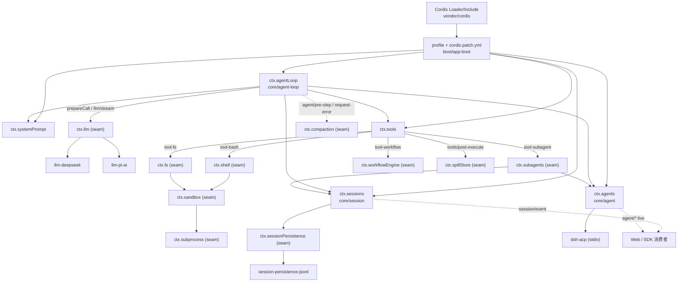
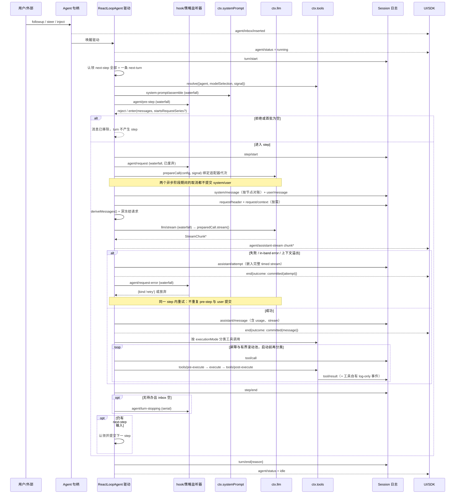

# 02a — DeepSeek Harness 微内核架构与运行时（v0.2.3-alpha.2）

> 分析对象：`D:\Files\Projects\WitCode\resources\src\deepseek-harness-dsh-v0.2.3-alpha.2`（只读）
> 视角：为 WitCode 以 ZCode 为基线重构 Coding Harness 提供可移植设计参考。
> 原则：文档与代码冲突时以代码为准并标注；不确定处标「待验证」。规模列为本仓库 `.ts/.tsx` 源文件计数（不含测试、不含 `client/`、`experimental/` 两个超大杂项包）。

---

## 1. 一句话定位

DSH 是一个「**内核只负责装载与编年史，其余一切皆为可热替换插件**」的事件驱动 Coding Harness：Cordis 提供插件容器与可逆 effect，会话日志（SessionEvent log）是唯一事实源，Agent Loop 只是一个可被换掉的具体实现，所有真实能力（文件、Shell、沙箱、LLM、子查询、压缩……）都以「接口 + 默认实现 + 替换点」的三角色 seam 暴露。

---

## 2. 设计哲学（从文档提炼）

1. **没有特权内核可打补丁**。`docs/architecture.md:11` 明说 "There is no privileged core to patch"：扩展就是在别的插件旁边再挂一个插件；注册行为都是 effect，插件卸载时自动回卷。配置树里任何一行都可以被上层 patch 替换（`docs/architecture.md:13-27`）。
2. **依赖靠名字，不靠 import**。插件用 `inject` 声明所需服务，加载顺序由服务依赖决定，而非 YAML 行序；服务消失时依赖者一起卸载、服务回来时重新加载（`docs/cordis-tutorial/03-services.md:44-79`）。这是「配置换实现不用改消费者」的物理基础。
3. **Model-visible means logged**（`docs/architecture.md:138`）：每一个模型请求都必须能从会话日志重建。因此请求头（`request/header`）与系统提示（作为 `system/message` surface 节点）都进日志，而不是散落在内存里。这条纪律是 fork、resume、telemetry、wire 上报的共同前提。
4. **seam 必须是三角色闭环**。`docs/architecture.md:146`：Service Definition（声明接口）+ Service Provider（实现）+ Consumer（通常是面向模型的工具）；"one role alone is not a seam"。这防止了「只有接口没人用」的空抽象。
5. **事件是唯一的正交扩展面**，并严格区分三类：durable 的 `session/event`（必须跨 reload 存活）、live 的 `agent/*`（观察/拦截在途工作）、capability 的 `fs/*`、`tools/*`、`telemetry/*`（给 seam 挂策略而不 import loop）（`docs/architecture.md:71-75`）。
   - **标注**：题面把事件分为「生命周期/内容/工具/流」四类，但 DSH 自己的分类是上述三个**域**；「内容/工具/流」实际是 `ContentBlock` / `StreamChunk` / `SessionEvent` 三套**词汇**，不是事件的分类维度。下文按 DSH 原意表述。
6. **公共接口禁用回调**。`docs/core-guidelines/general.md:61` 的 G.2：序列值用 `AsyncIterable`，通知用 typed Cordis 事件，策略用 Cordis service——因为函数无法跨进程/SDK 边界，也无法表达调用时机与异常语义。这是「所有跨边界 API 都可序列化」的根源。
7. **失败闭合、可逆、可重放**：审批缺失按 `unavailable` 拒绝（`docs/capability-seams.md:806`）；压缩锁用 `compaction/start`…`compaction/end` 括号，崩溃留下可检测的孤儿锁（`docs/subsystems/compaction.md:19`）；session-log 上报用 at-least-once + 水位事件，宁可重复不留空洞（`docs/deepseek-llm-api-wire-extensions.md:156`）。
8. **提示与策略分离**：plan mode 只是「软指导」，`ctx.planMode` 不读写 sandbox/approval（`docs/subsystems/plan.md:5`）；权限预设才是把两个旋钮绑在一起写的地方（`docs/capability-seams.md:807`）。

---

## 3. 包地图

| 包（组） | 职责 | 依赖关系（上游 → 本包 → 下游） | 规模（.ts） |
|---|---|---|---|
| `packages/core`（agent / agent-loop / session / system-prompt / tools / scope） | 内核脊柱：`Agent` 契约、具体循环驱动、追加式事件日志、提示装配、工具注册表 | `scope` → `session`/`system-prompt`/`tools` → `agent` → `agent-loop`；扩展包只依赖 `agent`，不依赖 `agent-loop` | 147 |
| `packages/boot`（app-boot / hmr / plugin-manager / plugin-market / cmdline / config-editor） | profile 与 bundle 组装、`cordis.patch.yml` 分层、HMR 调度、插件管理 | 依赖 vendor Cordis Loader/Include/HMR；向 `host`/`settings` 提供 `ctx.profileContext`、`ctx.hmr` | 127 |
| `packages/host` | 桌面/Web Host 侧能力：认证、目录选择器、WebServer、遥测出口 | 消费 `boot` 与 `client`；承载 `ctx.webServer` 等 | 60 |
| `packages/llm`（llm / llm-deepseek / llm-pi-ai / retry / token-meter / wire extensions） | 消息与流词汇、`LlmAdapter` seam、DeepSeek 与 pi-ai 两个适配器、请求扩展事务 | `agent-loop`、`compaction-basic` → `ctx.llm` → 适配器 | 182 |
| `packages/session` | 持久化后端（JSONL/SQLite）、格式迁移链、投影、标题、日志增量上报 | `ctx.sessions` → 持久化 seam；`session-log-deepseek` → `ctx.deepseekLlmApiExtensions` | 276 |
| `packages/fs`（fs / fs-local / fs-sandbox / tool-fs / observation-policy） | 文件系统 seam 与面向模型的 `read/write/edit/apply_patch` 工具 | `ctx.fs` 定义 → local/sandbox/ssh 实现 → `tool-fs` 消费 | 79 |
| `packages/shell`、`packages/subprocess`、`packages/sandbox` | Shell seam、进程 seam、同世界进程约束 seam；三者串成一条执行链 | `tool-bash` → `ctx.shell` → `bash-sandbox` → `ctx.sandbox` → `ctx.subprocess` | 54 / 62 / 54 |
| `packages/compaction`、`packages/spill` | 上下文压缩 seam、工具结果外溢 seam；均为可选能力，不在脊柱内 | `agent/pre-step` + `agent/request-error` → `ctx.compaction`；`tools/post-execute` → `ctx.spillStore` | 33 / 17 |
| `packages/subagent` / `team` / `workflow` / `goal` / `plan` / `schedule` / `jobs` | 多 Agent 编排与后台运行时 | 统一经 `ctx.subagents` 扇出；team 用共享任务板；workflow 用脚本 | 127 / 21 / 29 / 21 / 8 / 41 / 23 |
| `packages/acp` | 标准 ACP v1 的 automation-only stdio server | `ctx.agents` + `ctx.approval`；不做 DSH 专属表现层 | 19 |
| `packages/extensions` | 动态 Cordis 运行器、工具、推荐卡（把 Cordis 本身暴露给模型） | `ctx.dynamicCordisRunner`、`ctx.tools`、`ctx.pluginRecommendations` | 81 |
| `packages/guard` | 循环卫生：重复工具提醒、工具调用超时策略 | 监听 `agent/pre-step`、`tools/*`；base bundle 默认启用 | 4 |
| `packages/credentials` / `identity` / `settings` / `storage` | 凭据引用 seam、匿名身份、用户设置、KV 存储 seam | `credentials-local`、`storage-json/sqlite` 为默认实现 | 18 / 2 / 12 / 24 |
| `packages/connector` | 第三方应用插件（飞书、钉钉、腾讯会议、Linear、Notion…） | **不是**单一 seam：组合 `ctx.cliAccounts`、`ctx.skills`、`ctx.mcpManager`、`ctx.subprocess` | 78 |
| `packages/context` / `skill` / `todo` | 注入上下文、技能目录 seam、todo 工具与投影 | `ctx.fileReferences`、`ctx.skills`、`ctx.sessionProjections` | 40 / 25 / 7 |
| `vendor/cordis` 等 9 包 | **源码 vendored** 的 Cordis 4.0.0-rc.12 及 Loader/Include/Group/HMR/Timer/Logger | 全仓所有插件的运行容器 | — |
| `native/system` | 极薄原生层：Linux `landlock-run` 可执行文件 + POSIX `flock` binding | 只提供机制，策略与 Session 生命周期仍在 TS 侧 | 0（C/脚本） |

**Cordis 是自研还是依赖？** 二者都不完全是：它是**上游 cordiverse/cordis 的源码 vendored 分支**。`vendor/README.md:17-30` 的表列出 9 个上游包，Cordis 同步于 `v4.0.0-rc.12`（commit `01b3962…`），并带有 V1–V30 本地改动——其中 V6 是 `cordis/src/fiber.ts` 的生命周期加固（可重入卸载、effect 顺序），V17 是全仓 `@deepseek-ai` 重定域。`packages/core`、`packages/boot` **没有单一 package.json**，而是各自的子包目录（如 `packages/core/agent-loop`、`packages/boot/app-boot`）。结论：框架层是「**owned fork / 可审计可打补丁的依赖**」，不是从零自研。

---

## 4. 微内核与 Cordis

### 内核边界

- **包含**：Cordis 容器（fiber/effect/事件）、`Session` 追加日志与 surface 投影、`SystemPrompt` 装配、`ToolDefinition` 注册表、`Agent` 契约与默认 `agent-loop` 驱动、`ctx.llm` 的**中立词汇**（`Message`/`ContentBlock`/`StreamChunk`/`GenerateOptions`）。
- **不包含**：任何具体能力实现（fs-local、bash-local、sandbox-local、llm-deepseek、compaction-basic、subagent-*、connector-*）、任何 UI、任何持久化后端、ACP/SDK 传输、调度与任务板。它们都是包外插件。
- **seam 清单**（`docs/capability-seams.md:707-830` 的 Role 列标为 `seam` 者）：`ctx.llm`、`ctx.fs`、`ctx.shell`、`ctx.subprocess`、`ctx.sandbox`、`ctx.approval`、`ctx.compaction`、`ctx.spillStore`、`ctx.sessionPersistence`、`ctx.credentials`、`ctx.authorization`、`ctx.storage`、`ctx.sessionQuery`、`ctx.fileReferences`、`ctx.sessionTitle`、`ctx.skills`、`ctx.userQuestions`、`ctx.subagents`、`ctx.workflowEngine`、`ctx.jobs`、`ctx.web`、`ctx.terminals`、`ctx.workingDirectory`、`ctx.attachments`、`ctx.sessionTelemetry`、`ctx.deepseekLlmApiExtensions`、`ctx.lsp`、`ctx.directoryPicker`、`ctx.ptcRuntime`、`ctx.browserUse`/`ctx.computerUse` 等。Role=`core` 的是脊柱服务（不可替换或单实例），Role=`bundle` 的 `ctx.agentLoop` 是默认产品组装。

### Cordis 五个概念与机制（`docs/cordis-primer.md:7-45`）

1. 插件 = 实现 Service 的对象：函数（`apply(ctx)`）、对象（`{ apply }`）、类（`Service` 子类）三种形态（`docs/cordis-tutorial/01-first-plugin.md:53-77`）。
2. Context = 服务仓库，服务占据稳定的 `ctx.<key>`；消费者通过 key 找服务，不 import 实现。
3. `inject` = 硬依赖声明；缺依赖时 fiber 停在 `PENDING`（合法状态，不报错、不占事件循环），依赖恢复后自动重跑（`docs/cordis-tutorial/06-composition-and-hmr.md:61-109`）。
4. Typed Events 通过 declaration merging 声明，分五种派发模式：

| 模式 | 调用 | 等待 | 顺序 | 返回值 | 典型用途 |
|---|---|---|---|---|---|
| `emit` | `ctx.emit` | 否 | 注册序 | 无 | 通知（status、inbox） |
| `waterfall` | `ctx.waterfall(..., next)` | 是（链） | 注册序 | 有 | 拦截/改写（`agent/pre-step`、`llm/stream`） |
| `parallel` | `await ctx.parallel` | 是 | 并发 | 无 | 扇出通知 |
| `serial` | `await ctx.serial` | 是 | 注册序 | 首个非 null/false/undefined 胜出 | `agent/created`、`agent/turn-stopping` |
| `bail` | `ctx.bail` | 否 | 注册序 | 首个短路值 | 同步裁决 |

5. **Registrations are reversible effects**：`ctx.on()`、`ctx.plugin()`、`ctx.tools.register()` 自带 disposer；其他资源用 `ctx.effect()` 包住并返回释放函数。fiber 状态机 `PENDING → LOADING → ACTIVE → UNLOADING → DISPOSED`（失败转 `FAILED`）；多个**异步** disposer 并发执行，需要顺序就放在同一个 effect 里（`docs/cordis-tutorial/02-lifecycle-and-effects.md:68-94`）。

### 组合与热重载

profile（命名组合，如 `web`/`headless`/`sdk`/`sdk-minimal`/`acp`）= 有序 bundle + 外部插件 + 用户 `cordis.patch.yml`；层依次作用于空条目表：bundle → profile patch → home patch → `--patch`。patch 按 `id` 整行替换或插入，`preset` patch 在 `config.plugins` 内做同样的事（`docs/architecture.md:13-27`）。`isolate` 给 group 一份独立的服务实例（两个 group 可各自看到不同配置的 `shell`）（`docs/cordis-tutorial/06-composition-and-hmr.md:7-21`）。HMR 靠「卸载释放 effect + 加载跟依赖」实现：保存文件时旧实例回卷、新代码重跑 `apply`；Loader 按 `id` diff 条目（`docs/cordis-tutorial/06-composition-and-hmr.md:23-59`）。

### 最小插件走通（来自 tutorial，代码形态真实）

```ts
// greeter.ts —— 提供服务
declare module '@deepseek-ai/cordis' { interface Context { greeter: GreeterService } }
export class GreeterService extends Service {
  constructor(ctx: Context) { super(ctx, 'greeter') }   // 运行时注册；卸载自动移除
  greet(who: string) { return `Hello, ${who}!` }
}
export function apply(ctx: Context) { ctx.plugin(GreeterService) }

// consumer.ts —— 消费服务
export const inject = ['greeter']                      // PENDING 直到 greeter 出现
export function apply(ctx: Context) { console.log(ctx.greeter.greet('world')) }
```

把两行写进 `cordis.yml`，交换顺序输出不变；删掉 greeter，consumer 静默 PENDING。真实产品里的同一模式见 `packages/fs/tool-fs/src/index.ts:24`：`inject = ['tools','fs','systemPrompt','workingDirectory']`，`apply()` 里注册工具，并在 `ctx.inject(['attachments'], …)` 里做可选依赖。

### 服务依赖图（mermaid）



---

## 5. 事件模型与 content block 词汇

### Content block 词汇表（`docs/subsystems/llm-streaming.md:13-34`）

`ContentBlockMap` 是 merge-extensible 的判别映射，`ContentBlock = ContentBlockMap[keyof ContentBlockMap]`：

| key | 含义 | 备注 |
|---|---|---|
| `text` | 可见正文 | |
| `reasoning` | 思考（与可见文本分离） | UI 与遥测分别处理 |
| `image` | 持久化图片附件 | 请求序列化时才解析访问路径 |
| `file` | 逐字文件附件 | 请求装配投影为句柄文本 |
| `tool-call` | `id: ToolCallId` + `name` + 原始 JSON 字符串参数 | 参数全程保持 raw JSON |
| `tool-addition` / `tool-removal` | developer 消息里的工具定义增量 | 只允许在 `developer` role |

**关键边界**：工具**结果**不是 content block，而是一等 `ToolResultMessage`（`toolCallId` + `content` + `isError?`）。新增 block 必须同时打通 adapter、UI、compaction 与持久化重放四条路径，否则不允许进 map。

消息来源 `MessageSourceMap` = `user | model | tool | system-prompt`（同样是 merge-extensible，每个生产者自己声明 `kind`，没有兜底 `plugin` kind）。`form` 是独立轴：`instructions / catalog / snapshot / notice / relay / recall`（`docs/subsystems/llm-streaming.md:87-127`），语义化而非视觉化。

### StreamChunk：封闭协议（`docs/subsystems/llm-streaming.md:167-218`）

```ts
type StreamChunk =
  | { type:'block-start'; index:number; blockType:ContentBlockType }
  | { type:'text-delta'; index:number; text:string }
  | { type:'reasoning-delta'; index:number; text:string }
  | { type:'tool-call-delta'; index:number; id:ToolCallId; name?:string; argumentsDelta:string }
  | { type:'block-end'; index:number; block:ContentBlock }
  | { type:'usage'; usage:TokenUsage }
  | { type:'finish'; reason:FinishReason; replayState?:ReplayEnvelope }
```

与 `ContentBlockMap` 相反，这是**封闭**联合：新增变体导致所有消费者编译失败（`assertNever`）。`index` 把交错的 delta 绑到块；`block-end` 携带已装配好的块，消费者不必自己拼。`BlockAssembler`（`packages/llm/llm/src/assembler.ts`）是唯一的折叠实现：循环一边记录原始 chunk，一边喂给 assembler；`max-tokens` 截断会丢弃全部工具调用（未执行的半截调用不安全），并同步裁剪 replay 的 per-block 条目，保证内容与元数据一致。

**Compact streams**：`AssistantStreamAccumulator` 把连续 delta 压缩成带 `time0`/间隔数组的 `AssistantStreamRecord[]`，嵌进 `assistant/message`（有 surface）或 `assistant/attempt`（无 surface 的失败/重试/取消尝试）。live 增量只在 `agent/assistant-stream` 的 start/chunk/end 帧里；硬进程崩溃在结算前会丢失该帧，但 durable 日志不丢（`docs/architecture.md:134`）。

### 事件分类与解耦

| 类别 | 载体 | 派发 | 是否持久化 | 例子 |
|---|---|---|---|---|
| 生命周期（durable 边界） | `SessionEvent` | `Session.append` 同步通知 `session/event` | 是 | `turn/start`、`step/start`、`step/end`、`turn/end` |
| 内容（durable 事实） | `SessionEvent` 的 surface 子集 | 同上 | 是 | `system/message`、`user/message`、`assistant/message`、`assistant/attempt`、`tool/call`、`tool/result`、`developer/message` |
| 请求重建（durable 元数据） | `SessionEvent` log-only | 同上 | 是 | `request/header`、`request/context`、`session/end-seed`、`compaction/*` |
| 工具/能力策略（live） | Cordis 事件 | `waterfall` / `emit` | 否 | `tools/pre-execute`、`tools/execute`、`tools/post-execute`、`fs/write-intent`、`approval/request` |
| 流与拦截（live） | Cordis 事件 | `waterfall` | 否 | `llm/stream`、`agent/pre-step`、`agent/request`、`agent/request-error` |
| 控制/状态（live） | Cordis 事件 | `emit` / `serial` | 否 | `agent/status`、`agent/created`、`agent/turn-stopping`、`agent/inbox/*`、`agent/assistant-stream` |

**与 loop 的解耦机制**：loop 只认识 `ctx.sessions`、`ctx.systemPrompt`、`ctx.tools`、`ctx.llm` 与 `agent/*` 事件；它不 import UI、不 import 压缩、不 import 审批。UI/SDK 只读两条流：durable 的 `session/event`（`SessionController.follow`，`docs/subsystems/session.md:1073`）和 live 的 `agent/assistant-stream`。工具管线则由内置 executor 调用 `ctx.tools.execute()`，三段 waterfall 让策略插件在不改 loop 的前提下插入（`docs/tool-execution-pipeline.md:5-7`）。

事件声明位置可查 `docs/event-producer-consumer.md`：例如 `agent/pre-step` 在 `packages/core/agent/src/runtime-types.ts:351`，`llm/stream` 在 `packages/llm/llm/src/index.ts:78`，`fs/write-intent` 在 `packages/fs/fs/src/index.ts:67`。

---

## 6. Agent Loop 全链路

**术语**：一个 **step** = 一次模型请求 + 它触发的工具；一个 **turn** = 零个或多个 step，在第一个输入被认领前打开，在不再欠任何东西时关闭（`docs/architecture.md:87`）。



**关键细节**

- 驱动实现是 `ReactLoopAgent`（`packages/core/agent-loop/src/agent.ts`），事件调用点如 `agent/pre-step` 在 `packages/core/agent-loop/src/agent.ts:300`，`turn/start` 在 `:332`，`agent/turn-stopping` 在 `:392`，`agent/request-error` 在 `:539`，`prepareCall` 在 `:634`，`deriveMessages()` 在 `:718`。
- **创建事务**：构造 agent 与 scoped ctx → 存历史 → `SessionStore.enter` → `session/created` → setup → `AgentRegistry.enter` → serial `agent/created` → 才放开排队输入；任一步失败或 owner 卸载都会回卷（`packages/core/agent-loop/README.md:112`）。
- **取消**：`Agent.cancel(cause, {keepInbox?})`，cause ∈ `user | parent | hook | disposed`；first-cause-wins，写入 `AbortSignal.reason`；`turn/end` 记录 `{kind:'aborted', reason}`（`docs/subsystems/core.md:360-369`）。取消时未派发的工具调用补 `tool/call` + `ABORTED_BEFORE_DISPATCH` 结果对（`packages/core/agent-loop/README.md:132`）。
- **错误**：适配器最终选择/派发/迭代失败 → terminal `finish` → `agent/request-error`；监听器返回 `{kind:'retry'}` 才重试，否则失败终止。middleware/工具/插件自身失败保持 thrown，直接关 turn——插件失败结束 turn，而不是拖垮 loop（`:132`）。失败 step 关闭前为每个未答复调用补 `TOOL_OUTCOME_UNKNOWN` / `TOOL_NOT_STARTED`（`:134`）。
- **重试复用**：重试沿用同一装配与 header，不重跑 pre-step、不重提 user，但在压缩摘要之后的第一次尝试（含重试）会用已捕获的 sections 重建 system head（`docs/architecture.md:122`）。

---

## 7. 能力 seam 逐条拆解

### Seam A：`ctx.fs`（文件系统）

- **问题**：模型工具要读写文件，但「本地磁盘 / 沙箱内 / SSH 远端」的路径语义、版本令牌、错误码不能让工具知道。
- **接口**：`FileSystem extends Service`（`packages/fs/fs/src/index.ts:104`），核心动词 `resolve()`（`:149`）、`readText()`（`:222`）、`writeText()`（`:283`），另有 stat/listDir/edit/delete/move。所有目标与版本都是 **branded 不透明值**：`FsTargetKey`、`FsVersion`（`packages/fs/fs/src/types.ts:16,35`），消费者不得解析；写入用 `FsWriteIntent`（`createIfAbsent` / `replaceIfVersion`）做乐观并发；错误统一 `FsError` + `FS_ERROR_CODES`（`:190-226`）。
- **默认实现**：`dsh-fs-local`（`packages/fs/fs-local/src/index.ts`），realpath 作 targetKey、高分辨率 stat 作 version。
- **替换点**：`ctx.fs` 上同时只能有一个实现；换 `fs-sandbox`（用同一 sandbox mode  fencing 写操作）或 `fs-ssh`（远端 URI）即可，消费者 `tool-fs` 不变；`fs/*` waterfall（`fs/write-intent`、`fs/edit-intent`、`fs/delete-intent`，以及 `fs/observed` emit）给观察策略挂钩子（`docs/event-producer-consumer.md`）。
- **代码位置**：`packages/fs/fs/src/types.ts:16`；`packages/fs/fs/src/index.ts:104`；`packages/fs/tool-fs/src/index.ts:24,71`。

### Seam B：`ctx.shell` + `ctx.sandbox` + `ctx.subprocess`（执行三元组）

- **问题**：`tool-bash` 不该知道命令在本地、bubblewrap/Landlock 里、还是远端 SSH；沙箱策略也不该在 fs 与 shell 各写一份。
- **接口**：
  - `ShellExecutor extends Service`，唯一必需动词 `execute(spec): Promise<ShellExecution>`（`packages/shell/shell/src/index.ts:64,93`）。
  - `SandboxProvider extends Service`（`packages/sandbox/sandbox/src/index.ts:207`），把调用方**准备派发的精确 argv**包进 runner；`SandboxExecutionPolicy`（`:48`）与 fail-closed 语义（`:203`）。
  - `SubprocessRuntime extends Service`，`spawn(spec): SubprocessHandle`（`packages/subprocess/subprocess/src/index.ts:124,160`），统一进程坐标、stdio、终端机制与 kill 升级。
- **默认实现**：`bash-local` → `subprocess-local`；`bash-sandbox` → `sandbox-local`（Landlock/bubblewrap）→ `subprocess-local`；`pwsh-local`。共享世界意味着**把 fs 与 subprocess 指向同一个远端沙箱，Bash/PTY/LSP 会一起迁移，无需 fork 任何 provider**（`docs/architecture.md:148`）。
- **替换点**：`ctx.shell` 换实现（`bash-sandbox`/`pwsh-local`）；`ctx.sandbox` 换 `sandbox-local`/`sandbox-ssh`；`ctx.subprocess` 换 `subprocess-local`/`subprocess-ssh`。`ctx.sandboxPolicy`（`packages/sandbox/sandbox-policy`）是唯一的默认模式与 workspace root 来源，fs 与 bash 读同一份，避免两条边界各自设 root（`docs/capability-seams.md:805`）。
- **代码位置**：`packages/shell/shell/src/index.ts:64`；`packages/sandbox/sandbox/src/index.ts:48,207`；`packages/subprocess/subprocess/src/index.ts:124`；`native/system/README.md`（landlock-run 与 flock）。

### Seam C：`ctx.llm`（模型适配器）

- **问题**：loop 与压缩器要调用任意模型，但不能知道 DeepSeek 的 HTTP 细节或 pi-ai 的库细节。
- **接口**：`LlmAdapter extends Service`（`packages/llm/llm/src/index.ts:190`），唯一必需 `abstract stream(options): AsyncIterable<StreamChunk>`（`:284`），可选 `resolveModel`/`prepareCall`/`listModels`/`providerRetryPolicy`/`imageRequestPricing`；`LlmRuntime`（`:336`）负责 `registerAdapter()`（`:383`）、`prepareCall()`（`:942`）、`stream()`（`:1152`）。注册返回 handle 带原子 `replace(providers)`，供用户可配置路由的插件使用。
- **默认实现**：`llm-deepseek`（直连 fetch，含 wire extensions）、`llm-pi-ai`（库支持）；测试环境可换 `llm-replay`。
- **替换点**：`ctx.llm.registerAdapter(['my-provider'], adapter)`；`llm/stream` waterfall 可整体短路/改写；`agent/request` 不得改 provider/model（必须先用 `agent.model.select()`）。
- **代码位置**：`packages/llm/llm/src/index.ts:190,336,383,942,1152`。

### 其余 seam 速览（同一「问题→接口→默认→替换」结构）

| seam | 接口/定义 | 默认实现 | 替换/旁挂点 |
|---|---|---|---|
| `ctx.compaction` | `CompactionEngine` 三个抽象方法（`packages/compaction/compaction/src/index.ts`） | `compaction-basic` | `agent/pre-step` 压力、`agent/request-error` 溢出触发；`compaction/summary-error` waterfall |
| `ctx.spillStore` | `SpillStore.saveText()`（`packages/spill/spill/src/index.ts`） | `spill-local`（`session-<hash>/<random>-<name>`，0700 根 + `wx,0600`） | `spill-policy` 在 `tools/post-execute` 决定何时外溢；locator 不透明 |
| `ctx.sessionPersistence` | `create/open/stat/list/export` | `session-persistence-jsonl` | `session-persistence-sqlite`；JSONL 负责分帧、压缩、代次选择与独占发布（`docs/architecture.md:136`） |
| `ctx.credentials` | 配置只存引用，provider 存值 | `credentials-local` | `credentials/credentials/src/types.ts`；每次操作解析，轮换凭据立即生效 |
| `ctx.subagents` | `startActivation` / `prepareContinuable`（`packages/subagent/subagent`） | `subagent-spawn-in-process` | fork / ACP / Codex / Claude Code / DSH SDK 六个 provider |
| `ctx.workflowEngine` | `WorkflowStartRequest`（`packages/workflow/workflow/src/types.ts`） | `workflow-ptc` | 一 context 一引擎；子 agent 经 `ctx.subagents` 扇出 |
| `ctx.approval` | `approval/request` waterfall | 无默认应答者 | ACP bridge 作为 listener；缺席 fail-closed → `unavailable` |

**connector 的特殊性**：`packages/connector/*` 不是 seam，而是「应用插件」——飞书/钉钉等各自安装 vendor CLI、注册 skill、跑账号操作，组合的是已有 seam（`ctx.cliAccounts`、`ctx.skills`、`ctx.mcpManager`、`ctx.subprocess`）。这是「能力 seam + 应用插件」两层分工的范例（`packages/connector/README.md:5-9`）。

---

## 8. LLM / Provider / wire extensions

### Provider 契约要点（`docs/subsystems/llm-streaming.md:298-311`）

1. `usage` 必须在 `finish` 之前，之后不得再有 chunk。
2. 工具参数全程是 raw JSON 字符串；`argumentsDelta` 流式片段，provider 返回对象则在 `block-end` 重新字符串化。
3. **两条错误路径、一种 `LlmFailure`**：从 `stream()` 抛出（传输/协议），或以 `finish {kind:'error'|'aborted', failure}` 结束（provider in-band）。`LlmFailure` 字段：`message`、`code`、`status?`、`providerRetryAfterMs?`、`requestId?`、`offloadImages?`（`docs/subsystems/llm-streaming.md:236-257`）。
4. 一次 adapter 调用 = 一次 provider 尝试，库内重试被禁用；重试由 agent 层开启新的编号 step。
5. 空闲超时默认 5 分钟；上下文溢出统一 `CONTEXT_WINDOW_EXCEEDED`；空 completion 映射为可重试 `EMPTY_RESPONSE`。
6. 每个 HTTP 请求必须带 `attributionHeaders()`（`packages/llm/llm/src/attribution.ts`），`dsh` 启动器在插件加载前把 `DSH_USER_AGENT_SUFFIX` 设为 `dsh-profile/<profile>`。
7. replay state 由 adapter 私有，但 `ReplayEnvelope {response, blocks?}` 的**拆分**是共享词汇；只有同一 adapter 实例同时拥有历史 provider 与目标 provider 时才传给目标 adapter；不可用时降级为 provider-neutral 内容而非失败。

### 多 provider 兼容策略

- `GenerateOptions`（`docs/subsystems/llm-streaming.md:669-712`）：`provider`/`model`/`reasoningEffort?`/`messages`/`system?`/`tools?`/`toolHistory?`/`temperature?`/`maxTokens?`/`stop?`/`signal?`/`sessionId?`/`purpose?`。
- `prepareCall()` 把「精确模型解析 + header 日志 + 派发」绑到**同一个 adapter 代次**，HMR 期间不会把 A 的能力结果配上 B 的端点（`docs/subsystems/llm-streaming.md:1182`）。
- 模型目录是**建议性**的：核心路由不校验 catalog 成员；只有 GUI 选择器可能要求成员资格。
- `ToolSchema`（JSON Schema 参数描述）定义在 `dsh-llm` 而不是 `dsh-tools`，因为它是 loop 每步装配的请求的一部分（`:732-754`）。
- 系统提示更新：有 `systemPromptUpdate: 'in-history'` 能力时原生支持中途系统更新，否则 adapter 用 reminder 形式表达；工具增删同理经 `toolUpdate`/`projectToolUpdates` 投影。

### DeepSeek wire extensions（`docs/deepseek-llm-api-wire-extensions.md`）

请求头：`user-agent`（含 `dsh-profile/<profile>`）、`x-deepseek-harness-user-id`（匿名 UUID）、`x-deepseek-harness-session-id`、`x-deepseek-harness-compact: 1`（purpose=`compaction`）。凭据失败发生在匿名 ID 解析之前，未授权请求既不发头也不建身份文件。

body 顶层扩展（snake_case + `dsh_` 前缀，每个字段独立 `version`）：

- `dsh_plugin_packages`：当前 Loader 支撑的全量活跃插件包 `(name, version?)`，去重、字典序排序；禁用分组/失败/卸载条目均不在内。
- `dsh_session_log`：连续日志后缀 `{version, sessionFormatVersion, session, afterSeq, throughSeq, events[]}`，默认上限 8 MiB；首次 `afterSeq:-1`，按已接受水位递增。HTTP 2xx 后写入 `session-log-deepseek/delivery-accepted` 水位事件；崩溃可能重发已接受区间，但绝不产生空洞（at-least-once）。

**事务语义**（`:33-39`）：adapter 先序列化完整基础 body（含精确 `messages`），再让注册者 `prepare()`；返回 `undefined` 则本请求省略该字段；prepare 失败只记首个错误并省略该字段；与基础字段冲突则请求失败；合并后序列化失败则发无扩展的基础 body 并跳过 accept。只有 2xx 之后才运行 `accept()`，传输失败与非 2xx 不提交任何贡献。这些字段都在 `messages`/system/tools 之外，**不增加模型输入 token**。注册中心 `ctx.deepseekLlmApiExtensions` 按顶层字段名独占注册（`packages/llm/deepseek-llm-api-extensions/src/index.ts:99`），adapter 侧接入点在 `packages/llm/llm-deepseek/src/host.ts:80`。

---

## 9. Session / Context / compaction / spill

### Session 生命周期与持久化

`Session` 是追加式 `SessionEvent[]`，`seq = log.length`，`time` 为 epoch ms；事件是真正的判别联合，`switch(event.type)` 可直接窄化 `data`（`docs/subsystems/session.md:225-291`）。核心 13 类事件见 `docs/subsystems/session.md:27-173`。surface 子集（`system/message`、`developer/message`、`user/message`、`assistant/message`、`tool/result`）必须声明 `surfaceOp`：`append` 或 `{op:'replace',startSeq,endSeq}`；`deriveMessages()` 沿 surface 推导模型历史，纯尾部增长 O(新增)，替换/消息投影触发重建（`:695`）。`ignorable?: true` 决定读取器遇到未知类型时能否安全跳过——缺省意味着必须拒绝重建（`:276-283`）。

持久化：`ctx.sessionPersistence` 的 JSONL backend 一 Session 一文件，v0 为 `session.jsonl[.zstd]`，v1+ 为 `session.vN.jsonl[.zstd]`；header-only 的 `stat/list` 只扫目录选最高代次，不做发布；`open` 解码并组合相邻迁移链一次（v0→v1→v2→v3→v4，见 `packages/session/session-format-v*-to-v*`），只读打开不发布后继，写打开才独占发布版本化后继文件；已提交代次路径永不改名/替换/删除（`docs/architecture.md:136`）。`Session.append` 在源头上用 `isJsonValue` 校验所有 `event.data`，坏的 meta/data 在 append 处直接抛，不会拖到 backend flush（`:641-649`）。

fork：`ctx.sessions.fork(source, boundary?, childId?)` 深拷贝前缀、`isSeeded: true`、`inheritedEventCount`，用 `session/end-seed {inherited:true}` 标记继承切点；崩溃遗留的未闭合 turn 由 resume 合成 `interrupted`，fork 前缀中被截断的 turn 合成 `forked`（`docs/subsystems/session.md:717-723, 758-769`）。

### Compaction（触发条件与算法）

- **触发**：`CompactionTrigger = 'pressure' | 'context-overflow'`。压力在 `agent/pre-step`（针对已提交 header）与 `agent/request`（目标变更）检测；规范溢出在 `agent/request-error` 用 `CONTEXT_WINDOW_EXCEEDED` 检测（`docs/subsystems/compaction.md:81,101`）。
- **算法顺序**：任一触发合格 → 可选 `ctx.toolResultPruner` 按 Unicode code point 剪掉超预算工具结果的「中部」→ `ctx.tokenMeter` 重新测量 → 选择**两端工具调用/结果配对平衡**的 surface 范围（不含初始 system 节点）→ 用产出最新 assistant message 的同一 route 调用 LLM 摘要（除非显式配置目标）→ 追加 `compaction/summary` → 追加一条 `user/message` 且 `surfaceOp:{op:'replace',startSeq,endSeq}` 作为检查点 → 下一次模型尝试通过普通 `system/message` 替换重建完整 system head → `compaction/end`。
- **锁语义**：`compaction/start` 最先、`compaction/end` 最后；崩溃留下可检测孤儿锁；位于 `session/end-seed` 之前的未配对 start 属于上一生命周期，被忽略（`:19-21`）。`compactNow` 作为 agent maintenance 在 turn 之间运行，无有用范围时返回 `null` 不写日志（`:84`）。
- **成功条件**：只有 surface 替换代数推进（`replaceGeneration` 变化）才重试；剪枝或摘要没有推进则保留原错误（`docs/agent-lifecycle.md:87`）。
- **图像卸载**：独立的 `compaction-image-offload` 写 `image/offload` 事件 + 纯消息投影，把最老的图像出现换成占位文本后重试（`docs/subsystems/llm-streaming.md:250-256`）。

### Spill

`SpillStore.saveText(SaveTextSpill) → SpillRef {locator, bytes, retrievalHint}`：逐字持久化全文，`locator` 是不透明品牌字符串（本地 backend 是路径，远端可能是 URI/key），消费者按 `retrievalHint` 取回而不是自己解析（`docs/subsystems/spill.md:9-92`）。`spill-policy` 在 `tools/post-execute` 处把超 `maxInlineTokens` 的工具结果替换为「头尾 + 定位地址」；保存失败时保留原内联结果，不把成功调用变成 `isError`（best-effort）。

---

## 10. 多 Agent 编排（边界表）

| 子系统 | 解决的问题 | 状态归属 | 与 loop 的关系 | 代码位置 |
|---|---|---|---|---|
| **subagent** | 派生/委派一次独立执行；统一 activation API 管理本地子 Agent 与外部执行；身份、消息、发现、中断、inbox 等待 | 子 Session + 父子关系；provider 分 in-process spawn / fork / ACP / Codex / Claude Code / DSH SDK | `tool-subagent` 调 `ctx.subagents`；子结果通过父交付回流 | `packages/subagent/subagent/src/activation.ts`、`manager.ts`、`docs/subsystems/subagent.md:5-9` |
| **team** | 给一棵 subagent 树加**共享任务 DAG/任务板**与任务策略；成员用普通 subagent 消息通信 | `TeamId` 就是根 `SessionId`；任务板在根 Session；历史 roster 只供解码 | 可选启用；不改变 subagent 身份与 inbox 语义；`tool-agent-team` 提供任务控制 | `docs/subsystems/agent-team.md:5-17`；`ctx.agentTeams`（`docs/capability-seams.md:813`） |
| **workflow** | 让模型写一段编排脚本（`agent()` 扇出子 Agent），把复杂并行/条件逻辑一次性表达 | 一次 run 的句柄；`meta`/`args` 是**纯 JSON 数据**，引擎先校验再运行，绝不 eval 文本取 meta | 一 context 一引擎；`workflow-ptc` 用 VM/PTC 执行；子 agent 经 `ctx.subagents` | `docs/subsystems/workflow.md:5-13`；`packages/workflow/workflow/src/types.ts` |
| **goal** | 同一 Session 内的持久目标：修订号 + `active/paused/blocked/complete`，由策略驱动下一轮继续 | 事件溯源的域状态 + 进程内 activation（两者分离）；`GoalRef` 做 CAS | 通过 `agent/*` 继续；`goal-round-driver` 监听 `agent/created`、`goal/changed` | `docs/subsystems/goal.md:5-25`；`ctx.goals`（`:798`） |
| **plan** | **软指导**：plan mode 激活时在每步请求注入部署者拥有的 `plan:policy` 提示节；注册 `exit_plan_mode` 工具与 `/plan` 命令 | `plan/mode` 是 log-only、整值替换的 session event；选择在下一次被接受的 in-turn `agent/pre-step` 追加 | loop **不依赖**该包；作为 prepend waterfall 监听器挂入；沙箱/审批独立不受其影响 | `docs/subsystems/plan.md:5-11`；`packages/plan/plan-mode/src/index.ts` |
| **schedule** | Host 级定时任务，独立于 Session 激活；7 种时制 `after/at/every/daily/weekly/cron/rrule` | 持久化 task 单元 + RFC3339 UTC `scheduledAt` | 到期消息排入目标 Session 的 inbox，再走正常 turn | `docs/subsystems/schedule.md:5-9`；`ctx.schedule`（`:797`） |
| **jobs** | 后台长任务（bash/pwsh/PTY）的注册、状态、读取与终止 | `jobId`、`job/registered`/`job/settled` 写进 owner Session；`JobStatus` 五种 | 生产者注册、`job_*` 工具读取/停止；`turn/end` 不等于 job 结束 | `docs/subsystems/jobs.md:5-28`；`ctx.jobs`（`:816`） |

**边界总结**：subagent 管「派生与通信」，team 在其上加「共享任务」，workflow 管「一次性脚本编排」，goal 管「同一会话的持续目标」，plan 管「提示层软约束」，schedule 管「时间触发」，jobs 管「后台进程句柄」。它们彼此通过 `ctx.subagents`、`ctx.sessionProjections` 和 `agent/*` 事件协作，都不进入 loop 的依赖图。

---

## 11. ACP 与协议设计

DSH 的 ACP 是**automation-only 的 stdio JSON-RPC server**（`pnpm dsh --profile acp`）：`initialize` 暴露标准 ACP v1 + `session/list|resume|close` + Streamable HTTP MCP；`authenticate` 直接成功；`session/new|prompt|cancel|set_config_option|update|request_permission` 覆盖会话全生命周期（`packages/acp/acp/README.md:58-75`）。它刻意只传**标准语义更新**（已提交的 assistant 消息/思考、通用工具生命周期、配置与上下文用量），原始 provider delta、重试尝试、DSH 专属卡片/计划/标题/todo 一律不上线；`session/load`、删除、fork、modes、commands、plans、terminals 均不支持（`:82`）。settlement 遵循「quiescence before settlement」：prompt/close 要等本 Agent 活动、有序更新、后代 Agent、持久化与 disposal 都到位才返回（`:96-100`）。它同时是 `dsh-subagent-acp` 的服务端，即外部子 Agent 的标准入口。

**与 ZCode stdio 协议对比**（ZCode 侧证据：`D:\Files\Projects\WitCode\resources\src\ZCode-4.0.0\apps\dev-docs\src\data\protocolDocs.ts:955-1001`）：

| 维度 | DSH ACP | ZCode stdio |
|---|---|---|
| 规范来源 | 采用外部标准 ACP v1（agentclientprotocol.com） | 自研「轻量 JSON-RPC 风格」：`id/method/params/trace`，notification 为 `method/params/trace` |
| 实体命名 | `session/*`，与 DSH Session 一对 | 实体叫 session（不叫 task），方法 `session/create/resume/read/subscribe/send/stop/fork/compact/rewind/close` |
| 追踪 | 未在该 surface 暴露 trace 字段（**待验证**：底层 Remote carrier 可能另有追踪） | `trace.traceId/parentId/spanId/traceparent` 显式进 envelope |
| 阻塞交互 | `session/request_permission` 一次性 allow/reject，客户端可自动答 | `interaction/requestPermission`、`interaction/requestUserInput` 为 server→client request，host 负责 owner 路由与 pending 恢复 |
| 表现层 | 刻意剔除 DSH 专属数据，只传语义更新 | 有 `session/event` notification 与 presentation 相关方法（`workspace/readPresentation`） |
| 设计重心 | 标准化 + 自动化 + 严格 quiescence | 自研可控 + trace 内建 + 权限/用户输入路由 |

**判断**：两者传输层同构（都是 stdio 上的 JSON-RPC 风格请求/响应/通知），差异在**协议所有权与语义边界**。若 WitCode 想接 ACP 生态，最省力的是增加一个协议适配插件（把标准 ACP 方法映射到既有 session/agent Remote 服务），而不是替换自有 stdio 协议；反过来照搬 DSH 的「只传语义更新」纪律，比照搬其方法名更有价值。

---

## 12. 移植到 TypeScript 基线的可行性矩阵

ZCode 本身已是 TypeScript 基线，所以这里的判断对象是「**机制/代码**可否搬进 ZCode」。

| 项 | 等级 | 理由 | 成本 |
|---|---|---|---|
| Cordis 插件容器（inject/effect/fiber/五种派发） | **A** | 纯 TS、无平台依赖；可直接以包（或参考实现）引入。**但** ZCode 已有自己的 DI/扩展体系，宜先做桥接而非双容器并存 | 中：引入 vendored 包 + 兼容层 |
| `…Map → derived-union` + declaration merging 扩展点 | **A** | 零运行时成本，纯类型纪律；与 TS 基线天然契合 | 低 |
| Branded ID（SessionId/ToolCallId/…） | **A** | `Branded<B> = string & {[BRAND]:B}`，极易移植 | 低 |
| ContentBlock / StreamChunk / BlockAssembler 词汇 | **A** | 序列化友好、与 provider 解耦；直接采用可统一多 provider 适配 | 中：现有消息类型迁移 |
| LlmAdapter + `prepareCall` 代次绑定 + 单一 `LlmFailure` | **A** | 解决 HMR 期间能力/端点错配与错误归一化，价值高 | 中 |
| seam 三角色纪律与 `ctx.*` 注册表 | **A**（思想）+ **B**（代码） | 结构可直接照搬；但 ZCode 现有服务命名需统一规划 | 中高：涉及服务重命名 |
| `ctx.fs` 不透明 targetKey/version + 乐观写入 intent | **A** | 本地/远端统一的关键；Windows 基线尤有价值（share violation 重试） | 中 |
| shell → sandbox → subprocess 执行三元组 + 共享 sandboxPolicy | **A**（接口）+ **B**（实现） | 接口可移植；Landlock 是 Linux-only，Windows 需保留现有机制 | 中：跨平台策略 |
| Session 追加日志 + surface/replace + `deriveMessages` | **B** | 思想极值得借鉴（可重放、fork、请求可重建）；但 ZCode 已有自己的会话/事件模型，整体替换代价大 | 高 |
| JSONL 代次/迁移链 + 水位上报 | **B** | 格式迁移纪律可借鉴；具体 v0–v4 链属历史包袱，不必照搬 | 中 |
| compaction 锁括号 + 工具结果剪枝 + 配对平衡范围 | **A**（算法）+ **B**（事件形态） | 算法与触发点可直接实现；事件形态需适配 ZCode 日志 | 中 |
| spill locator + best-effort post-execute | **A** | 小而完整，低风险高收益 | 低 |
| wire extensions（prepare/accept 事务、at-least-once 水位） | **B** | 事务语义值得借鉴；字段是 DeepSeek 私有，ZCode 不一定需要 | 低中 |
| ACP server | **A**（作为新增插件） | 标准协议，独立进程；不动自有 stdio | 中 |
| native/system（landlock + flock） | **C** | Linux 专属；Windows 基线已有 koffi 锁与进程机制；无移植必要 | — |
| connector 应用插件（飞书/钉钉/…） | **C** | 业务插件生态，非架构机制；按需逐个移植 | — |
| 动态 Cordis Runner（把 Cordis 暴露给模型/`tool-cordis`） | **B** | 概念激进但安全边界复杂（VM、host 半体），建议观察 | 高 |
| profile/bundle/patch 分层 + HMR | **B** | 配置分层思想可借鉴；ZCode 配置体系已成型，避免双轨 | 高 |

**等级定义**：A = 可直接移植（代码或机制基本原样可用）；B = 只借鉴思想/算法，需按 ZCode 模型重写；C = 不适用或收益低于成本。

---

## 13. 对 WitCode 的启示

1. **把「事件溯源 + 派生视图」作为骨架，而不是把「消息数组」作为骨架**。DSH 的 surface/replace 让 compaction 变成一次可重放的替换操作，fork/resume/上报全部免费；这是比任何单个工具都更值钱的架构投资。
2. **先立 seam 纪律，再长能力**：任何新能力落到 `ctx.<key>` 上时，强制问「定义者/实现者/消费者分别是谁」；没有消费者的接口不接。ZCode 若要吸收，最小起点是给现有服务做 Role 标注（core/seam/bundle）。
3. **可逆 effect 是热重载与多租户的前提**：ZCode 已有扩展体系，若能把注册统一成「带 disposer 的 effect」，插件管理、HMR、agent 级隔离（isolate realm）会同时受益。
4. **不可跨边界的回调一律改成 AsyncIterable 或事件**（DSH 的 G.2）：这对 ZCode 的 stdio/SDK 边界尤其重要，能让协议层不再承载无法序列化的函数。
5. **提示与权限分离**：把「软引导（plan/persona/skill 提示）」与「硬约束（sandbox/approval）」分成两条独立配置轴，避免用一个 mode 旋钮同时表达两件事。
6. **工具管线三段 waterfall 是低成本高收益**：`pre-execute`（策略/审批）→ `execute`（超时/重试/指标）→ `post-execute`（裁剪/外溢/追加上下文），可在不改 loop 的前提下插入 guard、spill、hook。
7. **不要照搬的部分**：Linux 原生机制、DeepSeek 私有 wire 字段、v0–v4 历史迁移链、ACP 的方法名细节。要借的是「prepare/accept 事务语义」「at-least-once 水位」「quiescence before settlement」这些可迁移的纪律。

---

## 14. 证据索引

| 主题 | 位置 |
|---|---|
| 总体架构、profile/bundle/patch、turn flow、seam 定义 | `docs/architecture.md:7-179` |
| Cordis 五概念、派发模式、waterfall 语义 | `docs/cordis-primer.md:7-45` |
| 最小插件、inject、依赖跟踪、可选依赖 | `docs/cordis-tutorial/01-first-plugin.md:5-91`、`03-services.md:5-95` |
| effect/fiber 状态机、卸载顺序、HMR | `docs/cordis-tutorial/02-lifecycle-and-effects.md:5-94`、`06-composition-and-hmr.md:7-109` |
| Cordis 来源、vendored 清单与本地改动 | `vendor/README.md:1-80`（Manifest 表、V1–V30） |
| 一次 turn 的 Mermaid 时序与 compaction 触发 | `docs/agent-lifecycle.md:8-93` |
| Agent 句柄、取消 cause、四种 Agent 事件、两种类型模式 | `docs/subsystems/core.md:53-495`、`502-1168` |
| ContentBlockMap、StreamChunk、BlockAssembler、LlmFailure、adapter 契约 | `docs/subsystems/llm-streaming.md:13-34`、`167-218`、`230-311`、`372-431`、`869-909` |
| LlmRuntime/LlmAdapter 代码行 | `packages/llm/llm/src/index.ts:190,336,383,942,1152` |
| DeepSeek wire extensions、headers、dsh_* 字段、水位 | `docs/deepseek-llm-api-wire-extensions.md:9-162`；`packages/llm/llm-deepseek/src/host.ts:80`；`packages/llm/deepseek-llm-api-extensions/src/index.ts:99` |
| SessionEventMap、surfaceOp、deriveMessages、fork、TurnEndReason | `docs/subsystems/session.md:27-173`、`225-461`、`695-772` |
| Session 类代码行、持久化格式与迁移 | `packages/core/session/src/index.ts:304,508,778,822,839`；`docs/architecture.md:132-140` |
| 压缩触发、算法、锁、图像卸载 | `docs/subsystems/compaction.md:5-133`；`docs/agent-lifecycle.md:85-89` |
| spill seam | `docs/subsystems/spill.md:5-92` |
| seam 全量清单与 Role 表 | `docs/capability-seams.md:707-830` |
| fs / shell / sandbox / subprocess 接口代码行 | `packages/fs/fs/src/types.ts:16,35,190`；`packages/fs/fs/src/index.ts:104,149,222,283`；`packages/shell/shell/src/index.ts:64,93`；`packages/sandbox/sandbox/src/index.ts:48,207`；`packages/subprocess/subprocess/src/index.ts:124,160` |
| 事件生产者/消费者矩阵（含精确声明行号） | `docs/event-producer-consumer.md:9-70+` |
| 工具执行三段 waterfall | `docs/tool-execution-pipeline.md:5-60` |
| loop 驱动代码行、创建/失败/取消语义 | `packages/core/agent-loop/src/agent.ts:300,332,392,539,634,718`；`packages/core/agent-loop/README.md:73-134` |
| 多 Agent 编排边界 | `docs/subsystems/{subagent,agent-team,workflow,goal,plan,schedule,jobs}.md`（各文件开头） |
| ACP 协议面与实现 | `packages/acp/acp/README.md:12,58-110` |
| ZCode stdio 协议对照 | `D:\Files\Projects\WitCode\resources\src\ZCode-4.0.0\apps\dev-docs\src\data\protocolDocs.ts:955-1001` |
| 原生层职责 | `native/system/README.md:1-40`；`native/system/docs/architecture.md:1-30` |
| 编码纪律 G.2（禁回调） | `docs/core-guidelines/general.md:61-117` |

**待验证项**：① ACP 底层 Remote carrier 是否携带 trace 字段；② `ctx.agentLoop` 在 `docs/architecture.md:63` 与 `docs/capability-seams.md:793` 分别被描述为「具体驱动」与 Role=`bundle`，本文按后者理解（组装层提供的单实例服务）；③ 各包 `.ts` 计数不含 `client/`(2275) 与 `experimental/`(1476)，仅作相对规模参考。
