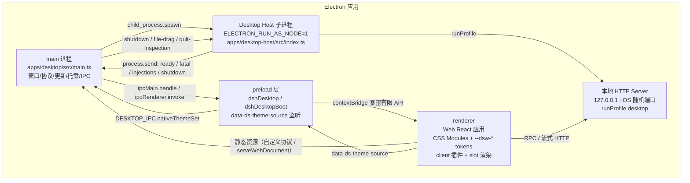

# DSH v0.2.3-alpha.2 插件、主题、UI 与开放性拆解

> 分析对象：`deepseek-harness-dsh-v0.2.3-alpha.2`（只读源码）
> 目的：为 WitCode「抄 DSH 的插件、主题、开放性」提供可落地的结构、格式、流程与 token 清单。
> 所有代码位置均为 DSH 源码根目录下的相对路径加行号，例如 `apps/desktop/src/main.ts:536`。未找到证据处明确写「未找到明确实现」。

## 1. 一句话定位

DSH 是一个「Cordis 插件内核 + 本地 HTTP Host + Web/React 前端 + Electron 外壳」的四层应用：真正的产品能力都装在可热换的 bundle 插件里，UI 由 CSS 变量 token sheets 统一着色、由 typed slot 系统拼装，第三方扩展通过 `ctx` 服务与 slot 注入同一份前端；文档用 `.i18n.yaml` 做双语一致性校验，运行时用 `locale/*.json` 与 TS 字典做界面翻译，配置以 `$DSH_HOME` 下分层 YAML patch 为公开契约。

对 WitCode 而言，最值得抄的不是某一行代码，而是三条设计纪律：**（a）配置/插件/主题全部是数据驱动的分层覆盖；（b）UI 只允许消费语义 token，不允许组件私藏颜色；（c）主题、插件、语言包都是可插拔的运行时注册，而不是编译期硬编码。**

## 2. 桌面与 Web 技术栈

### 2.1 版本与依赖事实

| 层 | 技术 | 证据 |
|---|---|---|
| Electron 主进程 | Electron `^44.11.5`、electron-builder `^26.17.0`、electron-updater `^6.8.9` | `apps/desktop/package.json:76`、`apps/desktop/package.json:77`、`apps/desktop/package.json:51` |
| 渲染框架 | React `^18.2.0` + react-dom、Vite `^6.4.3`、`@vitejs/plugin-react ^4.7.0` | `apps/desktop/package.json:87`、`apps/desktop/package.json:89`、`apps/web/package.json` |
| 前端入口 | `apps/web` 仅保留 `index.html` 与极薄的 `src/main.ts`，真正 shell 来自库 `@deepseek-ai/dsh-client-web`；`dist/` 由 `dsh web` 提供 | `apps/web/package.json` 的 description、`apps/web/index.html`、`apps/web/src/main.ts` |
| 插件内核 | Cordis（服务注入 / 事件 / 生命周期）、`@deepseek-ai/schemastery` 配置 schema、`zod 4.6.6` | `packages/client/ui-theme/src/theme-settings.ts:3`、`apps/desktop/package.json` devDeps |
| 样式 | CSS Modules + `clsx`；**明确不引入组件库或 Tailwind** | `docs/web-styling.md:17` |
| 打包 | 根脚本 `build:lib:host` / `build:lib:client` / `build:web` / `build:desktop`；桌面用 tsdown bundle + electron-builder | `package.json:26`–`package.json:30` |
| 产物形态 | macOS `dmg` + `zip`；Windows `nsis` 安装器（自研 NSIS 脚本）；Linux `AppImage`；`asar: true` | `apps/desktop/scripts/electron-builder-config.mjs:125`、`:183`、`:255`、`:259` |

### 2.2 Web 与 Desktop 的关系

Web 前端是**唯一的前端实现**，Desktop 只是把同一份打包后的 Web 资源装进 Electron 窗口：主进程通过 `serveWebDocument()` 直接从本地 dist 读静态资源，并把 index 注入一段 `__DSH_BOOT_READY__ Promise.withResolvers()` 引导脚本 (`apps/desktop/src/web-document.ts:18`)。所有业务流量走本地回环 HTTP：`forwardWebRequest()` 把请求转发给 Host，并刻意剥离 `set-cookie` 等 Node 传输头 (`apps/desktop/src/web-document.ts:83`)。

因此 DSH 的「桌面 UI」与「Web UI」不是两套代码，而是同一 React 应用分别跑在浏览器和 Electron renderer 中；平台差异靠 preload 暴露的 `window.dshDesktop` 与 `<html data-platform>` 表达 (`apps/desktop/src/preload-app.ts:128`、`apps/desktop/src/preload-platform.ts:10`)。

## 3. 进程模型

按源码可确认的切分：

- **主进程（main）**：`apps/desktop/src/main.ts` 拥有 BrowserWindow、单实例、协议 `SCHEME`、托盘、更新、快捷键、文件拖拽与原生菜单；通过 `ipcMain.handle` 暴露 `DESKTOP_IPC` 频道，并对渲染进程来源做 `assertDesktopSender(event, ['app'])` 校验 (`apps/desktop/src/main.ts:827`、`apps/desktop/src/main.ts:509`)。频道表见 `apps/desktop/src/ipc.ts:12`，`boot` 在 `:21`。
- **Desktop Host（独立 Node 子进程）**：`apps/desktop/src/main.ts:536` 用 `DesktopHostProcess` 启动；Host 入口 `apps/desktop-host/src/index.ts` 在 Electron Node 模式下调用 `runProfile({ profile: 'desktop', args: ['--no-open', '--host', '127.0.0.1', '--port', '0'] })` (`apps/desktop-host/src/index.ts:48`、`:53`)。**这就是「本地 server」**：监听 127.0.0.1、端口由 OS 分配（0），URL 只允许 `http(s)://127.0.0.1/` 且无 userinfo/query (`apps/desktop/src/host-process.ts:69`)。
- **renderer**：加载打包的 Web 资源，等 boot injections 到达后在同一 document 激活 client 插件；RPC 与流式响应归 Web 层，Desktop 只是「把本地页面接到已认证 Host 的载体」(`docs/architecture.md:53`)。
- **preload**：`contextBridge.exposeInMainWorld` 暴露有限 API（boot、目录选择、host paths、locale、product API）(`apps/desktop/src/preload-app.ts:113`、`apps/desktop/src/preload-app.ts:128`)；`syncNativeTheme()` 监听 `<html data-ds-theme-source>` 并转发到主进程的 `nativeTheme.themeSource` (`apps/desktop/src/preload-theme.ts:18`、`apps/desktop/src/ipc.ts:43`)。
- **IPC 方式**：main ↔ Host 用 Node `process.send` 事件（ready / fatal / platform-session / starting / shutdown-complete / 控制请求带 requestId）(`apps/desktop-host/src/index.ts:24`、`:168`)；main ↔ renderer 用 Electron IPC（`ipcRenderer.invoke` + `contextBridge`）；renderer ↔ Host 业务数据用回环 HTTP/RPC。



要点：**Host 不是 Electron 的 utilityProcess，而是通过 Node IPC 通信的独立进程；业务 server 在 Host 内，renderer 从不直连主进程拿业务数据。**

## 4. 主题系统

### 4.1 真实位置与职责切分

主题系统**不在** `apps/desktop`，而在 `packages/client/ui-theme` 与 `packages/client/ui-layout`：

| 文件 | 职责 |
|---|---|
| `packages/client/ui-theme/src/theme-settings.ts:6` | 偏好枚举 `light / dark / system`，命名空间 `ui-theme`，三种字号角色与范围 |
| `packages/client/ui-theme/src/client/index.ts:73` | `ThemeDefinition`（id / colorScheme / tokens / icons） |
| `packages/client/ui-theme/src/client/index.ts:100` | `ThemeSnapshot`（preference / fontSizes / fontFamilies / active / themes / revision） |
| `packages/client/ui-theme/src/client/index.ts:181` | `ThemeRuntime`：注册表 + 覆盖层 + 发布不可变快照 |
| `packages/client/ui-theme/src/client/index.ts:258` | `setTheme(id)` 唯一用户偏好写入口 |
| `packages/client/ui-theme/src/client/index.ts:354` | `register(definition)` 注册第三方主题，重复 id 抛错，返回 disposer |
| `packages/client/ui-theme/src/client/index.ts:388` | `overrideTokens(source, tokens)` 按来源叠加 token 层，后注册者胜 |
| `packages/client/ui-layout/src/client/theme-presenter.ts:81` | 把快照投影到 DOM（唯一写 DOM 的地方） |
| `packages/client/ui-theme/src/boot-theme.ts:55` | Host 端把首帧调色板/字号注入 index，避免闪白 |

关键设计：**服务层不碰 DOM，presenter 不持有 React**。`ThemeRuntime` 只发布不可变快照并 emit `ctx.theme/change`；`ThemePresenter.apply()` 负责写 `html { color-scheme }`、`body[data-ds-dark-theme]`、`--dsh-*` 字号/字体变量和 `meta[name=theme-color]`，且只回收自己写过的属性 (`packages/client/ui-layout/src/client/theme-presenter.ts:17`、`:97`)。

### 4.2 token 结构

token 分三层，全部是 CSS 自定义属性：

1. **静态色阶 `--dsw-static-*`**：品牌色、蓝/绿/红/中性灰阶，如 `--dsw-static-blue-500: rgb(59, 130, 246)` (`packages/client/ui-theme/src/styles/design-platform.css:14`)。组件**禁止**直接引用静态色。
2. **语义别名 `--dsw-alias-*`**：`--dsw-alias-bg-base`、`--dsw-alias-border-l1`、`--dsw-alias-brand-primary`、`--dsw-alias-label-primary`、`--dsw-alias-state-error-primary`、`--dsw-specific-sidebar-fill` 等，每个都必须有 light/dark 两套值 (`packages/client/ui-theme/src/client/index.ts:154`、`:203`)。
3. **组件专用 `--dsw-specific-*`** 与字号/字体轴 `--dsh-content-font-size`、`--dsh-code-font-size`、`--dsh-terminal-font-size`、`--dsh-font-family-<role>`。圆角与字体栈定义在 `packages/client/ui-theme/src/styles/base.css:7`、`:18`，字号阶梯在 `gradient-shadow-text.css`。

八张全局 sheet 按固定顺序导入：`base.css`、`corner-shape.css`、`design-platform.css`、`focus.css`、`onboarding.css`、`scrollbar.css`、`gradient-shadow-text.css`、`shiki.css` (`packages/client/ui-theme/src/client/styles.ts:3`–`:10`)。

字号 schema 用 schemastery 约束为整数 px：正文 10–22（默认 14）、代码 10–16（默认 11）、终端 10–20（默认 13）(`packages/client/ui-theme/src/theme-settings.ts:57`、`:139`)。字体族输入会被归一化：去引号/反斜杠/控制字符，非 CSS 通用族名自动加双引号 (`:164`)。

### 4.3 运行时切换与第三方主题

- `system` 通过 `matchMedia('(prefers-color-scheme: dark)')` 解析；OS 变化且偏好为 `system` 时重发快照 (`packages/client/ui-theme/src/client/index.ts:207`、`:211`)。
- `register()` 会把 `icons` 校验后冻结，返回 disposer；若当前偏好正好是被注销主题，回退到默认 `system` (`:354`)。
- `overrideTokens(source, { token: { light, dark } })` 是 token 级的叠加：基础主题不动，按 seq 顺序折叠，同 source 再调用会替换整层；传裸字符串会报教学式错误 (`:388`)。
- 第三方主题**只有进程内注册这一种方式**，未找到「独立 npm 主题包 / 主题文件自动发现 / 主题市场」的明确实现；README 也把它定性为「extension point, not a product」(`packages/client/ui-theme/README.md` 的 Known Limitations)。

### 4.4 最小主题结构示例（按 DSH 源码类型整理）

```ts
// 取自 packages/client/ui-theme/src/client/index.ts:54-97 的结构，简化示意
interface ThemeDefinition {
  id: string                       // setTheme(id) 的参数；'system' 是保留偏好，不可注册
  colorScheme: 'light' | 'dark'    // presenter 据此切换 body[data-ds-dark-theme]
  tokens: Record<string, string>   // --dsw-alias-* 覆盖值
  icons?: Record<string, string>   // ICON_SYMBOLS id -> 完整 SVG 文档
}

// 按 source 叠加的 token 层（packages/client/ui-theme/src/client/index.ts:62-70）
type ThemeTokenOverrides = Record<string, { light: string; dark: string }>

const brandTheme: ThemeDefinition = {
  id: 'witcode-brand',
  colorScheme: 'dark',
  tokens: {
    '--dsw-alias-brand-primary': 'rgb(65, 118, 230)',
    '--dsw-alias-bg-base': 'rgb(21, 21, 23)',
  },
}
ctx.theme.register(brandTheme)                       // 返回 disposer
ctx.theme.overrideTokens('witcode-runtime', {
  '--dsw-alias-state-warn-primary': { light: 'rgb(247,173,49)', dark: 'rgb(247,173,49)' },
})
ctx.theme.setTheme('witcode-brand')                  // 写入 ui-theme.preference 并 emit theme/change
```

暗色模式实现要点：`body[data-ds-dark-theme]` 只由 `active.colorScheme` 决定，**永不从 id 推断**；`html[data-ds-theme-source]` 供 Electron preload 镜像到 `nativeTheme`；首帧靠 Host 注入的 `<style>` + body 脚本提前设定 (`packages/client/ui-theme/src/boot-theme.ts:20`、`:42`)。

## 5. 插件 / 扩展模型

### 5.1 `packages/extensions` 到底扩展什么

它**不是**用户插件的主体。该组提供：只读的运行时 API 发现工具 `tool-cordis`、Host/Client 两端的「动态插件运行器」`cordis-host-runner` / `cordis-client-runner`（供模型在进程内临时生成 Cordis 插件）、UI 面板 `ui-cordis`、以及显式需求驱动的 `creation-recommendations` / `plugin-recommendations` (`packages/extensions/README.md`)。

**真正的持久化插件管理在 `packages/boot/plugin-manager`**：安装/卸载/启停 bundle、选版本、改 profile patch，Web 侧 `ui-plugin-manager` 与 `plugin_manager` 工具共用同一服务 (`packages/boot/plugin-manager/README.md:74`、`:91`)。

### 5.2 清单字段表

包作者侧，字段全部写在 `package.json` 的 `dsh` 键下，类型定义在 `packages/util/package-manifest/src/types.ts`：

| 字段 | 类型 | 含义 | 位置 |
|---|---|---|---|
| `manifestVersion` | `1` | manifest 格式版本，独立于 npm 版本 | `packages/util/package-manifest/src/types.ts:33` |
| `bundle.patch` | `string \| string[]` | bundle 贡献的 Cordis patch 文件；多文件按顺序作为一层应用 | `:71`–`:78` |
| `bundle.platforms` | `string[]` | 支持的 Node Host 平台，缺省=全部 | `:73` |
| `bundle.listedByDefault` | `boolean` | 是否在 GUI 默认列表出现 | `:77` |
| `profile.bundles` | `string[]` | profile 侧的**有序** bundle 列表 | `:81`–`:84` |
| `client.platform` | `string` | client 模块声明（Web 侧选 `web`） | `:87`–`:100` |
| `engines.dsh` | SemVer range | DSH 版本兼容范围 | `:59`–`:68` |
| `icon` | 相对路径 | SVG/PNG/JPEG/WebP，≤256 KiB | `:15`–`:16` |

插件目录的最小结构由教程给出：`package.json`（`dsh.bundle`）+ `cordis.patch.yml` + `index.js` (`docs/user/develop/basic/publish.md:13`、`:28`、`:42`)。patch 是 YAML 数组，行是 `- insert: [{ id, name }]`，`name` 用 npm 包名而不是相对路径 (`apps/web/tests/fixtures/plugins/fixture-bundle/cordis.patch.yml`)。

profile 侧启用/禁用规则：toggle 只改 `cordis.patch.yml` 中**最后一个匹配条目**的 `disabled: true/false`，没有则追加；只有 `id + disabled` 且 bundle 层已给出目标状态的覆盖会被删掉；bundle 开关改的是 `package.json` 的 `dsh.profile.bundles` 顺序 (`packages/boot/plugin-manager/README.md:100`)。

### 5.3 发现路径与加载顺序

配置在空根之上按序合成 (`apps/cli/README.md:42`–`:46`、`docs/user/develop/basic/publish.md:120`–`:128`)：

1. `dsh.profile.bundles` 中每个 bundle 的 patch，按列表顺序（内置 base 先）；
2. profile 自己的 `cordis.patch.yml`；
3. 全局 `$DSH_HOME/cordis.patch.yml`；
4. 命令行 `--patch` 覆盖层（argv 顺序）。

后层按 row 覆盖前层，**整块替换 config 而非深合并**。bundle 优先从 DSH 安装目录解析（`dsh-base`、`dsh-web-app`、`dsh-headless`、`dsh-sdk-app`、`dsh-sdk-minimal`、`dsh-acp-app`），其次 profile 自己的 `node_modules` (`apps/cli/README.md:48`)。

### 5.4 生命周期与版本约束

- 插件本体是导出 `name` / `inject` / `apply(ctx)` 的 ESM 模块；`ctx.effect()` 的 disposer 统一回收监听 (`packages/extensions/creation-recommendations/src/index.ts:29`、`:60`、`:106`)。
- 安装/启动前校验 `engines.dsh` 或 peer 范围，不匹配直接拒绝；需要用户显式确认的「版本豁免」存在 `profile/compatibility.json`，精确到 `package@version` × DSH 运行时版本 (`packages/boot/plugin-manager/README.md:139`–`:145`)。
- 变更结果有 `application: applied | restart-required | overridden | failed | cancelled` 与 `restartReason: no-hmr | package-moved | host-module | unmanaged-plugin | module-comparison` (`packages/boot/plugin-manager/src/types.ts:52`、`:171`)。
- HMR 开启时保存即重组合；无 HMR 时返回 `restart-required` (`packages/boot/plugin-manager/README.md:91`)。

### 5.5 与 skill 的区别

| 维度 | bundle 插件 | skill |
|---|---|---|
| 单位 | npm 包 + Cordis patch 层 + 可运行 JS | 一段任务指令（Markdown），可由本地目录、插件内嵌、远程 provider 提供 |
| 注册 | profile manifest + `cordis.patch.yml` | `ctx.skills.registerProvider()` / `ctx.skills.register()` |
| 能力 | 改运行时：注册服务、工具、UI slot、快捷键 | 只进模型上下文：`modelInvocable` / `userInvocable` 控制是否对模型/用户可见 |
| 安装 | `dsh plugin add` / 市场，pnpm 管理依赖 | 文件系统发现或插件内嵌，无 pnpm |
| 证据 | `docs/user/develop/basic/publish.md:13` | `packages/skill/skill/README.md`、`packages/skill/skill/src/index.ts` |

一句话：**插件改「程序怎么跑」，skill 改「模型知道怎么做」。**

## 6. 插件市场生成器

### 6.1 输入 → 输出

- 输入：纯文本清单，一行一个 npm 包名或 HTTPS Git 仓库 URL，`#` 开头为注释 (`apps/plugin-market-generator/README.md` Usage)。示例源见 README。
- 输出：单个 `index.json`（format 1）+ 大图标落到输出目录旁的 `icons/`；缓存放在 `.plugin-market-cache`，**不发布** (`apps/plugin-market-generator/src/cli.ts:48`–`:52`、`apps/plugin-market-generator/src/generate.ts:59`)。
- 运行：`pnpm --filter @deepseek-ai/dsh-plugin-market-generator start --input plugins.txt --output site/index.json --title "Example Market"`。
- 发布：把输出目录挂到 HTTPS 静态站点，再把 `index.json` URL 加为 Discover 的 index source。**未找到内置的一键发布/上传命令**。
- 安全约束：只下载和读文件、从不执行包代码；tarball 校验 integrity、限 64 MiB；Git 以 depth-1 裸仓库读 blob，不建工作树 (`apps/plugin-market-generator/README.md` Security)。

### 6.2 schema（format 1）

权威类型在 `packages/util/plugin-market-index/src/types.ts`：

```ts
// packages/util/plugin-market-index/src/types.ts:97-103
interface MarketIndex {
  format: 1
  title: LocalizedText                  // string 或 { en: string, [locale]: string }
  description?: LocalizedText
  metadata: { categories, labels, sortKeys }   // 市场级声明
  plugins: MarketPlugin[]               // 默认顺序
}
// :78-93
interface MarketPlugin {
  name: string                          // npm 包名，index 内唯一
  title?, description?, icon?, author?, homepage?
  repository?: { url: string; directory?: string }
  metadata: { category?, keywords: string[], labels: string[], sortKeys: Record<string, number> }
  versions: MarketVersion[]             // 非空，按 SemVer 降序
}
// :68-75 / :45-59
interface MarketVersion {
  version: string                       // 精确 SemVer
  publishTimestamp: number              // Unix 秒
  source: { type:'npm'; registry? } | { type:'git'; url; commit; path? }
  engines: { dsh?: string }
}
```

安装参数由 `marketInstallTarget(name, version)` 生成：npm → `name@version`（可带 registry），Git → commit 固定的 `git+https` URL 加可选 `path:` (`packages/util/plugin-market-index/README.md` API)。

### 6.3 校验与关键代码位置

- 生成后强制调用 `parseMarketIndex(index, VALIDATION_URL)`，校验失败即抛 `MarketIndexError` 带 JSON 路径 (`apps/plugin-market-generator/src/generate.ts:375`)；候选源行也先用同一解析器试探 (`apps/plugin-market-generator/src/sources.ts:6`)。
- 每个条目在写缓存前单独验证 (`apps/plugin-market-generator/src/generate.ts:76`–`:80`)。
- 输出用 `writeIfChanged()` 原子写，内容不变就不重写 (`apps/plugin-market-generator/src/cli.ts:90`、`apps/plugin-market-generator/src/files.ts:12`)。
- 指标：`GITHUB_TOKEN` 决定 `github_stars`，npm `last-week` 决定 `npm_weekly_downloads`，失败只告警不丢插件 (`apps/plugin-market-generator/README.md`)。

产物结构示意：

```
site/
├── index.json        // format:1，plugins[]，含每个 version 的 source/engines
└── icons/
    └── <hash>.svg    // 超过 --inline-icon-bytes(默认 16KiB) 的图标
.plugin-market-cache/ // 不入发布目录
```

## 7. i18n 体系

### 7.1 两套完全不同、不要混淆的 i18n

**（A）`.i18n.yaml`：文档双语一致性记录，不是翻译字典。**

它是 `foo.md` / `foo.zh.md` / `foo.i18n.yaml` 三件套的第三件，按英文标题 slug 记录每个小节英文块与中文块的哈希 (`docs/i18n/README.md:10`–`:11`)：

```yaml
# BRAND_GUIDELINES.i18n.yaml:1-6
# Bilingual-pair consistency record for BRAND_GUIDELINES.md ...
/deepseek-harness-brand-asset-usage-guidelines:
  en: 23933888033edf18
  zh: eaa5afb9e2cb4d25
```

生成/校验流程：编辑任一语言 → 同步另一语言 → `pnpm run verify-translation-pairing --write <pair>` 重记哈希；CI 的 `doc-sync` 全量校验 (`docs/i18n/README.md:20`–`:28`)。**源语言：两种语言权力相等**，可任一语言先写 (`docs/i18n/README.md:6`)。

**（B）运行时 i18n：TS 字典 + `locale/*.json` 展示元数据。**

- 用户界面文案写在 `src/client/locales.ts`，以 **中文为 key 集事实来源**，英文按该 key 集做完整性检查 (`packages/client/ui-theme/src/client/locales.ts:3`、`:33`、`:62`)。
- 插件注册：`ctx.locale.register('settings.theme', { zh, en, ja, es, fr, de, ru, pt })` (`packages/client/ui-theme/src/client/index.ts:606`)；语言包插件用 `ctx.locale.addLanguage({ id, label, fallback })` + `ctx.locale.register(ns, 'it', {...})` (`packages/client/locale/README.md` 的 Registering a language pack)。
- `locale/<lang>.json`（如 `packages/client/ui-theme/locale/en.json`）只承载插件市场展示用的 `meta.title` / `meta.description` / `meta.detail`，不是 UI 文案字典。
- 内置语言：`en / zh / ja / es / fr / de / ru / pt`；偏好存在 `locale.preference`，缺省时按 `navigator.languages` 全 tag → 主 subtag → 英文推断 (`packages/client/locale/README.md` Summary)。
- **缺失 key 行为**：沿当前语言的 fallback 链查本 namespace，再查 `common` namespace，再直接显示 key 本身 (`packages/client/locale/README.md:68`)。
- 校验：`pnpm run check:i18n` 拒绝零宽空格 U+200B 与 BOM；`verify-client-ui-i18n` 强制一方 UI 文案必须走 typed 字典。

示例文件结构：

```ts
// packages/client/ui-theme/src/client/locales.ts:4-5
export const zh = {
  'appearance.title': '外观',
  'appearance.dark': '深色',
} satisfies Record<string, string>
export type ThemeKey = keyof typeof zh   // key 联合由中文推导
export const en = { 'appearance.title': 'Appearance', 'appearance.dark': 'Dark' }
  satisfies Record<ThemeKey, string>      // 缺 key 直接编译失败
```

### 7.2 能否直接搬到 WitCode

- **思路可直接搬**：typed namespace 字典（`zh` 为 key 源、其他语言 `satisfies Record<Key,string>`）+ 显式 fallback 链 + 「缺 key 显示 key」；ZCode 目前无等价机制，值得抄。
- `.i18n.yaml` 只对「维护中英双语文档」的仓库有意义：若 WitCode 文档也要双语，直接抄三件套 + `verify-translation-pairing` 脚本；若只维护中文文档，此项**不适合**。
- 需自研的点：`ctx.locale` 依赖 Cordis 的声明合并与 slot 系统，WitCode 需换成自己的 i18n provider；`locale/<lang>.json` 的 `meta.detail` 约定可原样用于市场卡片。

## 8. 配置与开放性清单

### 8.1 用户配置目录

`$DSH_HOME` 未设置时为 `~/.dsh` (`docs/user/session-control.md:28`)。关键路径：

| 路径 | 内容 |
|---|---|
| `$DSH_HOME/profiles/<name>/package.json` | profile 清单：`dsh.profile.bundles` 有序列表 + 外部依赖 |
| `$DSH_HOME/profiles/<name>/cordis.patch.yml` | profile 用户 patch 层 |
| `$DSH_HOME/cordis.patch.yml` | 本机所有 profile 共享的用户 patch (`docs/user/develop/basic/publish.md:126`) |
| `$DSH_HOME/.env` | 代理/API key 等环境变量；项目自己的 `.env` 不生效 (`docs/user/guide/network-proxy.md:14`) |
| `$DSH_HOME/.credentials.yaml` | 密钥只写，settings 只保留引用 (`docs/user/guide/providers.md:13`) |
| `$DSH_HOME/profiles/<name>/compatibility.json` | 版本豁免 (`packages/boot/plugin-manager/README.md:141`) |
| `$DSH_HOME/profiles/desktop` | Electron 独占 profile，CLI 拒绝直接启动 (`apps/cli/README.md:17`) |

配置 schema 用 schemastery 声明；`docs/config-catalog.md` 由 `scripts/gen-config-catalog.ts` 从每个插件 `apply`/服务的 `Config` 类型**自动生成**，并用 `pnpm run verify-config-catalog` 保证新鲜度 (`docs/config-catalog.md:1`–`:7`)。运行时还提供 `--dump-config` / `--dump-config-schema` (`apps/cli/README.md:50`)。

### 8.2 开放性清单（公开契约 vs 内部实现）

**公开契约（文档化、可依赖）**

1. `package.json.dsh.bundle.patch` / `dsh.profile.bundles` /
   `engines.dsh` — 打包与安装契约 (`packages/util/package-manifest/src/types.ts:32`、`:71`、`:81`、`:59`)。
2. Cordis patch DSL：`insert` / `id` / `name` / `disabled` / `config` — 用户可手写 (`docs/user/develop/basic/publish.md:56`)。
3. `ctx` 服务键（如 `ctx.theme`、`ctx.slots`、`ctx.locale`、`ctx.skills`、`ctx.tools`）与事件 `theme/change`、`locale/change` — 插件编写契约。
4. `--dsw-alias-*`、`--dsw-static-*`、`--dsw-specific-*` 与 `--dsh-*` 字号变量 — 主题/样式契约 (`docs/web-styling.md`)。
5. `ui-theme`、`locale` settings namespace 与字段（preference、fontSize 等）— 跨重启持久化契约 (`packages/client/ui-theme/src/theme-settings.ts:92`)。
6. `.zcode-plugin`-对应的 DSH 市场 index format 1（`format/title/plugins/versions`）— 市场互操作契约 (`packages/util/plugin-market-index/src/types.ts:97`)。
7. `meta.title/description/detail` 与 `locale/<lang>.json` — 插件展示契约 (`packages/util/plugin-detail/README.md` Document order)。
8. `dsh plugin` / `dsh --profile` / `--patch` / `--dump-config-schema` — CLI 契约 (`apps/cli/README.md`)。
9. `BRAND_GUIDELINES.md`：第三方项目可用 "built on DeepSeek Harness"，但不应把 "DeepSeek Harness" 直接放进项目名，建议缩写 "DSH" (`BRAND_GUIDELINES.md`)。
10. 市场 index 生成器不执行包代码、Git 只读、密钥不写入产物 — 发布者安全契约 (`apps/plugin-market-generator/README.md` Security)。

**内部实现（不承诺稳定）**

- `DESKTOP_IPC` 频道名、`__DSH_BOOT_READY__`、`dshDesktop` 全局对象形状 (`apps/desktop/src/ipc.ts:12`)。
- preload 暴露的 `dshDesktopBoot`、`dshPlatform` 等全局名 (`apps/desktop/src/preload-app.ts:113`)。
- `ThemeRuntime` / `SlotCore` / `LocaleRuntime` 的具体类方法与内部 seq/disposer 语义（服务接口公开，类实现细节不公开）。
- `.i18n.yaml` 的哈希算法与 `translation-pairing.manifest.json` 清单 — 仓库维护工具，非产品 API。
- `.plugin-manager/run.json`、缓存目录布局、临时裸仓库路径 — 运维细节 (`packages/boot/plugin-manager/README.md` Implementation internals)。
- 第三方主题「进程内注册」虽公开为扩展点，但**没有**主题包文件格式、发现路径或市场 — 属于「半开放」。

## 9. UI 组件与样式方案

### 9.1 共享组件库

有，但**不是第三方 UI 库**：`packages/client/ui-primitives` 是零 Cordis 依赖的 React 原子组件库，提供 `Button`、`Switch`、`SegmentedControl`、`Checkbox`、`Input`、`Menu`、`Modal`、`Tooltip`、`Toast`、`SettingsForm`、`JsonTree`、`MarkdownText`、`CodeBlock`、`TerminalBlock`、图标等 (`packages/client/ui-primitives/README.md` Component catalog 起于 `:103`)。规则很硬：**跨功能包共享控件只有这一处**，不允许第二个包复制同名控件；视觉差异要提升为该包的 prop (`packages/client/ui-primitives/README.md:103`)。

### 9.2 样式方案

- **CSS Modules + clsx，明确禁止 Tailwind 和新增组件库** (`docs/web-styling.md:17`)。组件样式与组件同目录，如 `packages/client/ui-chat/src/client/chat/ChatView.tsx` 配 `ChatView.module.css`。
- 全局样式只允许放在 `packages/client/ui-theme/src/styles/`；功能包只消费 `--dsw-alias-*`，**不得写十六进制/颜色函数/white/black/静态色阶**，有专门的 color-token 规范检查 (`docs/web-styling.md`)。
- 圆角统一标准见 `docs/ui-radius.md`；焦点环 `--dsw-focus-ring-color`（亮 `#4176E6` / 暗 `#7AAAFF`）与 `--dsw-focus-ring-width: 2px` 在 `focus.css`；滚动条用 `@property` 注册 `--dsh-scrollbar-thumb` 实现可过渡重绑定。

### 9.3 UI 扩展机制：typed slot

`packages/client/ui-slots` 是 React-free 的 slot 核心，`ui-renderer` 才把它接成 React 渲染。插件通过 `ctx.slots.register(...)` / `ctx.slots.inject('settings.general.item', ...)` 把组件挂到父级声明的区域；五种形态 `single / list / keyed / chain / hoc`，类型由声明合并推导，未声明的 slot 在加载期直接报错 (`packages/client/ui-slots/README.md` Use this package / Declaration discipline)。主题设置页就是靠 `ctx.slots.inject('settings.general.item', ...)` 插进去的 (`packages/client/ui-theme/src/client/index.ts:630`、`:639`)。

对比：DSH 的 UI 扩展是**同一 React 树内的类型化插槽**；ZCode 是**独立 HTML 页面走 MCP Apps 协议**（见第 10 节）。

## 10. 与 ZCode 的机制对比表

| 机制 | DSH（本分析对象） | ZCode 4.0.0 | 结论 |
|---|---|---|---|
| 主题 | `ui-theme` + `ui-layout`；`--dsw-*` CSS 变量 + `body[data-ds-dark-theme]`；`ctx.theme.register/overrideTokens`，进程内可插拔 | `packages/ui/src/`、`packages/design-runtime/src/contract.ts` 以页面内注入、CSS 变量预览与元素检查为主；未找到面向第三方的主题包契约 | DSH 的主题契约更完整、更适合抄；ZCode 的 design-runtime 只服务浏览器设计工具 |
| 插件形态 | npm bundle + `cordis.patch.yml`；Cordis `ctx` 服务注入；`ctx.slots` 类型化 UI 插槽；`engines.dsh` 版本门槛 | 清单 `.zcode-plugin/plugin.json` + `extension` 键；`@zcode-dev/plugin-api` 纯类型包，`extension.engines.zcode` 门槛；MCP stdio server | 两者都是「清单 + 效果范围 + 版本约束」；DSH 更偏进程内服务，ZCode 更偏 MCP 工具与页面 |
| UI 扩展 | 同一 React 应用内的 slot/Component Factory，CSS Modules | UI Plugin：MCP Apps `_meta.ui.resourceUri` + `ui.surfaces`，页面通过 `app.callServerTool()` / `updateModelContext()` 与宿主通信；仅 Desktop 本地工作区支持 (`ZCode-4.0.0/UI_PLUGIN.md:16`、`:296`) | **不可直接互抄**：ZCode 是 iframe/沙箱页面模型，DSH 是同文档组件模型 |
| i18n | 中文为 key 源的 typed 字典 + fallback 链；`locale/*.json` 只做展示元数据；`.i18n.yaml` 是文档哈希 | `packages/ui/src/i18n/locales/`（如 `en-US.ts`）内置字典；未找到同等 typed namespace + fallback 链公开契约 | DSH 的「插件可注册语言包」更开放，值得抄 |
| 市场 | 参考生成器 → 静态 `index.json` format 1 → Discover 按 URL 读取；校验库 `dsh-plugin-market-index` | 普通插件市场 + `.zcode-plugin/plugin.json` 安装清单（UI_PLUGIN 沿用普通插件流程） | DSH 的「静态 JSON + 强校验 + 无代码执行」生成器是独立可抄组件 |
| 配置 | `$DSH_HOME` 分层 YAML patch + schemastery + 自动生成的 config catalog | ZCode 配置/清单走 extension host；具体映射未深挖 | 分层 patch 与「后层整块替换 config」是 DSH 的关键差异 |

## 11. 可抄清单（12+ 项，三档）

### A. 直接抄结构

1. **主题 token 三层体系**（`--dsw-static-*` / `--dsw-alias-*` / `--dsw-specific-*`）——位置 `packages/client/ui-theme/src/styles/design-platform.css:14`、`docs/web-styling.md:17`。WitCode 落点：新建 `design-tokens` 包，强制业务 CSS 只引用 alias 层。
2. **ThemeDefinition / ThemeSnapshot / ThemeRuntime**——`packages/client/ui-theme/src/client/index.ts:73`、`:100`、`:181`。落点：WitCode 的主题服务，保留 `register/overrideTokens/setTheme` 与 disposer 语义。
3. **主题 presenter 与 DOM 解耦**——`packages/client/ui-layout/src/client/theme-presenter.ts:81`。落点：独立 `applyTheme(snapshot)`，只写自己拥有过的属性，卸载可回收。
4. **首帧无闪白 bootstrap**——`packages/client/ui-theme/src/boot-theme.ts:20`、`:42`。落点：WitCode 启动 HTML 注入相同的最小 CSS + body 脚本。
5. **三角色字号/字体 schema**——`packages/client/ui-theme/src/theme-settings.ts:57`、`:139`、`:164`。落点：设置页 schema 用整数 px + 范围 + 字体名归一化。
6. **plugin bundle 清单**——`package.json.dsh.bundle.patch` / `dsh.profile.bundles`——`packages/util/package-manifest/src/types.ts:71`、`:81`。落点：WitCode 插件包清单直接采用同名字段。
7. **分层 patch 加载顺序**——`apps/cli/README.md:42`、`docs/user/develop/basic/publish.md:120`。落点：WitCode 配置加载器照抄 bundle → profile → home → CLI overlay 四层。
8. **市场 index format 1 + 校验器**——`packages/util/plugin-market-index/src/types.ts:97`。落点：WitCode 市场直接采用 `format/title/plugins/versions/source/engines` 结构。
9. **市场生成器「只读不执行」安全模型**——`apps/plugin-market-generator/README.md` Security。落点：WitCode 市场抓取器照做 integrity 校验 + 裸仓库只读。
10. **`.i18n.yaml` 三件套文档配对协议**——`docs/i18n/README.md:10`。落点：若 WitCode 文档要中英双语，照抄三件套 + `verify-translation-pairing`。
11. **typed 字典以中文为 key 源**——`packages/client/ui-theme/src/client/locales.ts:3`、`:33`。落点：WitCode i18n 用 `satisfies Record<Key,string>` 做编译期完整性。
12. **slot 的 single/list/keyed/chain/hoc 五形态**——`packages/client/ui-slots/README.md`。落点：WitCode UI 扩展点设计直接采用五种 slot 语义。
13. **插件展示元数据约定**——`meta.title/description/detail` 与 `locale/<lang>.json`——`packages/util/plugin-detail/README.md`。落点：WitCode 市场卡片直接复用。
14. **配置目录公开契约**——`$DSH_HOME/profiles/<name>/cordis.patch.yml` 等——`docs/user/develop/basic/publish.md:126`。落点：WitCode 用户目录命名与分层保持一致，降低迁移成本。

### B. 抄思想重写

15. **`overrideTokens(source, {light,dark})` 按来源叠加**——`packages/client/ui-theme/src/client/index.ts:388`。思想：多个插件各自贡献 token，不互相覆盖；WitCode 需换成自己的注册中心但保留 source 身份与 disposer。
16. **preload 镜像主题到原生 chrome**——`apps/desktop/src/preload-theme.ts:18`。思想：Web 主题要能影响原生窗口外观；WitCode 可用自己的 IPC 频道实现。
17. **`plugin_manager` 服务的变更结果模型**（application/restartReason）——`packages/boot/plugin-manager/src/types.ts:52`、`:171`。思想：插件操作必须报告「是否重启生效」；WitCode 需自建状态机。
18. **版本豁免精确到 `package@version × runtime`**——`packages/boot/plugin-manager/README.md:141`。思想：兼容失败要有显式、可撤销、带风险确认的例外；WitCode 需自建豁免文件。
19. **Cordis patch DSL（insert/disabled/config）**——`docs/user/develop/basic/publish.md:56`。思想：用户可手写的声明式覆盖；WitCode 可换 YAML schema 但保留「行级 id 匹配 + 整块替换」。
20. **`ui-primitives` 单一共享控件库纪律**——`packages/client/ui-primitives/README.md:103`。思想：禁止复制控件；WitCode 需先建组件库再谈插件 UI。
21. **市场指标可选且不作为质量信号**——`apps/plugin-market-generator/README.md`。思想：stars/downloads 只排序不信任；WitCode 市场同样应标注「仅展示」。
22. **首屏 skeleton 与失败可读**——`packages/client/ui-plugin-manager/README.md`。思想：插件列表异步加载要保留缓存与明确错误；WitCode 市场页照此实现。

### C. 不适合直接抄

23. **Cordis `ctx` 声明合并与 `ctx.slots` 类型推导**——`packages/client/ui-slots/README.md`。WitCode 若无 Cordis，硬抄会引入整套插件内核；应改为轻量 provider + 显式类型注册。
24. **Electron Node-mode Host 子进程 + Node IPC**——`apps/desktop-host/src/index.ts:48`。若 WitCode 保持现有 Electron 架构，不宜为抄而重做进程模型；只借鉴「本地 server + 来源校验」。
25. **`.i18n.yaml` 的文档配对门禁**——`docs/i18n/README.md`。若 WitCode 不维护双语文档，此机制只剩维护成本。
26. **第三方主题进程内注册**——`packages/client/ui-theme/README.md` Known Limitations。它是「扩展点不是产品」，没有包格式/市场，WitCode 若要真正主题市场必须自己补文件与发现协议。
27. **ZCode 式 MCP Apps UI Plugin**——`ZCode-4.0.0/UI_PLUGIN.md:296`。与 DSH/WS 的同文档 slot 模型协议不同，不能混用；WitCode 只能二选一。
28. **pnpm 驱动的插件安装/锁文件操作**——`packages/boot/plugin-manager/README.md:130`。WitCode 若用 npm/自有包管理，不能直接复用 `pnpm add` 流程。

## 12. 对 WitCode 的启示

1. **先立契约再谈功能**：DSH 最值钱的是「哪些是可依赖的公开字段、哪些是内部实现」这一明确边界（第 8 节）。WitCode 应先冻结插件清单、主题 token、市场 index、i18n key 四类 schema。
2. **主题不是换颜色，而是三层覆盖体系**：静态色阶只给设计系统用，组件只吃语义 alias，第三方通过 source 叠加层参与。这样主题、品牌定制、运行时动态配色三者不冲突。
3. **UI 扩展要类型化**：DSH 的 slot 在加载期就拒绝未声明/重复声明，比「运行时查询 DOM 挂载点」可靠得多。WitCode 若已有 `packages/plugin-api`，应把 UI slot 纳入同一套 manifest 契约。
4. **市场是静态数据 + 强校验 + 零执行**：生成器只读包 metadata、校验后输出不可变 JSON，是最容易直接抄且风险最低的一块。
5. **i18n 把「文档双语」和「界面文案」彻底分开**：前者用哈希记录保证同步，后者用 typed 字典保证完整；缺 key 显示 key 而不是空字符串。
6. **配置分层要能 `--dump`**：可检查的合成结果与 schema dump 是开放性真正落地的工具，不只是文档。

## 13. 证据索引

| 主题 | 关键证据 |
|---|---|
| 技术栈版本 | `apps/desktop/package.json:76`、`:77`、`:87`、`:89`；`apps/web/package.json`；`package.json:26`–`:30` |
| 进程模型 | `docs/architecture.md:53`；`apps/desktop/src/main.ts:536`、`:827`；`apps/desktop-host/src/index.ts:48`、`:53`、`:168`；`apps/desktop/src/ipc.ts:12`、`:43`；`apps/desktop/src/preload-app.ts:113`、`:128`；`apps/desktop/src/preload-theme.ts:18`；`apps/desktop/src/host-process.ts:69`；`apps/desktop/src/web-document.ts:18`、`:83` |
| 产物形态 | `apps/desktop/scripts/electron-builder-config.mjs:125`、`:183`、`:255`、`:259`、`:274` |
| 主题定义 | `packages/client/ui-theme/src/client/index.ts:54`–`:117`、`:148`、`:181`、`:258`、`:354`、`:388`；`packages/client/ui-theme/src/theme-settings.ts:6`、`:57`、`:92`、`:139`、`:164` |
| 主题应用 | `packages/client/ui-layout/src/client/theme-presenter.ts:17`、`:81`；`packages/client/ui-theme/src/client/styles.ts:3`–`:10`；`packages/client/ui-theme/src/boot-theme.ts:20`、`:42`、`:55` |
| token 样式 | `packages/client/ui-theme/src/styles/design-platform.css:14`、`:177`、`:203`；`packages/client/ui-theme/src/styles/base.css:7`、`:18`；`docs/web-styling.md:17`；`docs/ui-radius.md` |
| 插件模型 | `packages/util/package-manifest/src/types.ts:32`、`:59`、`:71`、`:81`、`:87`；`packages/boot/plugin-manager/src/types.ts:52`、`:73`、`:171`；`packages/boot/plugin-manager/README.md:74`、`:91`、`:100`、`:139`–`:145`；`docs/user/develop/basic/publish.md:13`、`:28`、`:42`、`:120`；`apps/cli/README.md:42`–`:48` |
| extensions vs skill | `packages/extensions/README.md`；`packages/skill/skill/README.md`；`packages/extensions/creation-recommendations/src/index.ts:29`、`:60`、`:106` |
| 市场生成器 | `apps/plugin-market-generator/README.md`（Usage / What gets listed / Caching / Security / Limits）；`apps/plugin-market-generator/src/cli.ts:48`–`:52`、`:90`；`apps/plugin-market-generator/src/generate.ts:76`、`:375`；`apps/plugin-market-generator/src/sources.ts:6`；`apps/plugin-market-generator/src/files.ts:12`；`packages/util/plugin-market-index/src/types.ts:45`、`:68`、`:78`、`:97` |
| i18n | `docs/i18n/README.md:6`、`:10`、`:11`、`:20`；`BRAND_GUIDELINES.i18n.yaml:1`–`:6`；`packages/client/locale/README.md`（Summary / Registering a language pack / :68）；`packages/client/ui-theme/src/client/locales.ts:3`、`:33`；`packages/client/ui-theme/src/client/index.ts:606`；`packages/client/ui-theme/locale/en.json`；`packages/client/locale/src/locale-settings.ts` |
| 配置与开放 | `apps/cli/README.md:17`、`:42`、`:50`；`docs/user/develop/basic/publish.md:126`；`docs/config-catalog.md:1`–`:7`；`docs/user/guide/providers.md:13`；`docs/user/guide/network-proxy.md:14`；`BRAND_GUIDELINES.md` |
| UI 组件与 slot | `packages/client/ui-primitives/README.md:103`；`packages/client/ui-slots/README.md`；`packages/client/ui-theme/src/client/index.ts:630`、`:639`；`packages/client/ui-plugin-manager/README.md` |
| ZCode 对比 | `ZCode-4.0.0/UI_PLUGIN.md:16`、`:296`；`ZCode-4.0.0/packages/plugin-api/README.md`；`ZCode-4.0.0/packages/design-runtime/src/CONTRACT.md` |

> 说明：ZCode 侧证据位于 `D:\Files\Projects\WitCode\resources\src\ZCode-4.0.0`，仅用于对比结论，未做深挖；DSH 侧所有引用均在只读源码中核对。凡本文件未列出的实现细节，一律视为「未找到明确实现」。
