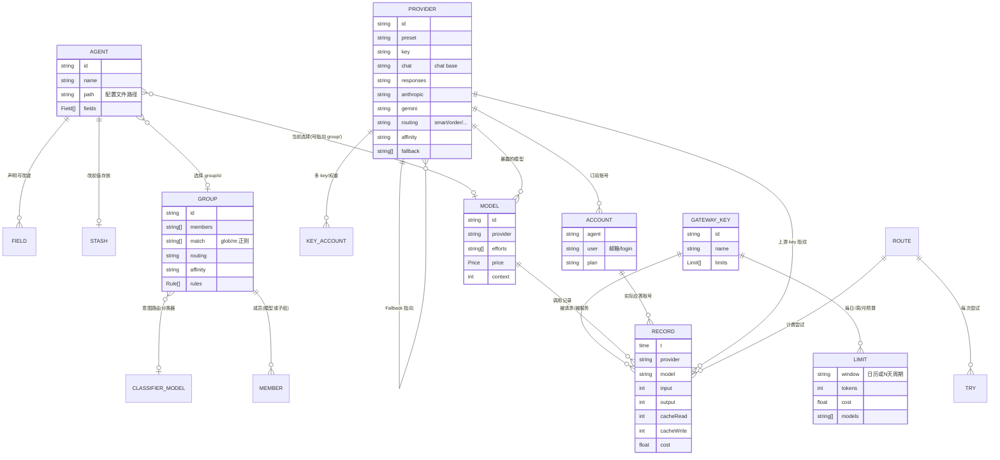
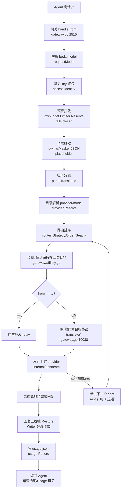
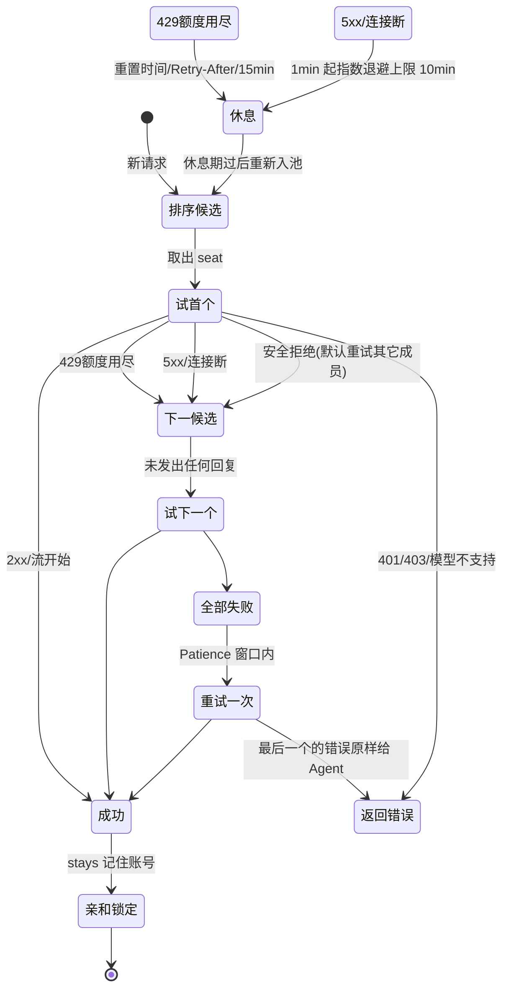
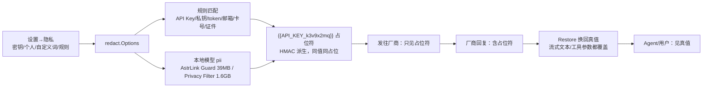

# 03 — Magpie 0.1.4801 模型网关与 Provider 管理拆解

> 分析对象：`D:\Files\Projects\WitCode\resources\src\magpie-0.1.4801`（只读，未做任何修改）
> 视角：为 WitCode 以 ZCode 4.0.0 为基线重构「模型 / Provider 管理」提炼可移植的数据模型、状态机与产品规则。
> 方法：先读 `README.zh-CN.md`、`docs/reference.md`、`docs/subsystems/*.md`、`AGENTS.md`，再用源码逐条核对；文档与代码冲突时以代码为准。不确定处标「待验证」。
> 代码位置格式：`internal/provider/xxx.go:123`。接口一律用 TypeScript 重写表达，不逐行翻译 Go。

---

## 1. 一句话定位

Magpie 是**一台跑在本机的 HTTP 模型网关 + 一个跨 Agent 的模型选择器**：它把「Agent 各自的模型配置」收敛为一张 `provider/model` 表，让 Claude Code / Codex / Gemini CLI / OpenCode 等上百种 Agent 共用同一个本地端点 `127.0.0.1:3425`；网关在四种线协议之间互转、按路由组/账号池分配请求、额度耗尽时透明切到下一个账号，并在请求离机前做本地脱敏。

它本质上是「**Agent 配置适配器 + 协议翻译器 + 路由/配额状态机 + 可拆装插件宿主**」四件事的组合，而不是一个单纯的 API 反代。

---

## 2. 产品模型（ER 图）

核心事实源：`internal/provider/provider.go:51`（Provider）、`internal/provider/account.go:46`（Account）、`internal/provider/group.go:197`（Group）、`internal/catalog/catalog.go:31`（Model）、`internal/agent/agent.go:128`（Agent）、`internal/gateway/trace.go:48`（Route）、`internal/usage/usage.go:30`（Record）、`internal/access/limit.go:26`（Limit）。



要点：

- **Agent 与 Provider 解耦**。Agent 只知道「选了哪个 `provider/model`」，密钥与 URL 从不写进 Agent 配置（`docs/reference.md:355`）。Agent 侧只有 `Field.Get/Set` 这种「一个键」的适配器（`internal/agent/agent.go:101`）。
- **Provider 有两种来源**：用户手填的 key+URL provider，以及「登录过的 Agent 背后的订阅」被反向暴露为 provider（`internal/provider/account.go:3-9`）。后者不存凭据，只读 Agent 自己的文件/钥匙串。
- **Group 是虚拟 Model**。成员是 `provider/model[:effort]` 或嵌套 `group/<id>`，也能用 glob / `re:` 正则按 catalog 动态匹配（`internal/provider/group.go:205-218`），所以目录变化会自动跟随。
- **Route 是一次请求的运行时轨迹**，Record 是落盘的计费行；两者通过 `route_id` 关联（`internal/usage/usage.go:32`）。
- **Budget 挂在 Gateway Key 上，不挂在 Provider 上**：它是「别人拿 magpie 的 key 来调」的用量上限（`internal/budget/budget.go:1-50`），与「provider 自己的订阅额度窗口」是两套体系。

---

## 3. Provider 抽象与凭据

### 3.1 Provider 类型

`Protocol` 只有四种线协议：`chat`（OpenAI Chat Completions）、`responses`（OpenAI Responses）、`anthropic`（Messages）、`gemini`（generateContent），见 `internal/provider/provider.go:37-48`。Provider 按「支持哪种协议 + 凭据形态」大致分四类：

| 类别 | 例子 | 配置形态 | 证据 |
|---|---|---|---|
| API key + 预设 | DeepSeek、Kimi、OpenAI、Anthropic、Bedrock、Ollama… | 选预设贴 key；`key` 字段 | `docs/reference.md:359-377` |
| 自定义/兼容端点 | 中转站、自建网关 | `url=`（OpenAI 兼容）、`anthropic=`、`responses=`、`gemini=`、`catalog=` 借 models.dev 列表 | `docs/reference.md:379-383` |
| 订阅登录（反向 provider） | Claude、ChatGPT/Codex、Copilot、Gemini Code Assist | 读 Agent 自己的登录态，magpie 只存模型选择 | `internal/provider/account.go:3-9`、`docs/reference.md:2581-2624` |
| 本地模型 / 插件 provider | Ollama、LM Studio、Bun 插件 | 无需 key；插件负责登录、列模型、发请求 | `docs/reference.md:360`、`AGENTS.md:100-105` |

Provider 还带一整套「运维旋钮」：多 key（`Keys []KeyAccount`）、每 key 权重/协议/套餐、代理、自定义头与 body、每账号并发与 RPM、队列、429 静默期（`QuotaRest`/`RestCap`）、价格倍率与分时费率、亲和期、fallback 列表等，见 `internal/provider/provider.go:85-378`。

### 3.2 凭据存储

- **用户 API key 不读环境变量**：`providers.json`（0600）是唯一事实源，文件注释明确写着 "Provider keys are never read from environment variables"（`internal/provider/provider.go:5-7`）。写入经 `lastgood.Keep(..., 0o600)` + 原子 rename（`internal/provider/provider.go:948-978`）。
- **订阅凭据不复制**：Claude 的 OAuth 在 macOS Keychain 或 `~/.claude/.credentials.json`，Codex 在 `~/.codex/auth.json`，Copilot 在 `~/.config/github-copilot/apps.json`；magpie 每次读 Agent 自己的文件，按 Agent 的方式刷新 token 并写回原处，只保留「用户选了哪些模型」（`docs/reference.md:2584-2599`）。
- **Claude 订阅的特殊路径**：为避免 Anthropic 把第三方 system prompt 判为第三方流量，magpie 直接驱动本机真正的 `claude` 二进制，通过 MCP 桥接调用方工具（`docs/reference.md:2602-2610`，`internal/claudebridge/`）。
- **加密**：`plugin-auth.json`、`logins.json`、`caller-keys.json`、`redact.key` 都是 0600（`docs/reference.md:4671-4682`）；订阅 token 走 Agent 自己的存储，magpie 侧没有统一「主密钥加密」层——这一点与「keychain/文件/加密」的预期不同，**待验证**是否有 OS keychain 写入（macOS 通过 Agent 间接使用 Keychain）。

### 3.3 可用性与模型列表探测

- **模型列表**：优先取厂商 API，名称/推理档位/价格用 `models.dev` 补全（`catalog` 从 `https://models.dev/api.json` 拉取，缓存到 `~/.cache/magpie/models.json`，`internal/catalog/catalog.go:585`）；`magpie provider models` 重新拉取，`refresh-every` 定时刷新，`auto-include` 用 glob/正则自动纳入新模型（`docs/reference.md:365-371`）。
- **可用性探测**：`magpie provider test` 对每个 API 打一次小请求并测延迟（`docs/reference.md:372`）；余额探测 `internal/provider/balance_probe.go:359`（`askProbe`）单独判断 key 还有没有额度。401/403、模型不支持、额度耗尽、限流都会让该 key 进入静默期，而不是从池里删除（`internal/provider/provider.go:130-142`）。
- **自动发现**：打开 Providers 页会自动扫本机 CC Switch / Claude Code / Codex / Alma 的配置供导入，只把应用名与不透明指纹发给自动提示（`docs/reference.md:2208-2223`）。

---

## 4. 本地网关与协议转换（请求流转图）

### 4.1 监听与端点

网关监听 `127.0.0.1:3425`（`MAGPIE_ADDR` 可改），随 App 启动，`magpie serve` 单跑（`docs/reference.md:2653`；常量见 `internal/gateway/gateway.go:50`）。用 `http.ServeMux` 风格路由（`routeMux`，`internal/gateway/gateway.go:1125`），核心端点：

- `POST /v1/chat/completions`、`POST /v1/responses`、`POST /v1/messages`、`POST /v1beta/models/{call...}`（Gemini）、`POST /v1/systemone`（决策 API）；
- 工具类：`/v1/images/*`、`/v1/videos`、`/v1/embeddings`、`/v1/rerank`、`/v1/decisions`、`/v1/audio/*`、`/v1/realtime`(WS)；
- 管理类：`/v1/models`、`/v1/magpie/route`、`/v1/magpie/quotas`、`/v1/magpie/usage`、`/api/providers` 等；
- `GET /` 的兜底回复直接列出支持的 API（`internal/gateway/gateway.go:1294-1296`）。

### 4.2 中间表示（IR）

四种 API 是「近亲」：请求先解析成统一 IR，再从 IR 生成目标协议。IR 的核心是 `Part{Kind, Text, MediaType, Data, URL, ID, Name, Args, CallID, Signature, ...}`，`Kind` 含 `text/image/file/tool_call/tool_result/thinking/web_search/advisor`（`internal/gateway/ir.go:17-100`）。工具调用在不同协议间的差异（function id、参数 JSON、思考签名密封）都在 IR 层消解。

### 4.3 请求流转图



要点：

- **翻译是按需的**：`from == to` 时原生转发（保留厂商特有字段与缓存），只在 provider 不说 Agent 的协议时才 `translate()`（`internal/gateway/gateway.go:10038-10115`）。
- **非流式请求内部也按流式跑**：`request.Stream = true` 再重组，这样所有上游只需处理一条流路径（`internal/gateway/gateway.go:10110-10115`）。
- **工具调用转换**在 `shapeChatTools`/`chat_tool_shape.go`、`tool_blocks_paired.go`、`tool_use_ids.go` 等文件中完成；思考签名用 `gemini_signature.go`/`claudeseal` 在 IR 的 `Signature/SignedBy` 上携带，保证 thinking block 签名与文本匹配。
- **每个请求都留一条 `Route` 轨迹**，记录每个 seat 的权重、为什么排在前面、每次尝试与应答，供 Routing 页回放（`internal/gateway/trace.go:1-9`）。

---

## 5. Agent 配置适配矩阵（表格）

适配的实现模式：每个 Agent 一个 `internal/agent/<id>.go`，声明 `Path`（配置文件）、`Fields[]`（每个键的 `Get/Set/Options/Live/Own`）、`Notice`（需重启提示）、`Unwire`/`Restore`（断开恢复）；实际读写由 format-preserving 编辑器完成——只改请求的键，注释/顺序/缩进不变（`internal/edit/file.go:1-3`）。改前值存 `stash.json`（0600，原子写；文件损坏先Backup），断开时按 stash 精确恢复（`internal/agent/stash.go:19-85`）。

下表是题面关心的主流 Agent；完整 80+ 列表见 `docs/reference.md:96-183`。

| Agent | 配置文件 | 改的 key | 备份/恢复方式 | 证据 |
|---|---|---|---|---|
| Claude Code | `~/.claude/settings.json` | provider、model、opus/sonnet/haiku/fable、auto mode、sign-in | stash + 原生字段默认恢复；换模型需新会话 | `docs/reference.md:98`、`internal/agent/claude.go` |
| Codex | `~/.codex/config.toml` | provider、model、effort（`model_provider`、`model`、`model_reasoning_effort`） | stash；`Unwire` 恢复原 endpoint/provider/model | `docs/reference.md:100`、`internal/agent/codex.go` |
| Gemini CLI | `~/.gemini/settings.json`、`~/.gemini/.env` | auth、model | stash；不写 magpie provider，只切 model/auth | `docs/reference.md:101`、`internal/agent/gemini.go` |
| OpenCode | `~/.config/opencode/opencode.json(c)` | model、small（`provider/model`） | stash；provider-scoped | `docs/reference.md:102` |
| Claude Desktop | `~/Library/Application Support/Claude/` + `Claude-3p/configLibrary/`（Win `%LOCALAPPDATA%`） | 第三方网关模式、tier 模型、subagent model/effort（Live 字段免重启） | stash + `desktopdir` 双写；Code/Cowork 模式需重启 | `docs/reference.md:99` |
| Zed | `~/.config/zed/settings.json` | model（magpie OpenAI-compatible provider + catalog） | stash；fork 可经 `MAGPIE_ZED_*` 复用同一适配器 | `docs/reference.md:116`、`docs/reference.md:327-351` |
| VS Code Chat | `Code/User/settings.json` + `chatLanguageModels.json` | `chat.defaultModel`（magpie Custom Endpoint） | 每个 profile 单独写；stash | `docs/reference.md:117` |
| JetBrains Copilot | `~/.config/github-copilot/byok.json` | provider（magpie 自定义 endpoint，BYOK） | 只删 magpie 的三个键，用户 provider 保留 | `docs/reference.md:121` |
| Cursor CLI | `~/.cursor/cli-config.json` | model | stash | `docs/reference.md:115` |
| Cline CLI | `~/.cline/data/settings/providers.json` | model、effort（接管 openai-compatible provider） | stash | `docs/reference.md:150` |
| 插件新增 Agent | 由插件 `agent` export 声明 `config/model/connect` | 由 `connect()` 返回的键值 | 由 `internal/agent/agentplug.go` 统一托管（moejs 内运行） | `internal/agent/agentplug.go:1-40` |

通用规律：

- **只改一个键**是产品承诺：「magpie 只改 Agent 配置里该改的那一个键」（`README.zh-CN.md:41`）。
- **Profile（方案）**把多个 Agent 的选择存成一个名字，`magpie save work && magpie use work` 一键切换（`internal/provider/provider.go` 相关 profile 文件、`docs/reference.md:113`）。
- **格式保持**：JSON/JSONC/TOML/YAML 四类编辑器（`internal/edit/json.go`、`toml.go`、`yaml.go`、`env.go`），写入用 `WriteAtomic`，避免并发与半写。
- **恢复优先级**：`Unwire`（放回原 provider/model）→ 字段默认值 → `Restore`（整个文件字节级回退），见 `internal/agent/agent.go:181-190`。

---

## 6. 路由 / 轮换 / 故障转移（状态机）

### 6.1 排序六步

当订阅有多个账号或组有多个成员时，网关按固定顺序决定谁先试（`docs/reference.md:2249-2291`）：

1. **谁可应答**：已登录且未暂停、勾选启用、模型在套餐内、未到用量的账号；需要重新登录的账号保留但轮到时跳过（不休息）。
2. **路由策略**排序（见下）。
3. **Sink 开时限流者靠后**：曾 429 但还有额度的账号排到所有未限流者之后。
4. **Provider 的 fallback 模型**排在本 provider 账号之后。
5. **休息者靠后**：故障休息的排到所有 fallback 之后；只剩它时仍会试。
6. **会话亲和账号提前**：按 `stays=`（auto/session/turn/off/strict）把上次应答的账号提前。auto 模式在跨轮且上游缓存有效（≥1024 token 写入、5 分钟内）时保持；strict 永不换账号，错误原样返回。

`internal/routes/routes.go:21-125` 的 `Seat` 把每个候选量化为 Used/Soon/Pace/TTFT/TPS/Cost/Weight 等维度；`Strategy.Order(pool, seats)` 只负责给出顺序，休息/亲和/失败转移由网关核心做（`internal/routes/routes.go:1-11`）。**Smart（Quota first）是核心内置**；其余策略由 `rotation` 插件注册（`internal/routes/routes.go:165-195`、`plugins/rotation/rotation.go:27-31`）。

### 6.2 路由策略表

| 策略 | 规则 | 证据 |
|---|---|---|
| smart / Quota first（默认） | 90% 以下按窗口「最早重置优先」；90%/98% 分档靠后；未知账号先试一次学习 | `docs/reference.md:2298-2323` |
| order / In order | 按序，第一个用到 100% 或失败才换 | `docs/reference.md:2335` |
| rotate / In turn | 每轮换下一个成员 | `docs/reference.md:2342` |
| usage / Least used first | 用量份额最低优先，再比最近发文 token（1 小时半衰） | `docs/reference.md:2345` |
| pace / Use before expiry | 周剩余量/剩余小时最高优先（每周损失最少） | `docs/reference.md:2348` |
| weight / By weight | 按权重平滑交错（1–1000） | `docs/reference.md:2132-2135` |
| fast / Speed first | 最近 TTFT + TPS 最快优先（20 分钟半衰）；1/5 请求探未测者 | `docs/reference.md:2366-2377` |
| cheap / Cheapest first | 按当前小时价格（含分时费率）最低优先，组专用 | `docs/reference.md:2378-2393` |
| small / Small context first | 能容纳请求的最小上下文窗口优先，组专用 | `docs/reference.md:2394-2404` |
| drain / expiring / free | 用尽为止、即将过期、免费优先 | `internal/routes/strategies.go:685-697` |

`routes.Builtin` 注册表见 `internal/routes/strategies.go:685-697`（Ordered/Rotate/LeastUsed/Pace/Weighted/FreeFirst/Fastest/Cheapest/Drain/FreeExpiring/SmallFirst）。

### 6.3 故障转移状态机



关键点：

- **透明性**：只要还没向 Agent 发出任何回复字节，失败尝试会立刻换下一个候选；只有全部失败才把最后一个错误原样返回（`docs/reference.md:2436-2477`）。Usage 页把「后来被重试救活」的尝试记为 `retried`，不算失败请求（`docs/reference.md:458-467`）。
- **休息时间计算**：优先用拒绝里的重置时间（Claude `usage limit reached|<time>`、ChatGPT `resets_at`），其次上次读到的窗口重置，再次 `Retry-After`（≤1h），默认 15 分钟；上限 8 天（`docs/reference.md:2439-2447`）。
- **last-good 机制澄清**：源码里的 `internal/lastgood/lastgood.go` 不是「上一个可用 provider」，而是**状态文件的最后完好版本恢复**——写前把有效文件复制为 `.bak`、无效文件另存 `.bad-<time>`，读取损坏文件时回退到 `.bak`，避免「全零但满长度」的文件被当作空状态（该文件头注释记录了一次 Windows 断电事故）。路由侧与之对应的是 **affinity.json + stays 的会话亲和**（`docs/reference.md:4696-4697`），二者不要混为一谈。
- **非网关路径**：Claude Code / Codex 自己直连厂商时 magpie 只搬登录态（定时检查窗口用量 98% 后换签），路由不介入（`docs/reference.md:2479-2502`）。

---

## 7. 配额与用量的数据模型

### 7.1 Usage Record

`usage.Record` 是每次调用的计费行，落盘 `usage.jsonl`（一行一条）。关键字段（`internal/usage/usage.go:30-149`）：

```ts
interface UsageRecord {
  t: number;                 // 时间
  agent: string;             // magpie agent id 或客户端产品名
  provider: string;          // provider id
  providerKeyId?: string;    // 实际服务请求的上游 key 指纹（非客户端 key）
  providerKeyName?: string;
  providerAccount?: string;  // 实际应答的订阅账号（邮箱/login，永不是 token）
  model: string;             // 上游模型 id
  req?: string;              // agent 请求的模型 id
  served?: string;           // 上游回复声称的模型
  wire?: string;             // 实际发给厂商的模型名
  in: number; out: number;   // 输入/输出 token
  cacheRead: number; cacheWrite: number; cacheWrite1h?: number;
  reasoning?: number; effort?: string;
  ms: number; ttftMs?: number; firstTextMs?: number;
  cost: number;              // 按官方价格估算
  maskedMs?: number;         // 脱敏耗时
}
```

统计规则：token 与费用按官方价格表（可自定义价格、provider 倍率与分时费率）；缓存读写分列；输出速度按「首个输出到末个输出」的窗口计算并对突发/缓冲回复做剔除（`docs/reference.md:490-561`）。每个请求记录实际服务它的上游 key 指纹与名字，**不存原始凭据**；轮转 key 不迁移旧用量，旧记录显示「key not recorded」（`docs/reference.md:442-451`）。

### 7.2 订阅额度窗口

订阅的额度来自各厂商的 `/usage` 类接口或 Agent 回复头，形成带窗口的 `Allowance`（5 小时、日、周、月、预付费钱包余额），路由据此计算 `Seat.Used/Soon/Pace/Left`。Claude 特殊：magpie 不直接问 Anthropic，而是跑 Claude Code 的 `/usage`（启动后一次、打开 Usage 页时 ≤30 秒一次、否则 5–15 分钟随机一次），未登录的保存账号只能从经过网关的应答推断（`docs/reference.md:2548-2579`）。读到的值存 `quotas.json`，历史存 `quota-history.json`（`docs/reference.md:4701-4703`）。

### 7.3 Budget（网关 key 限额）

`budget.Limiter.Reserve(who, body, model, now)` 在请求发给任何 provider 前拦截；`gwbudget` 是扩展点，**fail-closed**：key 有限额但没有 limiter 服务时直接拒绝 `ErrUnlimited`（`internal/gwbudget/gwbudget.go:1-11`）。规则（`internal/budget/budget.go:7-49`）：

- 一个调用计入它开始的窗口；窗口是本地日历窗或从设限时刻起的 N 天周期；reset 从该时刻重新开始。
- token 计uncached input + output + cache write（cache read 可选）；费用按 Usage 价格估算。
- 在途请求持有**预约**：body 大小/4 token + 该 key 本窗口平均输出；`used + reserved < cap` 才放行（并发会超额约一个调用）。
- 一个 key 可有多个独立窗口的 limit；所有 limit 都有余量才放行；可按模型范围限制（`<provider>/<model>` 或 `<provider>/*`）。
- 只有带 gateway key 的请求受限；本机无 key 的请求不限。

---

## 8. 隐私掩码链路

链路：`gwmw.Masker` 扩展点（`internal/gwmw/gwmw.go:111-124`）由 `plugins/redact` 以 `masking.Masker` 实现（`internal/masking/masking.go:1-5`）。



- **本地做的**：规则匹配（密钥、私钥、token、连接串密码、邮箱、校验位正确的银行卡/证件号）在 `internal/redact/rules.go`；需要时本地小模型找规则找不到的人名/地址/密码——AstrLink Guard（39MB，进程内）或 Privacy Filter（1.6GB q8 GGUF，独立 `pf-serve` 进程，GPU 优先否则 CPU，按需下载并校验 sha256），见 `internal/pii/pii.go:1-40`。
- **发给上游的**：只有占位符文本。`redact` 用「值的键控哈希」生成占位符，保证同值同占位，从而不破坏对话上下文、prompt 缓存与 thinking 签名（`internal/redact/redact.go:1-17`）。
- **真值只在内存**：原值不落盘，记录只留类型、长度、开头字符；重启不丢是因为下一个请求会再带原值（`internal/redact/redact.go:13-17`）。占位符与命中记录写入脱敏记录供「观测 › 脱敏」左右对照（`internal/maskrec/`）。
- **失败闭合**：设置要求脱敏但插件未服务时，请求被拒（503 `ErrUnmasked`），绝不原样发送（`internal/gwmw/gwmw.go:285-311`、`internal/gateway/redact.go:43`）。
- **动作可配**：命中可执行 mask / warn（按原样发送并提醒）/ block（拦下请求）；示例域名（example.com/.test/.invalid）不脱敏（`README.zh-CN.md:141-150`）。

---

## 9. 插件机制

### 9.1 两类插件

1. **Go 内置插件**：`plugins/<id>/` 各自 `init()` 调 `pluginrt.Register(Manifest)`；`plugins/all/all.go` 由 `main.go` 唯一导入，核心不导入插件，插件互不导入，只通过 service 交互（`docs/subsystems/plugin-runtime.md` Responsibilities 表）。Manifest 字段：`ID/API("^1")/Requires/Provides/Essential/Name/Sub/InUse/Apply/Parts/SetAt/Defaults/Settings/Client`。
2. **JS/npm 插件**：跑在 Bun 上（`~/.cache/magpie/bun/<version>/magpie-bun`），承担登录、列模型、发请求（`README.zh-CN.md:212-219`），或作为网关中间件 `onRequest/onEvent/onResponse`（`internal/gateway/middleware.go`、`docs/subsystems/gateway-middleware.md`）。OpenCode 登录插件/pi 包也能直接被当作 provider 使用。

### 9.2 扩展点（P0–P6）

| 点 | 作用 | 首个使用者 | 证据 |
|---|---|---|---|
| P0 注册表/生命周期/窗口开关 | `Runtime.Reconcile`，状态 off/pending/active/failed/disposed | — | `internal/pluginrt/pluginrt.go:136-165` |
| P1 窗口 kernel（slots/错误边界/kit/settings 表单） | 插件页注入 `page` slot | Gateway 页 | `docs/subsystems/plugin-runtime.md` |
| P2 页面整体外移 | 代码/样式/词条移出 core | Sessions/Library/Routing/Usage | 同上 |
| P3 网关扩展点 | observer、router strategy、middleware、tool、budget | OTel/rotation+middleware/redact/search/budget | 同上 |
| P4 社区插件 | 上述各点的 npm 插件 | — | 同上 |
| P5 社区面板 / P6 行菜单项 | 嵌入 magpie 自有页、provider/agent 行菜单 | — | 同上 |

### 9.3 官方内置插件清单（**与题面数量有出入，待验证**）

题面称「官方 9 个插件」，但当前源码 `plugins/all/all.go` 实际导入 **14 个**内置插件。逐一列如下（以源码为准）：

| ID | 名称 | 作用 |
|---|---|---|
| gateway | Gateway page | 网关状态/密钥、客户端连接、模型与最近调用 |
| routing | Routing | 每次请求如何路由、账号权重与应答、路由组页面 |
| rotation | Routing strategies | Smart 之外的策略（order/rotate/usage/pace/weight/free/fast/cheap/drain/expiring/small） |
| groups | Routing groups | 用户自建路由组，可开关 |
| budget | Key limits | 每个 gateway key 的 token/费用上限（gwbudget 实现） |
| redact | Privacy masking | 本地脱敏（masking.Masker 实现） |
| middleware | JS gateway plugins | 运行 JS 网关中间件、路由策略与用量观察者 |
| tools | Plugin tools | 把插件提供的工具以 MCP server 暴露给所有 Agent |
| search | Web search | 让不能联网搜索的模型借搜索 provider/API 搜索 |
| usage | Usage | 额度、花费、每次请求、上下文占用 |
| library | Library | 指令/MCP/技能/hooks 只写一次分发给各 Agent |
| sessions | Sessions | 各 Agent 历史会话的读/搜/恢复/导出 |
| otel | Observability | 把 traces/metrics 导出到 OTLP（如 Langfuse） |
| warmups | Warm-up and check-in | 定时预热订阅窗口、每日签到领额度 |

（若题面的「9 个」指某一历史快照，需进一步核对版本；此处以 0.1.4801 源码为准。）

---

## 10. 配置存储与迁移

### 10.1 目录与文件

配置目录 `~/.config/magpie`（Windows/Linux/macOS 统一；`XDG_CONFIG_HOME`/`XDG_CACHE_HOME` 尊重），**刻意扁平**以便备份、同步、Docker 挂载与老版本查找（`docs/reference.md:4653-4659`；判定目录见 `internal/appdir/appdir.go:157-165`）。文件可分为五类：

- 用户设置：`settings.json`、`providers.json`(0600)、`profiles.json`、`library.json`/`library/`、`plugins.json`/`plugins/`、`plugins.yml`、`caller-keys.json`(0600)；
- 账号登录：`logins.json`(0600)、`plugin-auth.json`(0600)、`mcp-signins.json`(0600)、`redact.key`；
- Agent 改写留痕：`stash.json`、`applied.json`、`migrations.json`；
- 网关/用量：`usage.jsonl`、`routing/<date>.jsonl`、`affinity.json`、`served.json`、`quotas.json`、`quota-history.json` 等；
- 缓存：`~/.cache/magpie/models.json`、`models/<provider>.json`、`bun/<version>/magpie-bun`。

### 10.2 写入安全与迁移

- **原子写 + last-good**：所有自有状态文件写前把有效版本留 `.bak`，损坏文件另存 `.bad-<time>`；读取无效文件时回退 `.bak`，绝不把「全零满长度」当空状态（`internal/lastgood/lastgood.go:1-45`）。
- **stash 损坏保护**：`stash.json` 解析失败先备份再覆盖，且首次创建即 0600（`internal/agent/stash.go:60-85`）。
- **schema 版本**：`plugins.yml` 有 `preset`/`settled`/`plugins`，设置 schema 由结构体反射生成 JSON Schema（`internal/pluginrt/schema.go`），**未见到全局 config schema version 字段**；迁移主要是「订阅迁往插件」的 `migrations.json` 状态机（`plugin`/`removed`/未迁），见 `AGENTS.md:51-104`。是否存在独立 migration 框架 **待验证**。
- **导入而非迁移**：CC Switch/Claude Code/Codex/Alma 的 provider 通过「导入」读取，不自动跟随后续变更（`docs/reference.md:2225-2233`）。

---

## 11. 对 WitCode 的落地设计（TypeScript 接口草案 + 包边界 + MVP）

### 11.1 包边界建议

WitCode 已有 `packages/provider`（account-provider-resolution / registry / resolver / config-service）与 `packages/services/src/model-provider`。建议新增两个包，保持 ZCode 的 architecture-policy 依赖方向：

- `packages/model-gateway`：只依赖 `provider` 的只读视图与协议类型；负责 HTTP 端点、IR 编解码、路由/故障转移、流式转发、用量埋点。不直接读 Agent 配置文件。
- `packages/provider-registry`：负责 Provider/Account/Model/Group 的数据模型、凭据引用、模型目录、token/费用估算；对外暴露 `resolve(modelId)` 与 `listModels()`，不依赖网关传输层。

保持「core 不依赖插件、插件通过 service 交互」的 Magpie 纪律；路由策略、中间件、预算limiter 都做成可注册扩展点。

### 11.2 TypeScript 接口草案

```ts
// packages/provider-registry/src/types.ts
export type WireProtocol = 'chat' | 'responses' | 'anthropic' | 'gemini';

export interface Provider {
  id: string;
  name: string;
  preset?: string;
  /** 只存凭据的引用（如 keychain key / 配置里的别名），不存明文 */
  credentialRef: string;
  endpoints: Partial<Record<WireProtocol, string>>;
  exposedModels: string[];
  routing: RoutingStrategy;
  affinity: 'auto' | 'session' | 'turn' | 'off' | 'strict';
  fallback: string[]; // provider/model[]
  noStandIn?: boolean;
  maxConcurrency?: number;
  quotaRestMinutes?: number;
  priceRate?: number;
}

export interface Account {
  agent: string;
  user: string;         // 邮箱/login，永不是 token
  plan?: string;
  credentialSource: 'keychain' | 'file' | 'plugin' | 'agent-owned';
  windows: AllowanceWindow[];
}

export interface AllowanceWindow {
  kind: '5h' | 'day' | 'week' | 'month' | 'wallet';
  usedShare: number;    // 0-100
  renewsAt?: number;
  left?: number;
  unit?: string;
}

export interface ModelInfo {
  id: string;           // 目录 id
  displayName: string;
  efforts: string[];
  context: number;
  price?: { in: number; out: number; cacheRead: number; cacheWrite: number };
  protocols: WireProtocol[];
}

export interface RoutingGroup {
  id: string;
  members: string[];    // provider/model[:effort] 或 group/<id>
  match?: string[];     // glob / re: 正则
  routing: RoutingStrategy;
  affinity: Affinity;
  rules?: IntentRule[];
  classifier?: string;
}

export type RoutingStrategy =
  | 'smart' | 'order' | 'rotate' | 'usage' | 'pace'
  | 'weight' | 'fast' | 'cheap' | 'drain' | 'small';

// packages/model-gateway/src/types.ts
export interface MessagePart {
  kind: 'text' | 'image' | 'file' | 'tool_call' | 'tool_result' | 'thinking' | 'web_search';
  text?: string;
  data?: string; url?: string;
  id?: string; name?: string; args?: unknown;
  callId?: string; signature?: string;
}

export interface GatewayRequest {
  from: WireProtocol;
  model: string;         // provider/model 或 group/id
  parts: MessagePart[];
  stream: boolean;
  callerKey?: string;
  sessionId?: string;
  effort?: string;
}

export interface RouteSeat {
  key: string;           // 稳定的账号/key 标识
  used: number; soon: number[]; pace: number;
  ttft: number; tps: number; cost: number;
  resting: boolean; spent: boolean;
  weight: number;
}

export interface RouterStrategy {
  order(pool: string, seats: RouteSeat[]): number[];
}

export interface BudgetLimiter {
  reserve(key: string, bodyBytes: number, model: string, now: number):
    { release(): void } | { refused: { retryAfter: number; resetAt: number } };
}

export interface Masker {
  json(body: Uint8Array): { body: Uint8Array; count: number };
  restore(text: string, escaped: boolean): string;
  wrapWriter(res: unknown): unknown;
}
```

### 11.3 MVP 范围（建议）

1. **P0**：`provider-registry` 的 Provider/Account/Model/Group 五张表 + 配置文件原子读写 + 一个内联 JSON Schema 校验；`model-gateway` 的四种入站协议 + IR + 至少 chat↔anthropic 双向翻译 + 原生转发。
2. **P1**：smart/order/rotate 三个路由策略、账号池、失败转移（429/5xx → 下一候选，休息计时）、会话亲和（session/turn）、usage.jsonl 落盘。
3. **P2**：预算 limiter、脱敏扩展点（先只做规则版）、路由轨迹、Agent 配置适配器框架（JSON/TOML 两种编辑器 + stash 恢复）。
4. **不做**：意图路由分类器、本地 PII 模型、订阅账号自动搬登录态、远程 magpie、搜索/生图 MCP，全部推到插件。

---

## 12. 不该照搬的部分

1. **超大的单体 Provider 结构**（`internal/provider/provider.go:51-378` 数百个字段，大多是历史 bug 的补丁）。WitCode 应拆成「核心字段 + 扩展标签」，不要整体搬运。
2. **80+ Agent 逐一适配**（`docs/reference.md:96-183`）。MVP 只做 Claude Code / Codex / Gemini CLI / OpenCode 四个，其余交给插件式适配器。
3. **JS 插件经 Bun 运行、moejs  bundled**（`internal/agent/agentplug.go:1-40`）。WitCode 已有 ZCode 插件体系，不应再引入第二套运行时。
4. **本地 1.6GB PII 模型 + 独立 pf-serve 进程**（`internal/pii/pii.go:1-40`）。工程成本极高，MVP 只做规则版脱敏，模型版作为可选插件。
5. **「订阅反向 provider」的登录搬运**（驱动真实 `claude` 二进制、MCP 桥接、改 Agent 的 auth.json）。合规与维护风险高，且与题面「参考改良」的目标不匹配；WitCode 应保留「用户自行登录、magpie 只引用」的边界。
6. **`lastgood`/stash 的 Windows 断电特化逻辑**可借鉴思想（原子写 + .bak），但不要照搬实现细节。
7. **中英文双语 i18n、数据上报、合作伙伴计数**与模型网关核心无关，不纳入。

---

## 13. 证据索引

| 主题 | 关键位置 |
|---|---|
| 定位与整体结构 | `README.zh-CN.md:37-48`、`README.zh-CN.md:99-106` |
| 文档入口 | `docs/reference.md:94-352`（Agents）、`353-`（Providers/gateway）、`2107-2415`（Routing groups）、`2247-2579`（选账号）、`2581-2624`（订阅 provider）、`4653-4734`（Files） |
| 子系统参考 | `docs/subsystems/README.md`、`plugin-runtime.md`、`gateway-routing.md`、`providers-accounts.md`、`agent-wiring.md` |
| Provider 数据模型 | `internal/provider/provider.go:37-48,51-378,948-993,1294-1359` |
| Account / Group / Model | `internal/provider/account.go:3-9,46-130`、`internal/provider/group.go:196-308`、`internal/catalog/catalog.go:1-5,31-170,585` |
| 网关端点与监听 | `internal/gateway/gateway.go:50,857,1125,1218-1297` |
| 请求处理与翻译 | `internal/gateway/gateway.go:2515-2604,10038-10117`、`internal/gateway/ir.go:1-100` |
| 路由策略与轨迹 | `internal/routes/routes.go:1-12,21-125,127-195`、`internal/routes/strategies.go:685-697`、`internal/gateway/trace.go:1-9,48-120` |
| 预算与用量 | `internal/budget/budget.go:1-50`、`internal/gwbudget/gwbudget.go:1-11`、`internal/usage/usage.go:30-149`、`internal/access/limit.go:26` |
| 脱敏 | `internal/gwmw/gwmw.go:111-146,285-311`、`internal/masking/masking.go:1-80`、`internal/redact/redact.go:1-75`、`internal/pii/pii.go:1-40`、`internal/gateway/redact.go:43` |
| 插件 | `internal/pluginrt/pluginrt.go:136-165`、`internal/pluginrt/schema.go`、`plugins/all/all.go`、`plugins/rotation/rotation.go:19-33`、`docs/subsystems/plugin-runtime.md` |
| 配置与恢复 | `internal/appdir/appdir.go:157-165,262-332`、`internal/lastgood/lastgood.go:1-45`、`internal/agent/stash.go:19-85`、`internal/edit/file.go:1-3`、`internal/agent/agent.go:101-128,181-190` |
| Agent 适配 | `docs/reference.md:96-183`、`internal/agent/agent.go:127-229`、`internal/agent/agentenv/agentenv.go`、`internal/agent/agentplug/agentplug.go:1-40` |
| CLI/TUI/GUI 入口 | `main.go:1-40`、`internal/cli/`、`internal/tui/`、`internal/gui/app.go` |
