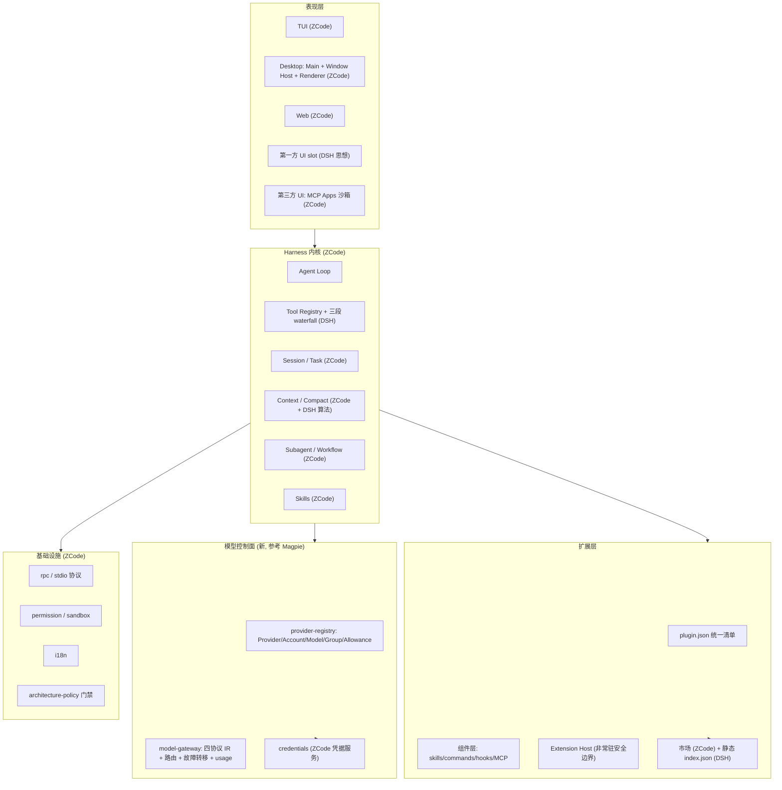

# 04 — 横向对比与融合映射矩阵

> 输入：`01a-zcode-core.md`、`01b-zcode-ext.md`、`02a-dsh-core.md`、`02b-dsh-ui.md`、`03-magpie.md`
> 目的：回答三个问题——**谁当基线、抄什么、怎么拼才不会互相打架**。
> 结论先行，论证在后。所有「成本」为单人/小团队的粗略人日量级，不是精确估算。

---

## 0. 结论先行

WitCode 不应该做「ZCode + DSH + Magpie 的功能并集」，那会是 500 万行的缝合怪。

正确的做法是：

> **以 ZCode 为可交付骨架，以 DSH 为架构纪律，以 Magpie 为模型控制面。**

| 角色 | 提供什么 | 占比 |
|---|---|---|
| **ZCode** | 可运行的 CLI/TUI/Desktop/Web、插件与市场、Skills、工程门禁、i18n、发布链路 | 约 90% 的代码与产品形态 |
| **DSH** | 5 条架构纪律与 3 套可直接抄的数据结构，**不引入其运行时** | 约 8% 的改造工作 |
| **Magpie** | 1 个 ZCode 最弱的子系统：账号池 / 路由 / 配额 / 协议网关 | 新代码量约 0.5%，但需要 4–6 周；差异化关键 |

一句话：**基线不动，换三个子系统，抄五条纪律。**

---

## 1. 三者根本不是同一层的东西

| 维度 | ZCode | DSH | Magpie |
|---|---|---|---|
| 产品定位 | AI 编程工作台（桌面 + Web + 终端） | 通用 Agent Harness（Web + Desktop + CLI + ACP） | Agent 的模型控制平面 |
| 内核形态 | 单体模块化（自有 DI + 事件） | 微内核（Cordis 容器 + 事件溯源） | 无 Agent Loop，只有 HTTP 网关 |
| 扩展模型 | 三层并存（组件 / UI / Extension Host） | 一切皆插件（npm bundle + patch 分层） | 网关注册插件 + JS 中间件 |
| 会话事实源 | task/session + SQLite | 追加式 SessionEvent 日志 | 无会话，只有 usage.jsonl |
| 模型接入 | 内置 provider + Coding Plan | `LlmAdapter` seam + wire extensions | Provider/Account/Group + 本地网关 |
| UI 扩展 | MCP Apps（独立沙箱页面） | typed slot（同一 React 树） | 插件页（自有 WebView/原生） |
| 工程纪律 | `architecture-policy.yaml` 强门禁 | Cordis 生命周期 + seam 三角色 | Go 包单责 + 插件注册表 |

**关键判断：Magpie 不是第三个 baseline。** 它没有 Agent Loop、没有工具系统、没有会话，把它当 harness 是类别错误。它的正确位置是 WitCode 的一个子系统 `model-gateway`。

**第二个判断：DSH 不能当 baseline，但它的「纪律」比它的代码更值钱。** 换成 DSH 基线等于把 ZCode 已解决的 90% 产品问题重做一遍；而把 DSH 的 5 条纪律注入 ZCode，成本低一个数量级。

---

## 2. 融合公式与三条不可妥协

```
WitCode v0.1
├── 骨架：ZCode 4.0.0（fork + rebrand）
│   ├── apps/zcode-cli      → apps/witcode-cli（Agent 运行时 + TUI）
│   ├── packages/desktop    → packages/desktop（Electron 三进程）
│   ├── packages/ui         → packages/ui（React + Zustand + 设计 token）
│   ├── packages/web/server → 保留
│   └── 工程门禁 / i18n / 插件市场 → 保留
├── 纪律：DSH（只抄机制，不引 Cordis）
│   ├── seam 三角色（定义 / 实现 / 消费者）
│   ├── 可逆 effect（注册即 disposer）
│   ├── 事件分层（durable session event / live agent event / capability event）
│   ├── 配置分层 patch（bundle → profile → home → CLI）
│   └── 能力协商（能力位 + 单点 strict schema，不按版本号猜）
└── 新子系统：Magpie 重写为 TS
    ├── packages/provider-registry（Provider/Account/Model/Group/Allowance）
    └── packages/model-gateway（四协议 IR + 路由 + 故障转移 + 用量）
```

**三条不可妥协：**

1. **单一运行时容器。** ZCode 已有 `ServiceProvider` / `IPlatformService` / `@zcode/rpc` 这套 DI 与进程边界。再引入 Cordis 会形成双容器、双生命周期、双扩展协议。**不引入 Cordis，只实现等价纪律。**
2. **单一会话事实源。** 不允许「ZCode SQLite 一份 + DSH 风格事件日志一份」。v0.1 保留 ZCode 会话模型，只增加「请求可重建」所需的日志字段。
3. **第三方扩展只走一条路径。** v0.1 的第三方扩展统一走 ZCode 的 `plugin.json` + MCP Apps；DSH 的 typed slot 只服务第一方 UI 组合，**不作为对外扩展 API**。

---

## 3. 能力域矩阵

图例：● 完整实现　◐ 部分实现　○ 缺失　— 不适用

| 能力域 | ZCode | DSH | Magpie | WitCode v0.1 决策 | 来源 |
|---|---|---|---|---|---|
| Agent Loop | ● 单体 loop + 事件 | ● 微内核驱动 | — | **继承 ZCode** | ZCode |
| 工具系统 | ● 权限 / 并行 / 流式结果 | ● 三段 waterfall | — | 继承 + 加 waterfall 钩子 | ZCode + DSH 纪律 |
| 会话与持久化 | ● task/session + SQLite | ● 追加日志 + surface | — | 继承 ZCode，补「请求可重建」 | ZCode |
| 上下文压缩 | ● compact + memory | ● 压力/溢出 + 可重放替换 | — | 继承 ZCode，抄触发与剪枝算法 | ZCode + DSH 算法 |
| 子代理 / 编排 | ● subagent + workflow | ● team/goal/plan/schedule/jobs | — | 继承 ZCode，按需补 goal/plan | ZCode |
| Provider / 模型目录 | ● Registry + ModelExecutor + option-map | ● adapter seam | ● 目录 + 额度 | 扩展 ZCode provider，补 Account/Group/Allowance | ZCode + Magpie |
| 模型网关 / 路由 | ○（直连） | ○ | ● 四协议 + 账号池 + 路由 | **新建 `model-gateway`** | Magpie |
| 代码插件 | ● 组件层 + Extension Host | ● npm bundle + patch | ◐ Go/JS 插件 | 合并为「一套清单、两种加载」 | ZCode 为主 |
| Skills | ● SKILL.md + 发现 + bundled | ● registerProvider | — | **整套继承** | ZCode |
| UI 扩展 | ● MCP Apps 沙箱 | ● typed slot | ○ | 第三方走 MCP Apps；第一方用 slot | ZCode + DSH 思想 |
| 主题 | ◐ CSS 变量 + 4 套 token | ● 三层 token + 运行时注册 | ◐ 设置页 | **抄 DSH 的 ThemeRuntime + token 三层** | DSH |
| 插件市场 | ● 四种来源 + 能力协商 | ● 静态 index.json + 生成器 | ○ | 保留 ZCode，抄 DSH 生成器 | ZCode + DSH |
| i18n | ● 5 语言 + 广播防回环 | ● typed 字典 + 语言包插件 | ● 双语 | 继承 ZCode，抄 typed 字典 | ZCode + DSH |
| 桌面进程模型 | ● window-scoped Host | ● Host 子进程 + 回环 HTTP | ◐ 多前端 | **保留 ZCode** | ZCode |
| 远程 / SSH / WSL | ● 完整 | ● ssh / terminal seam | — | 继承 | ZCode |
| 权限 / 沙箱 | ● 三模式 + 工作区信任 | ● approval fail-closed | — | 继承，抄 fail-closed 语义 | ZCode |
| 工程门禁 | ● architecture-policy | ◐ 规范文档 | ◐ AGENTS.md | **整套搬引擎，清空例外** | ZCode |
| 协议 / SDK | ● 自研 stdio + trace | ● ACP v1 | ○ | 保留自有，新增 ACP 适配插件 | ZCode + DSH |

---

## 4. 逐项采纳决策（Adopt / Adapt / Reject）

### 4.1 Adopt：直接继承（改动 ≤ 1 天/项）

| # | 项 | 来源 | 理由 |
|---|---|---|---|
| A1 | `SKILL.md` 格式 + 技能根发现 + 符号链接防护 + bundled 不可卸载模型 | ZCode `01b §6` | 纯文本、低耦合、已解决逃逸问题 |
| A2 | 插件清单 `plugin.json` + 稳定 ID `name@marketplace` + 诊断码体系 | ZCode `01b §3` | 身份与命名空间一次定死，后续不改协议 |
| A3 | `architecture-policy.yaml` 规则引擎 + 四件套 + pre-push 门禁 | ZCode `01b §10` | 引擎可整套复制；例外清单清空重建 |
| A4 | 设计 token（CSS 变量）+ `DESIGN.md` 规范 | ZCode `01b §7` | 725 处 `--color-*` 已成型，换品牌只换值 |
| A5 | i18n 五语言 + 回退 + 广播防回环 | ZCode `01b §9` | 现成出海方案 |
| A6 | 插件市场四来源 + 能力协商 + 三层数据模型 | ZCode `01b §11` | 混版不炸的设计已踩过坑 |
| A7 | DSH 市场生成器：静态 `index.json` format 1 + 零执行 | DSH `02b §6` | 风险最低、最容易独立落地 |
| A8 | DSH 主题三元：`ThemeRuntime` / `ThemePresenter` / 首帧注入 | DSH `02b §4` | 服务不碰 DOM、presenter 不持有 React |
| A9 | DSH typed 字典（中文为 key 源 + `satisfies Record<Key,string>`） | DSH `02b §7` | 编译期保证 i18n 完整 |
| A10 | Magpie 的 UsageRecord / AllowanceWindow / RouteSeat 数据模型 | Magpie `03 §7` | 字段设计经过真实计费验证 |
| A11 | Magpie 的 Agent 配置适配纪律：只改一个键 + stash + 格式保持 | Magpie `03 §5` | 「不接管用户配置文件」是产品信任基础 |
| A12 | `ModelExecutor` + `ProviderRegistry` + `model-option-map`（CEL → JSON Merge Patch） | ZCode `01a §6.4` | 模型切换只改 Selection、不动请求体；Magpie 的模型目录可直接对接 |

### 4.2 Adapt：抄机制、按 ZCode 模型重写（1–2 周/项）

| # | 项 | 来源 | 改造方式 |
|---|---|---|---|
| B1 | seam 三角色纪律 | DSH `02a §7` | 不建 Cordis；给 ZCode 现有服务加 Role 标注（core / seam / bundle），新能力必须三角色齐全 |
| B2 | 可逆 effect | DSH `02a §4` | 在 ZCode 服务注册处统一返回 disposer；插件/会话卸载自动回卷 |
| B3 | 事件三层分类 | DSH `02a §5` | 把 ZCode 事件标注为 durable / live / capability，禁止 live 事件写库、禁止 durable 事件只存内存 |
| B4 | 工具三段 waterfall | DSH `02a §7` | 在 ZCode tool executor 外包 `pre-execute → execute → post-execute`，用于审批、spill、指标 |
| B5 | compaction 触发与「工具配对平衡」范围选择 | DSH `02a §9` | 替换 ZCode compact 的范围算法，保留其触发入口 |
| B6 | Spill locator（不透明句柄 + best-effort） | DSH `02a §9` | 新增 `spill` 服务，工具结果超阈值外溢 |
| B7 | 配置分层 patch（bundle → profile → home → CLI） | DSH `02b §5` | 套在 ZCode 现有配置加载器上，保留 `--dump-config` |
| B8 | 能力协商（能力位 + 单点 strict schema） | ZCode `01b §11` 已有雏形 | 抽成通用 `capability-manifest` 包 |
| B9 | Magpie 路由策略接口 + 故障转移状态机 | Magpie `03 §6` | **不新建 provider-registry**；在 ZCode `packages/provider` 上补 Account/Group/Allowance，新建 `model-gateway` 承载路由，先实现 smart/order/rotate |
| B10 | Magpie 四协议 IR（text/image/tool_call/thinking/signature） | Magpie `03 §4` | 作为 `model-gateway` 内部 IR，不暴露给 Agent |
| B11 | ZCode 的 7 类 Hook 扩展为「三段 waterfall」 | ZCode `01a §6.6` + DSH | 现有 Hook 是离散事件；在 `turn-tools` 与 executor 外包 `pre → execute → post`，用于审批、spill、指标 |

### 4.3 Reject：明确不做（v0.1）

| # | 项 | 来源 | 不做的理由 |
|---|---|---|---|
| C1 | Cordis 运行时与 `inject` 容器 | DSH | 与 ZCode 自有 DI 冲突，双容器成本远高于收益 |
| C2 | 事件溯源替换 ZCode 会话模型 | DSH | 改动面覆盖 loop/持久化/UI/协议，v0.1 不可能安全落地 |
| C3 | Extension Host 作为第三方不可信插件沙箱 | ZCode | 它明确「不是安全边界」；v0.1 不承诺隔离，文档写死 |
| C4 | Magpie 的「订阅反向 provider + 驱动真实 claude 二进制」 | Magpie | 合规与维护风险高，且与 WitCode 自有 provider 体系冲突 |
| C5 | Magpie 的 80+ Agent 配置适配 | Magpie | MVP 只做 Claude Code / Codex / Gemini CLI / OpenCode 四个 |
| C6 | 本地 1.6GB PII 模型 + 独立 `pf-serve` | Magpie | 成本极高；MVP 只做规则版脱敏 |
| C7 | ZCode 的 105 条架构例外 + 1.5MB upstream-snapshot | ZCode | 历史包袱，照搬会让门禁变橡皮图章 |
| C8 | DSH 的 DeepSeek 私有 wire extensions 字段 | DSH | 只借 prepare/accept 事务语义，不搬字段 |

---

## 5. 五个硬冲突与裁决

### 冲突 1：会话模型 —— ZCode task/session vs DSH 事件日志

- ZCode：`task/session` + SQLite，UI/协议/恢复都围绕它建。
- DSH：追加式 `SessionEvent[]` + `surfaceOp` 投影，请求可由日志重建。
- **裁决：v0.1 保留 ZCode 模型。** ZCode 已经做到「动态公告先持久化再提交、resume 后请求字节不变」，基础比预想好。只补两条纪律：
  1. `request/header` 与 system prompt 必须有结构化可重建记录（对应 DSH 的 "Model-visible means logged"）；ZCode 已有事实基础，成本 3–5 天；
  2. compact 不得破坏性重写历史，改为「追加摘要 + 投影替换」，为 v0.2 的事件溯源留接口。
- 成本：1–2 周；风险：中。全量替换的成本是 2–3 个月，v0.1 不碰。

### 冲突 2：扩展容器 —— ZCode 自有 DI vs Cordis

- **裁决：不引 Cordis。** 用 ZCode 的 `ServiceProvider` 实现等价语义：声明式依赖、注册返回 disposer、typed event。
- 代价：失去 Cordis 的 fiber 状态机与 HMR 组合能力；收益：零双容器、零迁移成本。
- 这条是「抄思想不抄代码」的核心案例。

### 冲突 3：UI 扩展 —— MCP Apps vs typed slot

- ZCode：第三方 UI 是独立 HTML 页面，Electron 沙箱，CSP + 稳定 origin + 凭证二次校验。
- DSH：第三方 UI 是同一 React 树内的 typed slot，无进程隔离。
- A4 的结论是「不可混用」，但正确的解读是**同一扩展点不能同时支持两种协议**，而不是产品里不能有两种机制。
- **裁决：分层共存。**
  - 第三方（不可信）→ MCP Apps 沙箱页面（ZCode）。
  - 第一方功能模块（可信）→ typed slot 组合（DSH 思想，用 ZCode 的 React 树实现）。
  - 对外只公开 MCP Apps 一条协议；slot 是内部架构，不进插件清单。

### 冲突 4：插件运行时 —— ZCode 两套 vs DSH 一套

- ZCode 现有：组件层（skills/commands/hooks/MCP）+ Extension Host（常驻 `activate(ctx)`），两者清单字段、进程、生命周期完全不同。
- DSH：一种 npm bundle，注册服务/工具/slot。
- **裁决：统一清单、两种加载模式。**
  - 清单仍是 `plugin.json`，用 `extension` 键声明是否需要常驻代码。
  - 加载器按声明选择：无 `extension` → 组件层（会话内注入）；有 `extension` → Extension Host。
  - 生命周期状态机合并成一套（发现 → 安装 → 启用 → 就绪 → 暂停 → 卸载）。
  - 文档明确：Extension Host **不是安全边界**，同进程、授权可冒充。

### 冲突 5：桌面进程模型 —— ZCode window Host vs DSH Host 子进程

- ZCode：每窗口一个 utilityProcess Local Host，MessagePort 直连 renderer，Main 不持业务状态。
- DSH：独立 Node 子进程跑本地 HTTP server，renderer 走回环 HTTP。
- **裁决：保留 ZCode。** 它已经支持多窗口、远程 workspace、手机远控，改造成本高且无收益；只借 DSH 的「业务 server 与 UI 解耦」原则。

---

## 6. 换牌成本与迁移策略

### 6.1 量化事实

| 标识 | 数量 | 分布 |
|---|---|---|
| `@zcode/*` 包引用 | **8,056 处 / 4,579 个文件** | cli 1,824；ui 1,117；desktop 978；services 421；web 63 |
| `ZCODE_*` 环境变量 | **675 个不同变量** | desktop `desktopRuntimeEnv` / shared `runtimeEnv` 最集中 |
| `.zcode` 路径出现 | **1,753 次** | 另有 `.zcode-plugin` 166、`.zcodeignore` 47、`.zcode/workflows` 31 |
| 协议 scheme | `zcode://`、`zcode://oauth`、`zcode://share`、`zcode://workspace` 等 | desktop 协议注册与分享链路 |

**结论：换牌不是 sed 一把梭。** 8,056 处引用分布在 4,579 个文件，涉及包名、协议、数据目录、插件目录约定、i18n 文案、图标、appId、安装器。机械替换 1–2 天可完成，但回归验证需要 1–2 周。

### 6.2 分层换牌策略

| 层 | 策略 | 是否兼容旧值 |
|---|---|---|
| npm 包名 `@zcode/*` → `@witcode/*` | 一次性全量替换 + 全量 typecheck | 不需要（构建期） |
| 环境变量 `ZCODE_*` → `WITCODE_*` | 新名为主，旧名双读一个 minor 周期 | 是 |
| 数据目录 `~/.zcode` → `~/.witcode` | 首次启动检测旧目录，提示一次性迁移 | 是（只读旧目录） |
| 插件目录 `.zcode-plugin` | 新增 `.witcode-plugin`，同时识别 `.zcode-plugin` / `.claude-plugin` | 是 |
| 协议 `zcode://` | 注册 `witcode://`，保留 `zcode://` 解析 | 是 |
| appId / 图标 / 安装器 / 更新源 | 全部替换，不兼容 | 否 |
| i18n 品牌词 | 全量替换 + 截图回归 | 否 |

### 6.3 执行顺序

1. **先建 fork 基线**：`git clone` 上游 → 建 `witcode/main` 与 `upstream/main` 双分支。
2. **包名 codemod**：`@zcode/` → `@witcode/`，跑 `pnpm typecheck` 与 `architecture:check`。
3. **目录与 env 双读层**：先加兼容，不删旧。
4. **UI 品牌层**：token 换值 + 图标 + 文案。
5. **发布链路**：appId、安装器、更新源、签名。
6. **回归**：CLI/TUI、Desktop 三进程、Web、远程、插件安装/启用/卸载、i18n、升级。

---

## 7. 目标架构（v0.1）



---

## 8. 风险登记册

| # | 风险 | 概率 | 影响 | 缓解 |
|---|---|---|---|---|
| R1 | 范围失控，v0.1 变成三家功能并集 | 高 | 致命 | 冻结 v0.1 范围：只做「换牌 + 模型控制面 + 三条 DSH 纪律」 |
| R2 | 双容器 / 双会话 / 双扩展协议 | 中 | 高 | 三条不可妥协写进 ADR，架构门禁拦截 |
| R3 | 换牌遗漏导致运行时找不到资源 | 高 | 中 | 兼容层 + 启动自检 + 全链路 e2e |
| R4 | 上游无 git 历史，无法同步安全补丁 | 高 | 中 | 正式立项即 `git clone`，建 upstream 分支 + 定期 diff |
| R5 | 插件生态冷启动 | 高 | 中 | 兼容 Claude/Codex 插件目录；首批移植 5 个官方插件 |
| R6 | 模型网关的订阅登录搬运合规风险 | 中 | 高 | v0.1 只做 API key / 自定义端点，不做订阅反代 |
| R7 | Extension Host 被误认为安全沙箱 | 中 | 高 | 文档与 UI 明示「非安全边界」；不可信插件禁用 extension |
| R8 | 工程门禁照搬 105 条例外 | 中 | 中 | 只搬引擎，例外从零积累 |
| R9 | 许可证/商标问题 | 低 | 高 | Apache-2.0 + NOTICE 聚合 + 独立品牌；CI 加 SBOM |
| R10 | 单人维护不过来 | 高 | 高 | 优先复用上游，WitCode 只维护差异层；建立 upstream 同步节奏 |

---

## 9. 校准结果（基于 `01a-zcode-core.md`）

融合矩阵写完后，ZCode 内核的深挖结果回来了，推翻了两个初始假设：

| # | 初始假设 | 事实 | 对决策的修正 |
|---|---|---|---|
| 1 | Agent Loop 没有可插拔钩子，需要大改 | 已有 7 类 Hook（`SessionStart/UserPromptSubmit/PreToolUse/PermissionRequest/PostToolUse/PostToolUseFailure/Stop`）+ executor 前后置，但**不是 DSH 式三段 waterfall** | B11 改为「包裹现有 executor」，成本中等，不需要重写 loop |
| 2 | session 未记录 request header/system prompt | ZCode 已做到「动态公告先持久化再提交」，resume 保证请求字节不变（`turn-loop.ts:297-435`、`resume.ts:81-224`） | 冲突 1 的第 1 条纪律成本从「2–3 周」降为「3–5 天」，只需补 request header 的结构化记录 |
| 3 | tool executor 需要重写以支持并行 | `ToolScheduler` 已支持拓扑排序、依赖、只读并行、最大并发 10、`sideEffectScope` | B11 只需在 executor 外包 waterfall，成本低–中 |
| 4 | 需要新建 `provider-registry` 重做模型管理 | ZCode 已有 `ModelExecutor` + `ProviderRegistry` + `validateSelection` + `model-option-map`（CEL → Merge Patch） | **改为扩展 ZCode provider 包**，只补 Account/Group/Allowance；新建的只有 `model-gateway` |
| 5 | compact 是破坏性重写 | 有 `microcompact + autoCompact + 失败熔断 + 快速回填检测`，但是否 surface replace 未确认 | v0.1 不动；v0.2 评估「追加摘要 + 投影替换」，标注「待验证」 |

**结论：ZCode 内核比预想的更可复用。** 真正需要新写的只有 `model-gateway`（约 3–5k 行 TS）；DSH 的贡献集中在纪律与少量数据结构，而不是替代内核。

**新增的技术债警告（来自 `01a §10`）：**
- `turn.ts` 1210 行、`turn-model-step.ts` 982 行、`create-app.ts` 1692 行。WitCode 在改造这些文件时必须先拆模块，不要在原文件上继续堆。
- 权限与 Workspace-Hook Trust 深度产品化（十余文件），通用 Harness 难以直接复用，v0.1 保留但简化。
- V4 schema 40+ 文件、wire 二进制重组复杂；v0.1 只取 `command/snapshot/delta` 子集。
- Workflow 与 ZCode 特有 journal/额度强耦合，v0.1 不改造。
