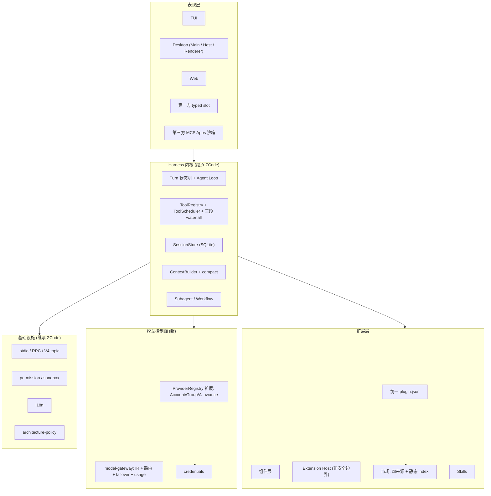
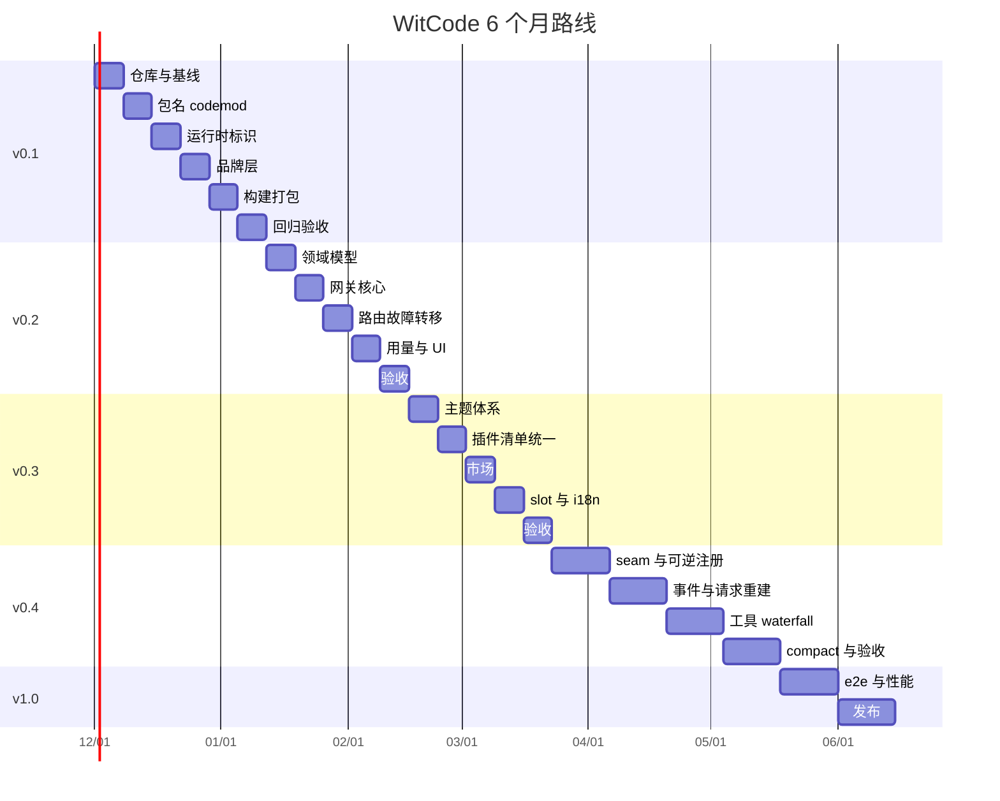

# 06 — WitCode 架构与路线图计划

> 这是「我（主 Agent）在学完三个项目后，认为 WitCode 应该怎么走」的方案，不是选项罗列。
> 假设：1 名全职 + 0–2 名兼职，Windows 为主开发环境，目标 6 个月内到 v1.0。
> 所有估算按「单人全职周」计；多人并行时看第 6 节的压缩方案。

---

## 0. 一页纸

**WitCode 是什么：** 一个以 ZCode 4.0.0 为骨架、吸收 DSH 架构纪律、内置 Magpie 式模型控制面的 Coding Harness。

**和三个参照物的关系：**

| | 拿什么 | 不拿什么 |
|---|---|---|
| ZCode | 全部工程实现、CLI/TUI/Desktop/Web、插件与市场、Skills、门禁、i18n | 105 条架构例外、Upstream 快照、品牌资产 |
| DSH | 事件分层、seam 三角色、可逆 effect、配置分层、能力协商、主题三层 token、市场生成器 | Cordis 运行时、Linux 原生层、DeepSeek 私有 wire 字段 |
| Magpie | Provider/Account/Group/Allowance 模型、四协议 IR、路由与故障转移、Usage 模型 | Go 实现、80+ Agent 适配、订阅反代、1.6GB PII 模型 |

**四个版本，一条主线：**

```
v0.1 叫 WitCode 且能跑  →  v0.2 模型控制面  →  v0.3 开放生态  →  v0.4 内核纪律  →  v1.0
   6 周                     5 周                5 周              8 周            4 周
```

**顺序不能反。** 先有产品再谈架构；先有用户再谈生态；先能跑再谈可换。任何阶段都不做「三家功能并集」。

---

## 1. 产品定义

### 1.1 一句话

> **WitCode 是一个「模型随便换、插件随便装、行为可复现」的本地 Coding Harness。**

三个形容词对应三块差异化：

- **模型随便换** → v0.2 的模型控制面（Provider / 账号 / 额度 / 路由）
- **插件随便装** → v0.3 的开放生态（统一清单 + 主题 + 市场）
- **行为可复现** → v0.4 的内核纪律（事件分层 + 请求可重建）

### 1.2 目标用户

1. **多模型订阅用户**：同时有 Claude / ChatGPT / Gemini / GLM / DeepSeek，想把它们放进同一个工作台。
2. **插件作者**：想写一次插件，同时服务 WitCode 与其他 Agent。
3. **小团队/工作室**：需要审计「谁在什么时候用了哪个模型、花了多少」。

### 1.3 差异化（相对 ZCode / DSH / Magpie）

| 差异点 | 为什么成立 |
|---|---|
| 模型控制面内置 | ZCode 有 provider 抽象但没有账号池/路由/配额；Magpie 有但没有 Agent 产品 |
| 第三方 UI 真隔离 | ZCode 的 MCP Apps 沙箱 + CSP + 稳定 origin，比 DSH 的同树 slot 更适合不可信插件 |
| 行为可复现 | ZCode 已有「先持久化再提交」的基础，补 request header 后可审计每次请求 |
| 插件兼容层 | 同时识别 `.witcode-plugin` / `.zcode-plugin` / `.claude-plugin`，降低迁移成本 |

### 1.4 非目标（v1.0 前不做）

- 不做云端 IDE、不做多人实时协作编辑。
- 不做移动端原生 App（沿用 ZCode 的手机远控）。
- 不做订阅账号反代（不驱动真实 `claude` 二进制、不搬运 OAuth）。
- 不做本地 PII 大模型（只做规则版脱敏）。
- 不做 80+ Agent 配置适配（只做 4 个）。
- 不做 Cordis 兼容层。

---

## 2. 架构蓝图

### 2.1 分层



### 2.2 包边界

| 包 | 来源 | 动作 | 说明 |
|---|---|---|---|
| `apps/witcode-cli` | ZCode `apps/zcode-cli` | 换牌 + 拆巨型文件 | 内核权威；优先拆 `turn.ts` / `create-app.ts` |
| `packages/desktop` | ZCode 同名 | 换牌 | 保留三进程模型 |
| `packages/ui` | ZCode 同名 | 换牌 + 主题改造 | 引入三层 token |
| `packages/web` / `server` | ZCode 同名 | 换牌 | 保留 |
| `packages/provider` | ZCode 同名 | **扩展** | 加 Account/Group/Allowance，不改 ModelExecutor |
| `packages/model-gateway` | **新增** | 新写 | 四协议 IR + 路由 + failover + usage |
| `packages/design-tokens` | **新增** | 新写 | 静态色阶 / alias / specific 三层 |
| `packages/theme-runtime` | **新增** | 参考 DSH | ThemeRuntime + Presenter + 首帧注入 |
| `packages/plugin-api` | ZCode 同名 | 扩展 | 加统一清单与能力协商 |
| `packages/extension-host` | ZCode `packages/desktop` 内 | 抽出 | 明确「非安全边界」 |
| `packages/market-index` | **新增** | 参考 DSH | 静态 `index.json` schema + 生成器 |
| `packages/spill` | **新增** | 参考 DSH | 工具结果外溢 |
| `packages/session-replay` | **新增（v0.4）** | 新写 | request header 可重建 |

### 2.3 核心数据模型

**会话**（继承 ZCode，只加不换）：
- `session` / `message` / `part` 三张表保留。
- 新增 `request_header` 表或 part 类型，记录每次模型请求的 provider/model/参数摘要。
- compact 改为「追加摘要 + 投影替换」，不删历史。

**模型控制面**（参考 Magpie，TS 重写）：
```ts
Provider { id, name, credentialRef, endpoints, models, routing, affinity, fallback }
Account  { agent, user, plan, credentialSource, windows[] }
Group    { id, members, match[], routing, affinity, rules[] }
ModelInfo{ id, displayName, efforts[], context, price, protocols[] }
UsageRecord { t, provider, model, in, out, cacheRead, cacheWrite, cost, ttftMs }
```

**插件**（统一 ZCode 三层）：
```ts
PluginManifest {
  name, version, description,
  skills?, commands?, agents?, hooks?, mcpServers?,
  ui?: { surfaces[] },
  extension?: { engines, activationEvents, grants, contributes },
  slots?: SlotEntry[]
}
```

### 2.4 五条 ADR（先写进 `docs/adr/`，后续实现不得违反）

| ADR | 决策 | 理由 |
|---|---|---|
| ADR-0001 | 基线锁定 ZCode 4.0.0，不换 DSH | ZCode 覆盖 90% 产品问题；DSH 是开发预览 |
| ADR-0002 | 不引入 Cordis 运行时 | 避免双容器；只实现等价纪律 |
| ADR-0003 | 第三方 UI 只走 MCP Apps | 真隔离；slot 只服务第一方 |
| ADR-0004 | v0.1 不改会话为事件溯源 | 改动面覆盖 loop/存储/UI/协议，风险不可控 |
| ADR-0005 | v0.1 不做订阅反代 | 合规与维护风险高于收益 |

---

## 3. 路线图

### v0.1 Foundation — 「叫 WitCode 且能跑」（6 周）

**目标：** 一个陌生人能 clone、构建、安装、启动，并看出这是 WitCode 而不是 ZCode。

| 周 | 工作 | 产出 |
|---|---|---|
| W1 | 仓库与基线 | `git clone` 上游；`upstream/main` + `witcode/main` 双分支；Node 24.14 + pnpm 10.33.2；`pnpm bootstrap` 跑通并记录耗时/失败点 |
| W2 | 包名 codemod | `@zcode/* → @witcode/*`（8,056 处 / 4,579 文件）；tsconfig paths、lockfile；`pnpm typecheck` 通过 |
| W3 | 运行时标识 | 数据目录 `~/.witcode`、env 双读层、appId、`witcode://` scheme、插件目录兼容 |
| W4 | 品牌层 | 图标、i18n 品牌词、主题 token 换值、安装器名称、关于页 |
| W5 | 构建与打包 | Desktop 安装器、CLI 发行包、Web 构建；三平台冒烟 |
| W6 | 回归与文档 | CLI/TUI/Desktop/Web/远程/插件/升级冒烟；README/NOTICE/LICENSE 聚合 |

**验收标准（5 条，缺一不算完成）：**
1. `pnpm bootstrap && pnpm dev:desktop` 在干净 Windows 机器上成功。
2. `zcode`（改名后 `witcode`）无参数进入 TUI，能完成一次读文件 + 改文件 + 运行命令。
3. Desktop 能打开、能新建会话、能安装一个内置插件。
4. 全局搜索 `zcode` 无残留（文档中的事实性引用除外）。
5. `docs/adr/0001-0005` 已落地，`architecture:check` 通过。

**明确不做：** 模型网关、主题运行时、DSH 纪律、插件清单合并。

**退出条件：** 如果 W2 的 codemod 导致 typecheck 无法在 3 天内收敛，立即停止，改为「只改运行时标识、保留 `@zcode/*` 包名」的 B 方案，把品牌工作后移。

---

### v0.2 Model Plane — 「模型随便换」（5 周）

**目标：** 把模型管理从「设置页填 key」升级为控制面。这是 WitCode 的差异化生死线。

| 周 | 工作 | 产出 |
|---|---|---|
| W7 | 领域模型 | 在 ZCode `packages/provider` 上补 `Account` / `Group` / `AllowanceWindow`；配置 schema + 迁移 |
| W8 | 网关核心 | `packages/model-gateway`：HTTP 端点、四协议 IR、`chat ↔ anthropic` 双向翻译、原生转发 |
| W9 | 路由与故障转移 | smart/order/rotate 三策略；429/5xx → 下一候选；休息计时；会话亲和 |
| W10 | 用量与 UI | `usage.jsonl`、费用估算、模型设置页（Providers / Models / Groups / Usage 四页） |
| W11 | 验收 | 三 provider 互通、限流切换、配额显示、与 ZCode 原有 provider 选择共存 |

**验收标准：**
1. 同一会话可在 DeepSeek / GLM / Anthropic 兼容端点之间切换，工具调用不丢。
2. 配两个 key，第一个 429 后请求透明切到第二个，Agent 无感知。
3. Usage 页能显示每次请求的 model / in / out / cost / ttft。
4. 路由组支持 `provider/model` 与 glob 匹配。
5. 原有 ZCode provider 配置不被破坏，可双向导入。

**明确不做：** 订阅反代、PII 模型、80+ Agent 适配、意图路由分类器。

---

### v0.3 Openness — 「插件随便装」（5 周）

**目标：** 让第三方能安全地扩展 UI 与能力，让主题能换。

| 周 | 工作 | 产出 |
|---|---|---|
| W12 | 主题体系 | `design-tokens` 三层 token + `theme-runtime`（Runtime / Presenter / 首帧注入） |
| W13 | 插件清单统一 | 一套 `plugin.json`，`extension` 键决定加载模式；统一生命周期状态机 |
| W14 | 市场 | 静态 `index.json` format 1 + 生成器（只读、零执行、integrity 校验）；能力协商 |
| W15 | 第一方 slot + i18n | typed slot 五形态（single/list/keyed/chain/hoc）；i18n typed 字典 |
| W16 | 验收 | 第三方插件安装/启停/卸载、主题切换、市场生成、混版兼容 |

**验收标准：**
1. 写一个最小插件（skill + MCP server + 一个 surface），能安装、启用、在侧栏打开。
2. 切换两套主题不重启，首帧无闪白。
3. 市场从 `plugins.txt` 生成 `index.json`，客户端能按 URL 添加来源。
4. 旧版客户端遇到新版 `extensionSummary` 不崩溃。
5. Extension Host 在 UI 与文档中明确标注「非安全边界」。

---

### v0.4 Kernel Discipline — 「行为可复现」（8 周）

**目标：** 把 DSH 的纪律真正落到 ZCode 内核，而不是停留在文档。

| 周 | 工作 | 产出 |
|---|---|---|
| W17–18 | seam 三角色 + 可逆注册 | 给现有服务打 Role 标注；注册统一返回 disposer；新增服务必须三角色齐全 |
| W19–20 | 事件分域 + 请求可重建 | durable / live / capability 标注；`request_header` 落库；resume 校验请求字节一致 |
| W21–22 | 工具三段 waterfall | `pre-execute → execute → post-execute` 包裹现有 executor；审批、spill、指标挂上去 |
| W23–24 | compaction 非破坏 + 验收 | 「追加摘要 + 投影替换」；fork 复用；回归全链路 |

**验收标准：**
1. 任一历史会话 resume 后，构造出的模型请求与原始请求字节一致。
2. 卸载一个插件/服务后，其注册的监听、工具、UI slot 全部回卷，无残留。
3. 工具执行可在不改 loop 的前提下插入一个「结果超限外溢」策略。
4. compact 后历史消息仍可回放，fork 可基于 compact 前的边界。
5. 新增服务的 PR 模板强制填写三角色表。

---

### v1.0 Release — 「能发出去」（4 周）

| 周 | 工作 |
|---|---|
| W25 | 全链路 e2e：CLI/TUI/Desktop/Web/远程/插件/市场/主题 |
| W26 | 性能基线：冷启动、首个 token 延迟、内存、大仓库索引 |
| W27 | 安装器、签名、自动更新、崩溃上报（可选、默认关闭） |
| W28 | 文档、迁移指南（从 ZCode 导入配置/会话）、发布检查清单 |

**发布门槛：**
- 关键路径 e2e 全绿。
- 冷启动 ≤ ZCode 基线的 1.2 倍。
- 许可证 SBOM 无新增 copyleft。
- 从 ZCode 迁移的会话可正常打开（只读兼容）。

---

## 4. 总 WBS 与依赖



关键依赖：
- v0.2 依赖 v0.1 的 provider 包可构建。
- v0.3 依赖 v0.2 的设置页壳（主题页复用）。
- v0.4 依赖 v0.1 的会话存储（加表不改表）。
- v1.0 依赖全部。

---

## 5. 质量与门禁

### 5.1 从第一天就生效

| 门禁 | 内容 | 来源 |
|---|---|---|
| `architecture:check` | 受管模块 + 四件套 + 依赖方向 + 深导入 + 文件体量 | ZCode 引擎，例外清零 |
| `typecheck` | 全 workspace `tsc -b` | ZCode |
| `lint` | oxlint + React Hooks | ZCode |
| `license-audit` | SPDX SBOM，阻断 AGPL/SSPL/BUSL | 新增 |
| `docs:adr` | 新增服务必须填三角色表 | 新增（DSH 纪律） |
| `e2e:smoke` | CLI/TUI/Desktop/Web 各一条 | 新增 |

### 5.2 测试策略

- **单测**：只覆盖纯逻辑（IR 转换、路由排序、compact 范围、token 计算）。
- **集成**：provider ↔ gateway ↔ usage 一条链；插件安装 ↔ 启用 ↔ surface 打开。
- **e2e**：桌面启动、会话、工具调用、插件安装、主题切换。
- **回归**：每次换牌/改内核后跑全链路冒烟。
- 不追求覆盖率数字，追求「关键路径有断言」。

### 5.3 上游同步

- `upstream/main` 只读镜像；`witcode/main` 承载差异。
- 每月一次 `git diff upstream/main...witcode/main --stat`，评估安全补丁与破坏性变更。
- 差异层原则：**能放插件就不改内核**；能改配置就不改代码。

### 5.4 合规

- WitCode 自身 Apache-2.0。
- 保留三方 LICENSE/NOTICE，维护聚合 `THIRD-PARTY-NOTICES.md`。
- 修改过的 ZCode 文件加 `Modified for WitCode` 标记。
- CI 生成 SBOM 并存档。

---

## 6. 团队与节奏

### 6.1 基线配置（1 全职 + 1 兼职）

| 角色 | 负责 |
|---|---|
| 全职（你） | 架构、内核改造、模型控制面、代码评审 |
| 兼职 A | UI/主题/市场/文档 |
| 兼职 B（可选） | e2e/CI/发布/兼容性测试 |

### 6.2 每周节奏

- 周一：定本周验收标准（写进 issue，不超过 3 条）。
- 周三：中途检查，只问「能否按时验收」，不扩范围。
- 周五：demo + 更新 `docs/study` 或 `docs/adr`；未完成项进下周，不加班补。
- 每两周：跑一次全链路冒烟。

### 6.3 压缩方案（只有你一个人 / 时间减半）

| 方案 | 砍什么 | 结果 |
|---|---|---|
| **A. 只要产品** | 砍 Desktop（只做 CLI + Web）、砍 v0.3 主题、v0.4 全部推迟 | v0.1 4 周 + v0.2 5 周 = **9 周** |
| **B. 只要差异化** | 砍 v0.3 市场、v0.4 只做「请求可重建」一条 | v0.1 6 周 + v0.2 5 周 + 2 周 = **13 周** |
| **C. 完整路线** | 不砍 | **28 周** |

我的建议：**先走 A，跑通后再补 B 的差异化项。** 不要一上来做 28 周的计划，前 4 周就能验证「换牌是否可行」。

---

## 7. 度量指标

| 维度 | 指标 | v0.1 | v0.2 | v1.0 |
|---|---|---|---|---|
| 功能 | 关键路径可跑 | CLI/TUI/Desktop | + 模型切换 | + 插件/市场/主题 |
| 稳定 | 冒烟通过率 | 100% | 100% | 100% |
| 性能 | 冷启动 | ≤1.2× ZCode | ≤1.2× | ≤1.0× |
| 性能 | 首 token 延迟 | 持平 | 持平（网关 <20ms 开销） | 持平 |
| 生态 | 可安装插件数 | 内置 | 内置 | ≥20 |
| 质量 | 架构门禁违规 | 0 | 0 | 0 |
| 合规 | copyleft 依赖 | 0 新增 | 0 新增 | 0 新增 |

---

## 8. 本周就能开始的 7 件事

按顺序执行，每件都可独立验证：

```powershell
# 1. 用 git clone（不要用 zip），保留上游历史
git clone https://github.com/zai-org/ZCode.git D:\Files\Projects\WitCode\src
cd D:\Files\Projects\WitCode\src
git remote rename origin upstream
git checkout -b witcode/main

# 2. 安装仓库要求的 Node 24.14.0 与 pnpm 10.33.2
#    本机已有 fnm 与 corepack；Node 24.9 可先跑，但正式基线用 24.14
D:\env\sdk\fnm\fnm.exe install 24.14.0
D:\env\sdk\fnm\fnm.exe use 24.14.0
corepack prepare pnpm@10.33.2 --activate

# 3. 跑通 bootstrap（记录耗时与失败点，这是 v0.1 W1 的验收）
pnpm bootstrap

# 4. 跑通三条最小路径
pnpm --filter @zcode/cli dev --help
pnpm dev:desktop:test
pnpm dev:web

# 5. 建立 ADR 目录，先写 0001–0005
mkdir docs\adr

# 6. 跑一次许可证盘点，确认没有 AGPL/SSPL
#    以 pnpm licenses list 或 license-checker 输出为准

# 7. 写第一份 `docs/adr/0001-baseline.md`
#    内容：基线锁定 ZCode 4.0.0、理由、上游同步策略、退出条件
```

**如果第 3 步失败，先不要开始换牌。** 构建不通过说明环境或依赖有问题，换牌只会放大问题。

---

## 9. 需要你拍板的 6 个决策

这些会改变路线图，我不替你决定：

1. **产品性质**：自用工具 / 开源项目 / 商业产品？
   - 影响：许可证策略、是否需要签名与自动更新、插件市场是否要审核。
2. **是否保留 Desktop**：Desktop 占 v0.1 约 3 周工作量（Electron 三进程 + 安装器 + 签名）。
   - 如果只做 CLI + Web，v0.1 可压到 3–4 周。
3. **目标平台**：Windows only / Windows + macOS / 三平台？
   - 影响：签名、公证、安装器、e2e 矩阵。
4. **模型控制面的边界**：只做 API key + 自定义端点，还是也要做订阅账号池？
   - 我的建议：v0.2 只做前者；后者涉及合规与厂商私有接口，放到 v1.x 评估。
5. **品牌资产**：名字 `WitCode` 是否最终确定？图标/配色是否已有？
   - 影响 v0.1 W4 是否阻塞。
6. **投入强度**：每周能投入多少小时？是否有其他人？
   - 影响选 A / B / C 哪条压缩路线。

---

## 10. 最后一句

这个项目真正的风险不是「三家代码合不进来」，而是**范围失控**。

ZCode 已经给了你 90% 的产品；DSH 给了你 5% 的架构清醒；Magpie 给了你 5% 的差异化。你要做的是**克制地只拿这三份东西**，而不是把三个仓库都搬进来。

先让 `witcode` 这个名字跑起来，再让它值得这个名字。
